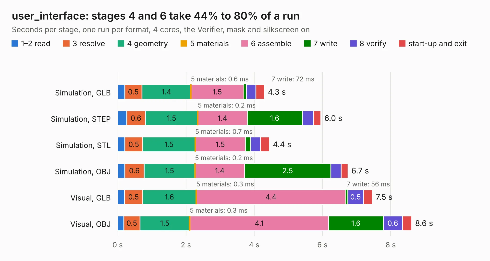

# 2903. user_interface

Board 2,903 of the 3,101 of [Corpus Testing](../Corpus-Testing.md), on [Corpus Page 27](../CorpusTestingPages/Corpus-Testing-27.md#2903-user_interface).

| Mode and format | 1–2 read | 3 resolve | 4 geometry | 5 materials | 6 assemble | 7 write | 8 verify | start-up and exit | Total |
|---|---:|---:|---:|---:|---:|---:|---:|---:|---:|
| Simulation, GLB | 0.2 | 0.5 | 1.4 | 0.6&nbsp;ms | 1.5 | 72&nbsp;ms | 0.3 | 0.3 | 4.3 |
| Simulation, STEP | 0.3 | 0.6 | 1.5 | 0.2&nbsp;ms | 1.4 | 1.6 | 0.3 | 0.2 | 6.0 |
| Simulation, STL | 0.2 | 0.5 | 1.5 | 0.7&nbsp;ms | 1.5 | 0.2 | 0.3 | 0.3 | 4.4 |
| Simulation, OBJ | 0.2 | 0.6 | 1.5 | 0.2&nbsp;ms | 1.4 | 2.5 | 0.3 | 0.2 | 6.7 |
| Visual, GLB | 0.2 | 0.5 | 1.6 | 0.3&nbsp;ms | 4.4 | 56&nbsp;ms | 0.5 | 0.3 | 7.5 |
| Visual, OBJ | 0.2 | 0.5 | 1.5 | 0.3&nbsp;ms | 4.1 | 1.6 | 0.6 | 0.3 | 8.6 |

<table align="center"><tr><td valign="top">

| Board | Repo: [twisted-fields/rp2040-motor-controller](https://github.com/twisted-fields/rp2040-motor-controller) Board: `user_interface.kicad_pcb` |
|---|---|
| Folder | user_interface |
| Complexity | 262&nbsp;/&nbsp;1000 (size&nbsp;177, features&nbsp;85) |
| KESE&nbsp;features | through vias, rounded, trapezoid or chamfered pads, filled zones, curved board outline, stack-up, dielectric εr and tanδ |
| Tested | 9th November 2026 |
| Copper&nbsp;layers | 4 |
| File&nbsp;format | KiCad 7 (20221018) |
| Parts,&nbsp;tracks,&nbsp;vias | 38, 386, 62 |
| Triangles,&nbsp;simulation | 492,310 in 40 parts |
| Verifier | PASS in all six runs |

</td><td valign="top">

<table>
<tr><th>File type</th><th>File size</th><th>Peak memory used</th></tr>
<tr><th colspan="3" align="left">Simulation</th></tr>
<tr><td>GLB</td><td align="right">17&nbsp;MB</td><td align="right">282&nbsp;MB</td></tr>
<tr><td>STEP</td><td align="right">64&nbsp;MB</td><td align="right">336&nbsp;MB</td></tr>
<tr><td>STL</td><td align="right">25&nbsp;MB</td><td align="right">292&nbsp;MB</td></tr>
<tr><td>OBJ</td><td align="right">50&nbsp;MB</td><td align="right">390&nbsp;MB</td></tr>
<tr><th colspan="3" align="left">Visual</th></tr>
<tr><td>GLB</td><td align="right">12&nbsp;MB</td><td align="right">330&nbsp;MB</td></tr>
<tr><td>OBJ</td><td align="right">35&nbsp;MB</td><td align="right">331&nbsp;MB</td></tr>
</table>

</td></tr></table>

| Previous | Next |
|:---|---:|
| [2902. rp2040_encoder](b2902b_rp2040-motor-controller_rp2040-encoder.md) | [2904. Board-DjinnBase](b2904b_keyboards_Board-DjinnBase.md) |
