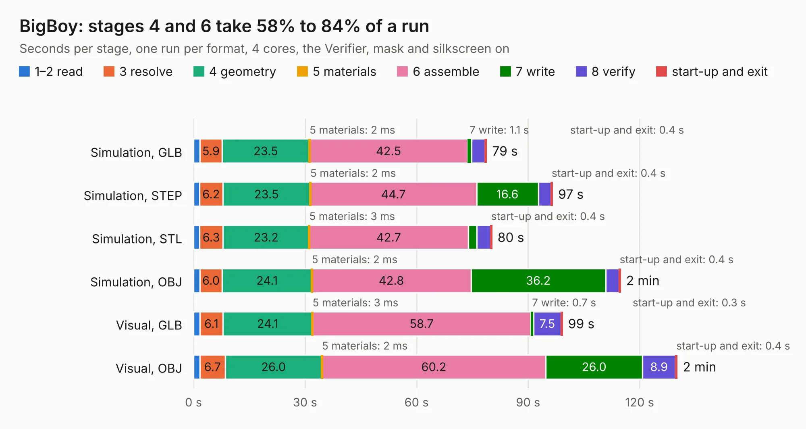

# 2904. BigBoy

Board 2,904 of the 3,117 of [Corpus Testing](../Corpus-Testing.md), on [Corpus Page 27](../CorpusTestingPages/Corpus-Testing-27.md#2904-bigboy).

| Mode and format | 1–2 read | 3 resolve | 4 geometry | 5 materials | 6 assemble | 7 write | 8 verify | start-up and exit | Total |
|---|---:|---:|---:|---:|---:|---:|---:|---:|---:|
| Simulation, GLB | 1.7 | 5.9 | 23.5 | 2&nbsp;ms | 42.5 | 1.1 | 3.6 | 0.4 | 78.8 |
| Simulation, STEP | 1.6 | 6.2 | 23.5 | 2&nbsp;ms | 44.7 | 16.6 | 3.4 | 0.4 | 96.5 |
| Simulation, STL | 1.6 | 6.3 | 23.2 | 3&nbsp;ms | 42.7 | 2.3 | 3.7 | 0.4 | 80.2 |
| Simulation, OBJ | 1.7 | 6.0 | 24.1 | 2&nbsp;ms | 42.8 | 36.2 | 3.6 | 0.4 | 114.8 |
| Visual, GLB | 1.8 | 6.1 | 24.1 | 3&nbsp;ms | 58.7 | 0.7 | 7.5 | 0.3 | 99.2 |
| Visual, OBJ | 1.8 | 6.7 | 26.0 | 2&nbsp;ms | 60.2 | 26.0 | 8.9 | 0.4 | 130.1 |

<table align="center"><tr><td valign="top">

| Board | Repo: [transistorfet/retroverse](https://github.com/transistorfet/retroverse) Board: `BigBoy.kicad_pcb` |
|---|---|
| Folder | components / bigboy / hardware / BigBoy |
| Complexity | 411&nbsp;/&nbsp;1000 (size&nbsp;286, features&nbsp;125) |
| KESE&nbsp;features | through vias, slotted holes, custom pads, rounded, trapezoid or chamfered pads, arc tracks, filled zones, copper drawings, stack-up, dielectric εr and tanδ |
| Tested | 9th November 2026 |
| Copper&nbsp;layers | 4 |
| File&nbsp;format | KiCad 7 (20221018) |
| Parts,&nbsp;tracks,&nbsp;vias | 118, 3,938, 636 |
| Triangles,&nbsp;simulation | 5,700,846 in 315 parts |
| Verifier | PASS in all six runs |

</td><td valign="top">

<table>
<tr><th>File type</th><th>File size</th><th>Peak memory used</th></tr>
<tr><th colspan="3" align="left">Simulation</th></tr>
<tr><td>GLB</td><td align="right">195&nbsp;MB</td><td align="right">1.6&nbsp;GB</td></tr>
<tr><td>STEP</td><td align="right">764&nbsp;MB</td><td align="right">2.2&nbsp;GB</td></tr>
<tr><td>STL</td><td align="right">285&nbsp;MB</td><td align="right">1.6&nbsp;GB</td></tr>
<tr><td>OBJ</td><td align="right">607&nbsp;MB</td><td align="right">3.6&nbsp;GB</td></tr>
<tr><th colspan="3" align="left">Visual</th></tr>
<tr><td>GLB</td><td align="right">128&nbsp;MB</td><td align="right">2.0&nbsp;GB</td></tr>
<tr><td>OBJ</td><td align="right">409&nbsp;MB</td><td align="right">2.6&nbsp;GB</td></tr>
</table>

</td></tr></table>

| Previous | Next |
|:---|---:|
| [2903. BigBoy-Frontpanel](b2903b_retroverse_BigBoy-Frontpanel.md) | [2905. BigBoy.stretch_bkup](b2905b_retroverse_BigBoy-stretch-bkup.md) |
