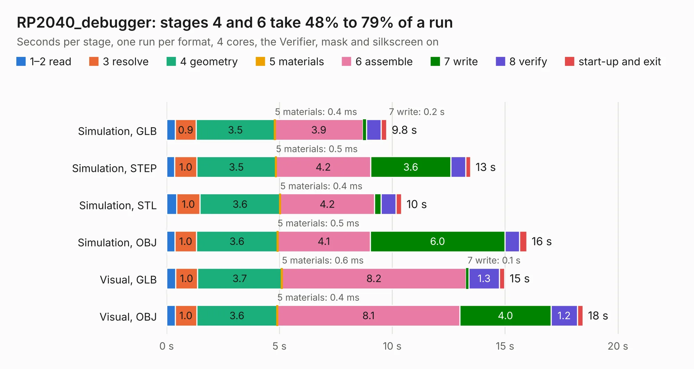

# 2904. RP2040_debugger

Board 2,904 of the 3,106 of [Corpus Testing](../Corpus-Testing.md), on [Corpus Page 27](../CorpusTestingPages/Corpus-Testing-27.md#2904-rp2040_debugger).

| Mode and format | 1–2 read | 3 resolve | 4 geometry | 5 materials | 6 assemble | 7 write | 8 verify | start-up and exit | Total |
|---|---:|---:|---:|---:|---:|---:|---:|---:|---:|
| Simulation, GLB | 0.4 | 0.9 | 3.5 | 0.4&nbsp;ms | 3.9 | 0.2 | 0.7 | 0.2 | 9.8 |
| Simulation, STEP | 0.4 | 1.0 | 3.5 | 0.5&nbsp;ms | 4.2 | 3.6 | 0.7 | 0.2 | 13.5 |
| Simulation, STL | 0.4 | 1.0 | 3.6 | 0.4&nbsp;ms | 4.2 | 0.3 | 0.7 | 0.2 | 10.4 |
| Simulation, OBJ | 0.4 | 1.0 | 3.6 | 0.5&nbsp;ms | 4.1 | 6.0 | 0.6 | 0.3 | 16.0 |
| Visual, GLB | 0.4 | 1.0 | 3.7 | 0.6&nbsp;ms | 8.2 | 0.1 | 1.3 | 0.2 | 15.0 |
| Visual, OBJ | 0.4 | 1.0 | 3.6 | 0.4&nbsp;ms | 8.1 | 4.0 | 1.2 | 0.3 | 18.5 |

<table align="center"><tr><td valign="top">

| Board | Repo: [twisted-fields/rp2040-motor-controller](https://github.com/twisted-fields/rp2040-motor-controller) Board: `RP2040_debugger.kicad_pcb` |
|---|---|
| Folder | debugger |
| Complexity | 322&nbsp;/&nbsp;1000 (size&nbsp;227, features&nbsp;95) |
| KESE&nbsp;features | through vias, slotted holes, rounded, trapezoid or chamfered pads, filled zones, curved board outline, stack-up, dielectric εr and tanδ |
| Tested | 9th November 2026 |
| Copper&nbsp;layers | 4 |
| File&nbsp;format | KiCad 8 (20240108) |
| Parts,&nbsp;tracks,&nbsp;vias | 57, 560, 87 |
| Triangles,&nbsp;simulation | 1,002,398 in 78 parts |
| Verifier | PASS in all six runs |

</td><td valign="top">

<table>
<tr><th>File type</th><th>File size</th><th>Peak memory used</th></tr>
<tr><th colspan="3" align="left">Simulation</th></tr>
<tr><td>GLB</td><td align="right">34&nbsp;MB</td><td align="right">433&nbsp;MB</td></tr>
<tr><td>STEP</td><td align="right">156&nbsp;MB</td><td align="right">532&nbsp;MB</td></tr>
<tr><td>STL</td><td align="right">50&nbsp;MB</td><td align="right">440&nbsp;MB</td></tr>
<tr><td>OBJ</td><td align="right">101&nbsp;MB</td><td align="right">742&nbsp;MB</td></tr>
<tr><th colspan="3" align="left">Visual</th></tr>
<tr><td>GLB</td><td align="right">24&nbsp;MB</td><td align="right">590&nbsp;MB</td></tr>
<tr><td>OBJ</td><td align="right">72&nbsp;MB</td><td align="right">595&nbsp;MB</td></tr>
</table>

</td></tr></table>

| Previous | Next |
|:---|---:|
| [2903. iMX6 Demo Board_from_REF](b2903b_imx6-demo-board_iMX6-Demo-Board-from-REF.md) | [2905. driver_module](b2905b_rp2040-motor-controller_driver-module.md) |
