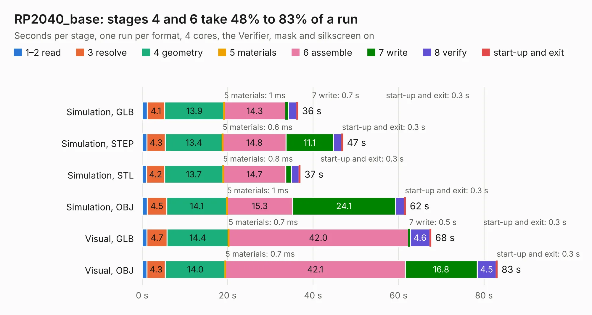

# 2906. RP2040_base

Board 2,906 of the 3,106 of [Corpus Testing](../Corpus-Testing.md), on [Corpus Page 27](../CorpusTestingPages/Corpus-Testing-27.md#2906-rp2040_base).

| Mode and format | 1–2 read | 3 resolve | 4 geometry | 5 materials | 6 assemble | 7 write | 8 verify | start-up and exit | Total |
|---|---:|---:|---:|---:|---:|---:|---:|---:|---:|
| Simulation, GLB | 1.2 | 4.1 | 13.9 | 1&nbsp;ms | 14.3 | 0.7 | 1.9 | 0.3 | 36.5 |
| Simulation, STEP | 1.1 | 4.3 | 13.4 | 0.6&nbsp;ms | 14.8 | 11.1 | 1.9 | 0.3 | 46.9 |
| Simulation, STL | 1.1 | 4.2 | 13.7 | 0.8&nbsp;ms | 14.7 | 1.3 | 1.8 | 0.3 | 37.0 |
| Simulation, OBJ | 1.2 | 4.5 | 14.1 | 1&nbsp;ms | 15.3 | 24.1 | 2.1 | 0.3 | 61.7 |
| Visual, GLB | 1.1 | 4.7 | 14.4 | 0.7&nbsp;ms | 42.0 | 0.5 | 4.6 | 0.3 | 67.6 |
| Visual, OBJ | 1.1 | 4.3 | 14.0 | 0.7&nbsp;ms | 42.1 | 16.8 | 4.5 | 0.3 | 83.1 |

<table align="center"><tr><td valign="top">

| Board | Repo: [twisted-fields/rp2040-motor-controller](https://github.com/twisted-fields/rp2040-motor-controller) Board: `RP2040_base.kicad_pcb` |
|---|---|
| Folder | RP2040_base |
| Complexity | 418&nbsp;/&nbsp;1000 (size&nbsp;283, features&nbsp;135) |
| KESE&nbsp;features | through vias, slotted holes, custom pads, rounded, trapezoid or chamfered pads, arc tracks, filled zones, copper drawings, curved board outline, stack-up, dielectric εr and tanδ |
| Tested | 10th November 2026 |
| Copper&nbsp;layers | 4 |
| File&nbsp;format | KiCad 8 (20240108) |
| Parts,&nbsp;tracks,&nbsp;vias | 257, 4,544, 553 |
| Triangles,&nbsp;simulation | 4,250,826 in 226 parts |
| Verifier | PASS in all six runs |

</td><td valign="top">

<table>
<tr><th>File type</th><th>File size</th><th>Peak memory used</th></tr>
<tr><th colspan="3" align="left">Simulation</th></tr>
<tr><td>GLB</td><td align="right">145&nbsp;MB</td><td align="right">1.2&nbsp;GB</td></tr>
<tr><td>STEP</td><td align="right">592&nbsp;MB</td><td align="right">1.6&nbsp;GB</td></tr>
<tr><td>STL</td><td align="right">213&nbsp;MB</td><td align="right">1.2&nbsp;GB</td></tr>
<tr><td>OBJ</td><td align="right">456&nbsp;MB</td><td align="right">2.7&nbsp;GB</td></tr>
<tr><th colspan="3" align="left">Visual</th></tr>
<tr><td>GLB</td><td align="right">100&nbsp;MB</td><td align="right">1.6&nbsp;GB</td></tr>
<tr><td>OBJ</td><td align="right">319&nbsp;MB</td><td align="right">2.0&nbsp;GB</td></tr>
</table>

</td></tr></table>

| Previous | Next |
|:---|---:|
| [2905. driver_module](b2905b_rp2040-motor-controller_driver-module.md) | [2907. rp2040_encoder](b2907b_rp2040-motor-controller_rp2040-encoder.md) |
