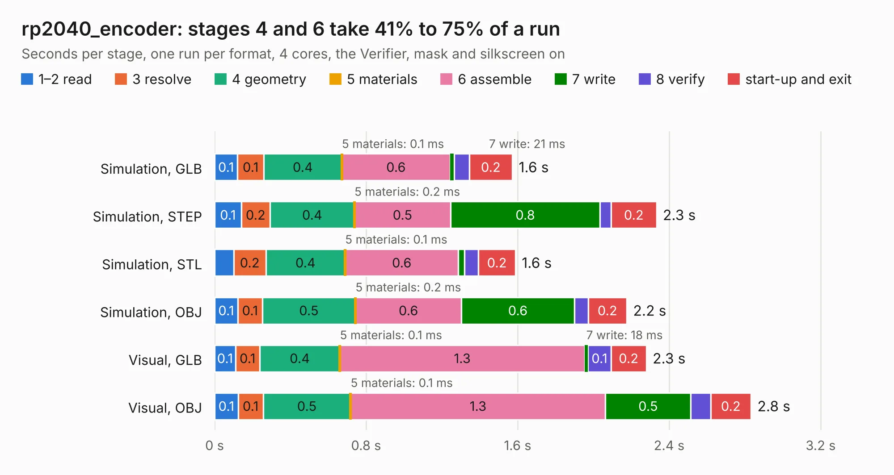

# 2906. rp2040_encoder

Board 2,906 of the 3,105 of [Corpus Testing](../Corpus-Testing.md), on [Corpus Page 27](../CorpusTestingPages/Corpus-Testing-27.md#2906-rp2040_encoder).

| Mode and format | 1–2 read | 3 resolve | 4 geometry | 5 materials | 6 assemble | 7 write | 8 verify | start-up and exit | Total |
|---|---:|---:|---:|---:|---:|---:|---:|---:|---:|
| Simulation, GLB | 0.1 | 0.1 | 0.4 | 0.1&nbsp;ms | 0.6 | 21&nbsp;ms | 79&nbsp;ms | 0.2 | 1.6 |
| Simulation, STEP | 0.1 | 0.2 | 0.4 | 0.2&nbsp;ms | 0.5 | 0.8 | 59&nbsp;ms | 0.2 | 2.3 |
| Simulation, STL | 0.1 | 0.2 | 0.4 | 0.1&nbsp;ms | 0.6 | 33&nbsp;ms | 73&nbsp;ms | 0.2 | 1.6 |
| Simulation, OBJ | 0.1 | 0.1 | 0.5 | 0.2&nbsp;ms | 0.6 | 0.6 | 72&nbsp;ms | 0.2 | 2.2 |
| Visual, GLB | 0.1 | 0.1 | 0.4 | 0.1&nbsp;ms | 1.3 | 18&nbsp;ms | 0.1 | 0.2 | 2.3 |
| Visual, OBJ | 0.1 | 0.1 | 0.5 | 0.1&nbsp;ms | 1.3 | 0.5 | 0.1 | 0.2 | 2.8 |

<table align="center"><tr><td valign="top">

| Board | Repo: [twisted-fields/rp2040-motor-controller](https://github.com/twisted-fields/rp2040-motor-controller) Board: `rp2040_encoder.kicad_pcb` |
|---|---|
| Folder | rp2040_encoder |
| Complexity | 185&nbsp;/&nbsp;1000 (size&nbsp;110, features&nbsp;75) |
| KESE&nbsp;features | through vias, rounded, trapezoid or chamfered pads, filled zones, stack-up, dielectric εr and tanδ |
| Tested | 9th November 2026 |
| Copper&nbsp;layers | 2 |
| File&nbsp;format | KiCad 8 (20240108) |
| Parts,&nbsp;tracks,&nbsp;vias | 10, 47, 4 |
| Triangles,&nbsp;simulation | 126,086 in 22 parts |
| Verifier | PASS in all six runs |

</td><td valign="top">

<table>
<tr><th>File type</th><th>File size</th><th>Peak memory used</th></tr>
<tr><th colspan="3" align="left">Simulation</th></tr>
<tr><td>GLB</td><td align="right">4.4&nbsp;MB</td><td align="right">188&nbsp;MB</td></tr>
<tr><td>STEP</td><td align="right">22&nbsp;MB</td><td align="right">204&nbsp;MB</td></tr>
<tr><td>STL</td><td align="right">6.3&nbsp;MB</td><td align="right">189&nbsp;MB</td></tr>
<tr><td>OBJ</td><td align="right">12&nbsp;MB</td><td align="right">189&nbsp;MB</td></tr>
<tr><th colspan="3" align="left">Visual</th></tr>
<tr><td>GLB</td><td align="right">3.8&nbsp;MB</td><td align="right">168&nbsp;MB</td></tr>
<tr><td>OBJ</td><td align="right">10&nbsp;MB</td><td align="right">164&nbsp;MB</td></tr>
</table>

</td></tr></table>

| Previous | Next |
|:---|---:|
| [2905. RP2040_base](b2905b_rp2040-motor-controller_RP2040-base.md) | [2907. user_interface](b2907b_rp2040-motor-controller_user-interface.md) |
