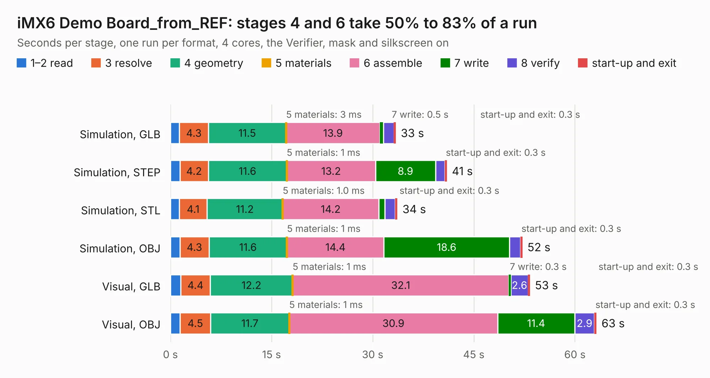

# 2907. iMX6 Demo Board_from_REF

Board 2,907 of the 3,110 of [Corpus Testing](../Corpus-Testing.md), on [Corpus Page 27](../CorpusTestingPages/Corpus-Testing-27.md#2907-imx6-demo-board_from_ref).

| Mode and format | 1–2 read | 3 resolve | 4 geometry | 5 materials | 6 assemble | 7 write | 8 verify | start-up and exit | Total |
|---|---:|---:|---:|---:|---:|---:|---:|---:|---:|
| Simulation, GLB | 1.3 | 4.3 | 11.5 | 3&nbsp;ms | 13.9 | 0.5 | 1.6 | 0.3 | 33.4 |
| Simulation, STEP | 1.4 | 4.2 | 11.6 | 1&nbsp;ms | 13.2 | 8.9 | 1.4 | 0.3 | 41.0 |
| Simulation, STL | 1.3 | 4.1 | 11.2 | 1.0&nbsp;ms | 14.2 | 0.9 | 1.5 | 0.3 | 33.7 |
| Simulation, OBJ | 1.4 | 4.3 | 11.6 | 1&nbsp;ms | 14.4 | 18.6 | 1.7 | 0.3 | 52.2 |
| Visual, GLB | 1.5 | 4.4 | 12.2 | 1&nbsp;ms | 32.1 | 0.3 | 2.6 | 0.3 | 53.3 |
| Visual, OBJ | 1.4 | 4.5 | 11.7 | 1&nbsp;ms | 30.9 | 11.4 | 2.9 | 0.3 | 63.2 |

<table align="center"><tr><td valign="top">

| Board | Repo: [ts-manuel/imx6-demo-board](https://github.com/ts-manuel/imx6-demo-board) Board: `iMX6 Demo Board_from_REF.kicad_pcb` |
|---|---|
| Folder | kicad |
| Complexity | 433&nbsp;/&nbsp;1000 (size&nbsp;313, features&nbsp;120) |
| KESE&nbsp;features | through vias, slotted holes, custom pads, rounded, trapezoid or chamfered pads, copper drawings, curved board outline, stack-up, dielectric εr and tanδ, copper finish, mask and silkscreen colours |
| Tested | 9th November 2026 |
| Copper&nbsp;layers | 6 |
| File&nbsp;format | KiCad 8 (20240108) |
| Parts,&nbsp;tracks,&nbsp;vias | 468, 3,672, 333 |
| Triangles,&nbsp;simulation | 3,165,490 in 480 parts |
| Verifier | PASS in all six runs |

</td><td valign="top">

<table>
<tr><th>File type</th><th>File size</th><th>Peak memory used</th></tr>
<tr><th colspan="3" align="left">Simulation</th></tr>
<tr><td>GLB</td><td align="right">107&nbsp;MB</td><td align="right">1.0&nbsp;GB</td></tr>
<tr><td>STEP</td><td align="right">465&nbsp;MB</td><td align="right">1.3&nbsp;GB</td></tr>
<tr><td>STL</td><td align="right">158&nbsp;MB</td><td align="right">1.0&nbsp;GB</td></tr>
<tr><td>OBJ</td><td align="right">340&nbsp;MB</td><td align="right">2.1&nbsp;GB</td></tr>
<tr><th colspan="3" align="left">Visual</th></tr>
<tr><td>GLB</td><td align="right">63&nbsp;MB</td><td align="right">1.4&nbsp;GB</td></tr>
<tr><td>OBJ</td><td align="right">209&nbsp;MB</td><td align="right">1.5&nbsp;GB</td></tr>
</table>

</td></tr></table>

| Previous | Next |
|:---|---:|
| [2906. iMX6 Demo Board](b2906b_imx6-demo-board_iMX6-Demo-Board.md) | [2908. RP2040_debugger](b2908b_rp2040-motor-controller_RP2040-debugger.md) |
