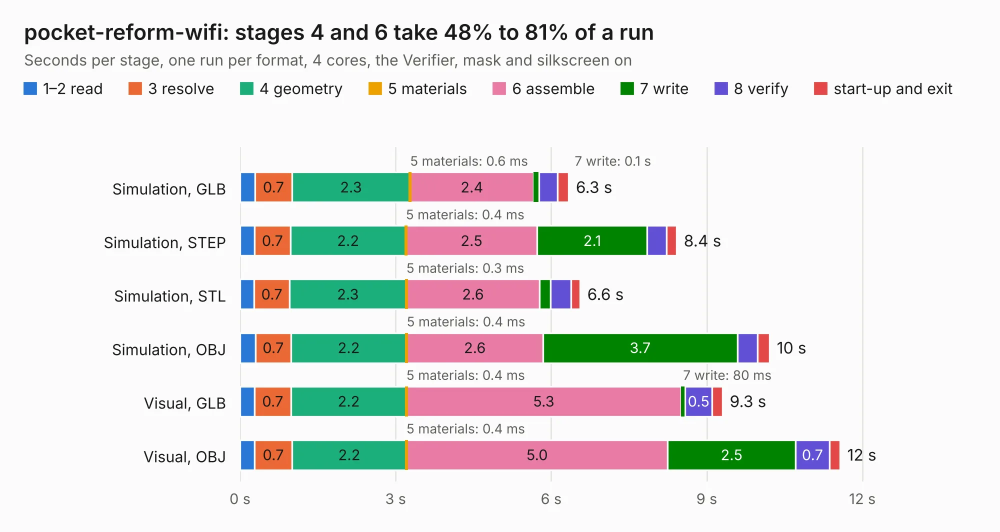

# 2907. pocket-reform-wifi

Board 2,907 of the 3,131 of [Corpus Testing](../Corpus-Testing.md), on [Corpus Page 27](../CorpusTestingPages/Corpus-Testing-27.md#2907-pocket-reform-wifi).

| Mode and format | 1–2 read | 3 resolve | 4 geometry | 5 materials | 6 assemble | 7 write | 8 verify | start-up and exit | Total |
|---|---:|---:|---:|---:|---:|---:|---:|---:|---:|
| Simulation, GLB | 0.3 | 0.7 | 2.3 | 0.6&nbsp;ms | 2.4 | 0.1 | 0.4 | 0.2 | 6.3 |
| Simulation, STEP | 0.3 | 0.7 | 2.2 | 0.4&nbsp;ms | 2.5 | 2.1 | 0.4 | 0.2 | 8.4 |
| Simulation, STL | 0.3 | 0.7 | 2.3 | 0.3&nbsp;ms | 2.6 | 0.2 | 0.4 | 0.2 | 6.6 |
| Simulation, OBJ | 0.3 | 0.7 | 2.2 | 0.4&nbsp;ms | 2.6 | 3.7 | 0.4 | 0.2 | 10.2 |
| Visual, GLB | 0.3 | 0.7 | 2.2 | 0.4&nbsp;ms | 5.3 | 80&nbsp;ms | 0.5 | 0.2 | 9.3 |
| Visual, OBJ | 0.3 | 0.7 | 2.2 | 0.4&nbsp;ms | 5.0 | 2.5 | 0.7 | 0.2 | 11.6 |

<table align="center"><tr><td valign="top">

| Board | Repo: [torlye/pocket-reform](https://github.com/torlye/pocket-reform) Board: `pocket-reform-wifi.kicad_pcb` |
|---|---|
| Folder | pocket-reform-wifi |
| Complexity | 274&nbsp;/&nbsp;1000 (size&nbsp;184, features&nbsp;90) |
| KESE&nbsp;features | through vias, rounded, trapezoid or chamfered pads, filled zones, knockout text, stack-up, dielectric εr and tanδ |
| Tested | 9th November 2026 |
| Copper&nbsp;layers | 4 |
| File&nbsp;format | KiCad 10 (20260206) |
| Parts,&nbsp;tracks,&nbsp;vias | 33, 457, 161 |
| Triangles,&nbsp;simulation | 719,012 in 87 parts |
| Verifier | PASS in all six runs |

</td><td valign="top">

<table>
<tr><th>File type</th><th>File size</th><th>Peak memory used</th></tr>
<tr><th colspan="3" align="left">Simulation</th></tr>
<tr><td>GLB</td><td align="right">25&nbsp;MB</td><td align="right">368&nbsp;MB</td></tr>
<tr><td>STEP</td><td align="right">102&nbsp;MB</td><td align="right">438&nbsp;MB</td></tr>
<tr><td>STL</td><td align="right">36&nbsp;MB</td><td align="right">359&nbsp;MB</td></tr>
<tr><td>OBJ</td><td align="right">72&nbsp;MB</td><td align="right">522&nbsp;MB</td></tr>
<tr><th colspan="3" align="left">Visual</th></tr>
<tr><td>GLB</td><td align="right">17&nbsp;MB</td><td align="right">435&nbsp;MB</td></tr>
<tr><td>OBJ</td><td align="right">52&nbsp;MB</td><td align="right">467&nbsp;MB</td></tr>
</table>

</td></tr></table>

| Previous | Next |
|:---|---:|
| [2906. nref-wifi-m2](b2906b_pocket-reform_nref-wifi-m2.md) | [2908. pods_panel](b2908b_RAMN_pods-panel.md) |
