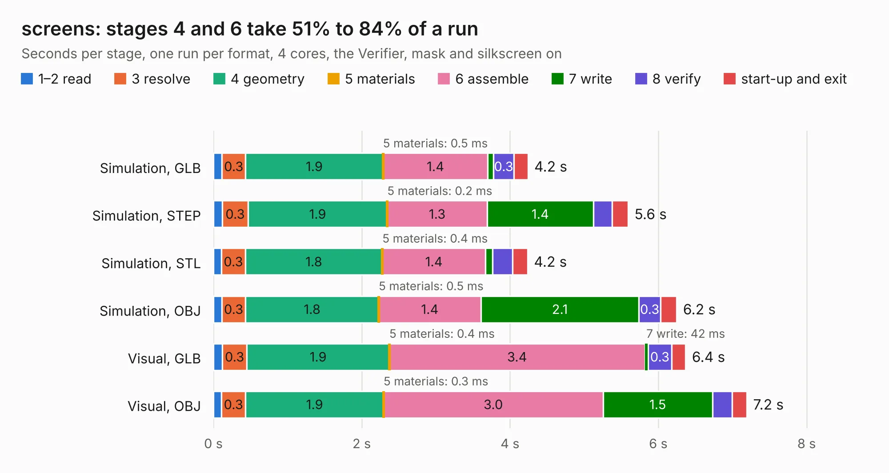

# 2908. screens

Board 2,908 of the 3,129 of [Corpus Testing](../Corpus-Testing.md), on [Corpus Page 27](../CorpusTestingPages/Corpus-Testing-27.md#2908-screens).

| Mode and format | 1–2 read | 3 resolve | 4 geometry | 5 materials | 6 assemble | 7 write | 8 verify | start-up and exit | Total |
|---|---:|---:|---:|---:|---:|---:|---:|---:|---:|
| Simulation, GLB | 0.1 | 0.3 | 1.9 | 0.5&nbsp;ms | 1.4 | 75&nbsp;ms | 0.3 | 0.2 | 4.2 |
| Simulation, STEP | 0.1 | 0.3 | 1.9 | 0.2&nbsp;ms | 1.3 | 1.4 | 0.3 | 0.2 | 5.6 |
| Simulation, STL | 0.1 | 0.3 | 1.8 | 0.4&nbsp;ms | 1.4 | 96&nbsp;ms | 0.3 | 0.2 | 4.2 |
| Simulation, OBJ | 0.1 | 0.3 | 1.8 | 0.5&nbsp;ms | 1.4 | 2.1 | 0.3 | 0.2 | 6.2 |
| Visual, GLB | 0.1 | 0.3 | 1.9 | 0.4&nbsp;ms | 3.4 | 42&nbsp;ms | 0.3 | 0.2 | 6.4 |
| Visual, OBJ | 0.1 | 0.3 | 1.9 | 0.3&nbsp;ms | 3.0 | 1.5 | 0.3 | 0.2 | 7.2 |

<table align="center"><tr><td valign="top">

| Board | Repo: [ToyotaInfoTech/RAMN](https://github.com/ToyotaInfoTech/RAMN) Board: `screens.kicad_pcb` |
|---|---|
| Folder | hardware / V1_revB / 1_screens |
| Complexity | 182&nbsp;/&nbsp;1000 (size&nbsp;127, features&nbsp;55) |
| KESE&nbsp;features | through vias, filled zones, copper text, curved board outline |
| Tested | 9th November 2026 |
| Copper&nbsp;layers | 2 |
| File&nbsp;format | KiCad 5 (20171130) |
| Parts,&nbsp;tracks,&nbsp;vias | 5, 218, 15 |
| Triangles,&nbsp;simulation | 435,086 in 49 parts |
| Verifier | PASS in all six runs |

</td><td valign="top">

<table>
<tr><th>File type</th><th>File size</th><th>Peak memory used</th></tr>
<tr><th colspan="3" align="left">Simulation</th></tr>
<tr><td>GLB</td><td align="right">14&nbsp;MB</td><td align="right">260&nbsp;MB</td></tr>
<tr><td>STEP</td><td align="right">60&nbsp;MB</td><td align="right">314&nbsp;MB</td></tr>
<tr><td>STL</td><td align="right">22&nbsp;MB</td><td align="right">274&nbsp;MB</td></tr>
<tr><td>OBJ</td><td align="right">43&nbsp;MB</td><td align="right">335&nbsp;MB</td></tr>
<tr><th colspan="3" align="left">Visual</th></tr>
<tr><td>GLB</td><td align="right">9.4&nbsp;MB</td><td align="right">305&nbsp;MB</td></tr>
<tr><td>OBJ</td><td align="right">28&nbsp;MB</td><td align="right">309&nbsp;MB</td></tr>
</table>

</td></tr></table>

| Previous | Next |
|:---|---:|
| [2907. ramn](b2907b_RAMN_ramn.md) | [2909. chassis](b2909b_RAMN_chassis.md) |
