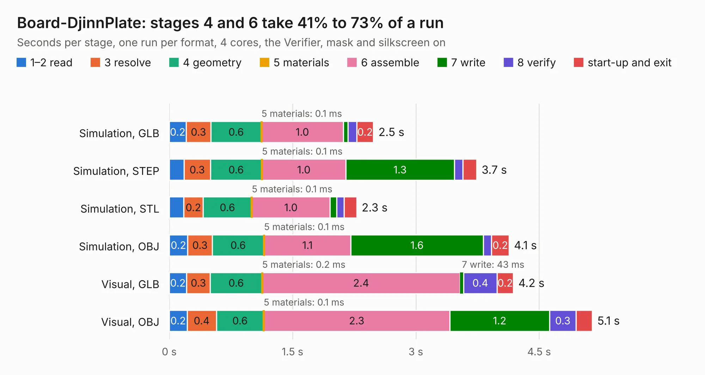

# 2909. Board-DjinnPlate

Board 2,909 of the 3,105 of [Corpus Testing](../Corpus-Testing.md), on [Corpus Page 27](../CorpusTestingPages/Corpus-Testing-27.md#2909-board-djinnplate).

| Mode and format | 1–2 read | 3 resolve | 4 geometry | 5 materials | 6 assemble | 7 write | 8 verify | start-up and exit | Total |
|---|---:|---:|---:|---:|---:|---:|---:|---:|---:|
| Simulation, GLB | 0.2 | 0.3 | 0.6 | 0.1&nbsp;ms | 1.0 | 55&nbsp;ms | 0.1 | 0.2 | 2.5 |
| Simulation, STEP | 0.2 | 0.3 | 0.6 | 0.1&nbsp;ms | 1.0 | 1.3 | 0.1 | 0.2 | 3.7 |
| Simulation, STL | 0.2 | 0.2 | 0.6 | 0.1&nbsp;ms | 1.0 | 80&nbsp;ms | 91&nbsp;ms | 0.2 | 2.3 |
| Simulation, OBJ | 0.2 | 0.3 | 0.6 | 0.1&nbsp;ms | 1.1 | 1.6 | 0.1 | 0.2 | 4.1 |
| Visual, GLB | 0.2 | 0.3 | 0.6 | 0.2&nbsp;ms | 2.4 | 43&nbsp;ms | 0.4 | 0.2 | 4.2 |
| Visual, OBJ | 0.2 | 0.4 | 0.6 | 0.1&nbsp;ms | 2.3 | 1.2 | 0.3 | 0.2 | 5.1 |

<table align="center"><tr><td valign="top">

| Board | Repo: [tzarc/keyboards](https://github.com/tzarc/keyboards) Board: `Board-DjinnPlate.kicad_pcb` |
|---|---|
| Folder | Djinn / Rev1 / Board-DjinnPlate |
| Complexity | 69&nbsp;/&nbsp;1000 (size&nbsp;29, features&nbsp;40) |
| KESE&nbsp;features | slotted holes, filled zones, curved board outline |
| Tested | 9th November 2026 |
| Copper&nbsp;layers | 2 |
| File&nbsp;format | KiCad 5 (20171130) |
| Parts,&nbsp;tracks,&nbsp;vias | 2, 0, 0 |
| Triangles,&nbsp;simulation | 347,412 in 12 parts |
| Verifier | PASS in all six runs |

</td><td valign="top">

<table>
<tr><th>File type</th><th>File size</th><th>Peak memory used</th></tr>
<tr><th colspan="3" align="left">Simulation</th></tr>
<tr><td>GLB</td><td align="right">12&nbsp;MB</td><td align="right">272&nbsp;MB</td></tr>
<tr><td>STEP</td><td align="right">69&nbsp;MB</td><td align="right">314&nbsp;MB</td></tr>
<tr><td>STL</td><td align="right">17&nbsp;MB</td><td align="right">297&nbsp;MB</td></tr>
<tr><td>OBJ</td><td align="right">35&nbsp;MB</td><td align="right">294&nbsp;MB</td></tr>
<tr><th colspan="3" align="left">Visual</th></tr>
<tr><td>GLB</td><td align="right">9.6&nbsp;MB</td><td align="right">272&nbsp;MB</td></tr>
<tr><td>OBJ</td><td align="right">28&nbsp;MB</td><td align="right">281&nbsp;MB</td></tr>
</table>

</td></tr></table>

| Previous | Next |
|:---|---:|
| [2908. Board-DjinnBase](b2908b_keyboards_Board-DjinnBase.md) | [2910. Djinn](b2910b_keyboards_Djinn-Rev1_Djinn.md) |
