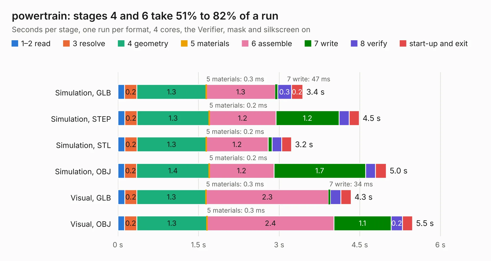

# 2913. powertrain

Board 2,913 of the 3,132 of [Corpus Testing](../Corpus-Testing.md), on [Corpus Page 27](../CorpusTestingPages/Corpus-Testing-27.md#2913-powertrain).

| Mode and format | 1–2 read | 3 resolve | 4 geometry | 5 materials | 6 assemble | 7 write | 8 verify | start-up and exit | Total |
|---|---:|---:|---:|---:|---:|---:|---:|---:|---:|
| Simulation, GLB | 0.1 | 0.2 | 1.3 | 0.3&nbsp;ms | 1.3 | 47&nbsp;ms | 0.3 | 0.2 | 3.4 |
| Simulation, STEP | 0.1 | 0.2 | 1.3 | 0.2&nbsp;ms | 1.2 | 1.2 | 0.2 | 0.2 | 4.5 |
| Simulation, STL | 0.1 | 0.2 | 1.3 | 0.2&nbsp;ms | 1.2 | 73&nbsp;ms | 0.2 | 0.2 | 3.2 |
| Simulation, OBJ | 0.1 | 0.2 | 1.4 | 0.2&nbsp;ms | 1.2 | 1.7 | 0.2 | 0.2 | 5.0 |
| Visual, GLB | 0.1 | 0.2 | 1.3 | 0.3&nbsp;ms | 2.3 | 34&nbsp;ms | 0.2 | 0.2 | 4.3 |
| Visual, OBJ | 0.1 | 0.2 | 1.3 | 0.3&nbsp;ms | 2.4 | 1.1 | 0.2 | 0.2 | 5.5 |

<table align="center"><tr><td valign="top">

| Board | Repo: [ToyotaInfoTech/RAMN](https://github.com/ToyotaInfoTech/RAMN) Board: `powertrain.kicad_pcb` |
|---|---|
| Folder | hardware / V1_revB / 3_powertrain |
| Complexity | 190&nbsp;/&nbsp;1000 (size&nbsp;125, features&nbsp;65) |
| KESE&nbsp;features | through vias, rounded, trapezoid or chamfered pads, filled zones, copper text, curved board outline |
| Tested | 9th November 2026 |
| Copper&nbsp;layers | 2 |
| File&nbsp;format | KiCad 7 (20221018) |
| Parts,&nbsp;tracks,&nbsp;vias | 15, 94, 8 |
| Triangles,&nbsp;simulation | 344,580 in 41 parts |
| Verifier | PASS in all six runs |

</td><td valign="top">

<table>
<tr><th>File type</th><th>File size</th><th>Peak memory used</th></tr>
<tr><th colspan="3" align="left">Simulation</th></tr>
<tr><td>GLB</td><td align="right">11&nbsp;MB</td><td align="right">242&nbsp;MB</td></tr>
<tr><td>STEP</td><td align="right">48&nbsp;MB</td><td align="right">284&nbsp;MB</td></tr>
<tr><td>STL</td><td align="right">17&nbsp;MB</td><td align="right">253&nbsp;MB</td></tr>
<tr><td>OBJ</td><td align="right">34&nbsp;MB</td><td align="right">248&nbsp;MB</td></tr>
<tr><th colspan="3" align="left">Visual</th></tr>
<tr><td>GLB</td><td align="right">7.8&nbsp;MB</td><td align="right">265&nbsp;MB</td></tr>
<tr><td>OBJ</td><td align="right">23&nbsp;MB</td><td align="right">262&nbsp;MB</td></tr>
</table>

</td></tr></table>

| Previous | Next |
|:---|---:|
| [2912. chassis](b2912b_RAMN_chassis.md) | [2914. body](b2914b_RAMN_body.md) |
