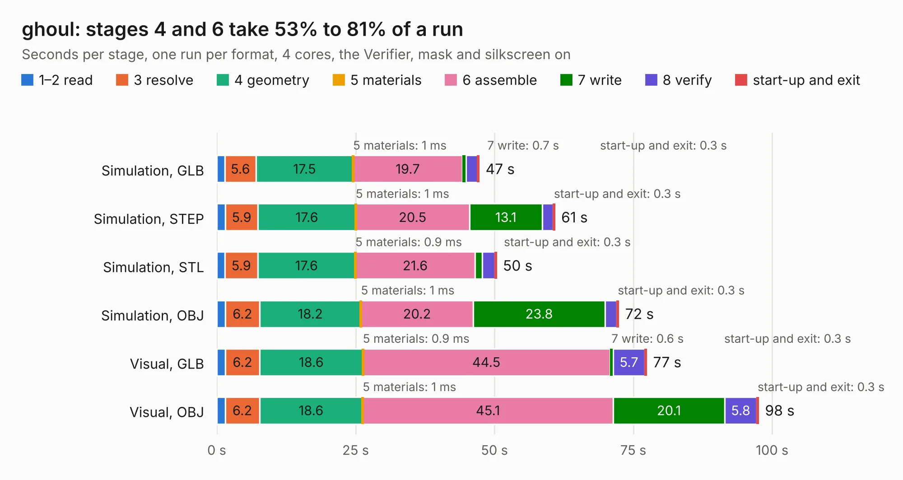

# 2914. ghoul

Board 2,914 of the 3,105 of [Corpus Testing](../Corpus-Testing.md), on [Corpus Page 27](../CorpusTestingPages/Corpus-Testing-27.md#2914-ghoul).

| Mode and format | 1–2 read | 3 resolve | 4 geometry | 5 materials | 6 assemble | 7 write | 8 verify | start-up and exit | Total |
|---|---:|---:|---:|---:|---:|---:|---:|---:|---:|
| Simulation, GLB | 1.4 | 5.6 | 17.5 | 1&nbsp;ms | 19.7 | 0.7 | 2.0 | 0.3 | 47.2 |
| Simulation, STEP | 1.5 | 5.9 | 17.6 | 1&nbsp;ms | 20.5 | 13.1 | 2.0 | 0.3 | 60.9 |
| Simulation, STL | 1.5 | 5.9 | 17.6 | 0.9&nbsp;ms | 21.6 | 1.3 | 2.2 | 0.3 | 50.4 |
| Simulation, OBJ | 1.5 | 6.2 | 18.2 | 1&nbsp;ms | 20.2 | 23.8 | 2.1 | 0.3 | 72.4 |
| Visual, GLB | 1.5 | 6.2 | 18.6 | 0.9&nbsp;ms | 44.5 | 0.6 | 5.7 | 0.3 | 77.4 |
| Visual, OBJ | 1.5 | 6.2 | 18.6 | 1&nbsp;ms | 45.1 | 20.1 | 5.8 | 0.3 | 97.5 |

<table align="center"><tr><td valign="top">

| Board | Repo: [tzarc/keyboards](https://github.com/tzarc/keyboards) Board: `ghoul.kicad_pcb` |
|---|---|
| Folder | Ghoul / v1.0 |
| Complexity | 326&nbsp;/&nbsp;1000 (size&nbsp;206, features&nbsp;120) |
| KESE&nbsp;features | through vias, slotted holes, custom pads, rounded, trapezoid or chamfered pads, filled zones, copper drawings, curved board outline, stack-up, dielectric εr and tanδ |
| Tested | 10th November 2026 |
| Copper&nbsp;layers | 2 |
| File&nbsp;format | KiCad 6 (20211014) |
| Parts,&nbsp;tracks,&nbsp;vias | 166, 2,087, 497 |
| Triangles,&nbsp;simulation | 3,894,076 in 191 parts |
| Verifier | PASS in all six runs |

</td><td valign="top">

<table>
<tr><th>File type</th><th>File size</th><th>Peak memory used</th></tr>
<tr><th colspan="3" align="left">Simulation</th></tr>
<tr><td>GLB</td><td align="right">134&nbsp;MB</td><td align="right">1.5&nbsp;GB</td></tr>
<tr><td>STEP</td><td align="right">737&nbsp;MB</td><td align="right">1.8&nbsp;GB</td></tr>
<tr><td>STL</td><td align="right">195&nbsp;MB</td><td align="right">1.5&nbsp;GB</td></tr>
<tr><td>OBJ</td><td align="right">417&nbsp;MB</td><td align="right">2.6&nbsp;GB</td></tr>
<tr><th colspan="3" align="left">Visual</th></tr>
<tr><td>GLB</td><td align="right">116&nbsp;MB</td><td align="right">1.8&nbsp;GB</td></tr>
<tr><td>OBJ</td><td align="right">371&nbsp;MB</td><td align="right">2.5&nbsp;GB</td></tr>
</table>

</td></tr></table>

| Previous | Next |
|:---|---:|
| [2913. ExtraBoard-Plate](b2913b_keyboards_ExtraBoard-Plate.md) | [2915. half-plate](b2915b_keyboards_half-plate.md) |
