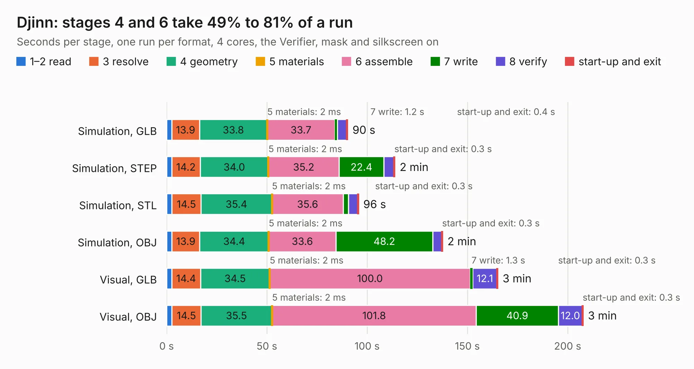

# 2916. Djinn

Board 2,916 of the 3,110 of [Corpus Testing](../Corpus-Testing.md), on [Corpus Page 27](../CorpusTestingPages/Corpus-Testing-27.md#2916-djinn).

| Mode and format | 1–2 read | 3 resolve | 4 geometry | 5 materials | 6 assemble | 7 write | 8 verify | start-up and exit | Total |
|---|---:|---:|---:|---:|---:|---:|---:|---:|---:|
| Simulation, GLB | 2.5 | 13.9 | 33.8 | 2&nbsp;ms | 33.7 | 1.2 | 4.8 | 0.4 | 90.2 |
| Simulation, STEP | 2.6 | 14.2 | 34.0 | 2&nbsp;ms | 35.2 | 22.4 | 5.1 | 0.3 | 113.8 |
| Simulation, STL | 2.6 | 14.5 | 35.4 | 2&nbsp;ms | 35.6 | 2.6 | 4.6 | 0.3 | 95.6 |
| Simulation, OBJ | 2.7 | 13.9 | 34.4 | 2&nbsp;ms | 33.6 | 48.2 | 4.6 | 0.3 | 137.6 |
| Visual, GLB | 2.6 | 14.4 | 34.5 | 2&nbsp;ms | 100.0 | 1.3 | 12.1 | 0.3 | 165.1 |
| Visual, OBJ | 2.7 | 14.5 | 35.5 | 2&nbsp;ms | 101.8 | 40.9 | 12.0 | 0.3 | 207.6 |

<table align="center"><tr><td valign="top">

| Board | Repo: [tzarc/keyboards](https://github.com/tzarc/keyboards) Board: `Djinn.kicad_pcb` |
|---|---|
| Folder | Djinn / Rev2a |
| Complexity | 353&nbsp;/&nbsp;1000 (size&nbsp;263, features&nbsp;90) |
| KESE&nbsp;features | through vias, slotted holes, custom pads, rounded, trapezoid or chamfered pads, filled zones, copper drawings, curved board outline |
| Tested | 9th November 2026 |
| Copper&nbsp;layers | 2 |
| File&nbsp;format | KiCad 5 (20171130) |
| Parts,&nbsp;tracks,&nbsp;vias | 230, 3,274, 711 |
| Triangles,&nbsp;simulation | 7,974,724 in 196 parts |
| Verifier | PASS in all six runs |

</td><td valign="top">

<table>
<tr><th>File type</th><th>File size</th><th>Peak memory used</th></tr>
<tr><th colspan="3" align="left">Simulation</th></tr>
<tr><td>GLB</td><td align="right">273&nbsp;MB</td><td align="right">2.9&nbsp;GB</td></tr>
<tr><td>STEP</td><td align="right">1.5&nbsp;GB</td><td align="right">3.2&nbsp;GB</td></tr>
<tr><td>STL</td><td align="right">399&nbsp;MB</td><td align="right">2.8&nbsp;GB</td></tr>
<tr><td>OBJ</td><td align="right">856&nbsp;MB</td><td align="right">5.0&nbsp;GB</td></tr>
<tr><th colspan="3" align="left">Visual</th></tr>
<tr><td>GLB</td><td align="right">245&nbsp;MB</td><td align="right">3.6&nbsp;GB</td></tr>
<tr><td>OBJ</td><td align="right">787&nbsp;MB</td><td align="right">4.7&nbsp;GB</td></tr>
</table>

</td></tr></table>

| Previous | Next |
|:---|---:|
| [2915. Djinn](b2915b_keyboards_Djinn-Rev1_Djinn.md) | [2917. ExtraBoard-Base](b2917b_keyboards_ExtraBoard-Base.md) |
