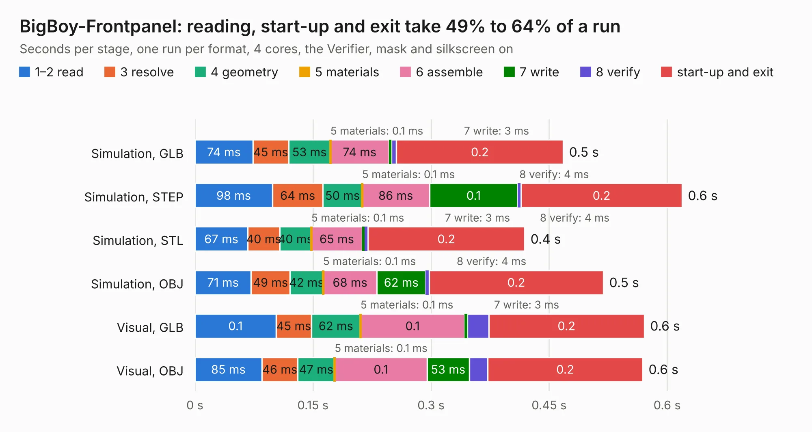

# 2916. BigBoy-Frontpanel

Board 2,916 of the 3,130 of [Corpus Testing](../Corpus-Testing.md), on [Corpus Page 27](../CorpusTestingPages/Corpus-Testing-27.md#2916-bigboy-frontpanel).

| Mode and format | 1–2 read | 3 resolve | 4 geometry | 5 materials | 6 assemble | 7 write | 8 verify | start-up and exit | Total |
|---|---:|---:|---:|---:|---:|---:|---:|---:|---:|
| Simulation, GLB | 74&nbsp;ms | 45&nbsp;ms | 53&nbsp;ms | 0.1&nbsp;ms | 74&nbsp;ms | 3&nbsp;ms | 7&nbsp;ms | 0.2 | 0.5 |
| Simulation, STEP | 98&nbsp;ms | 64&nbsp;ms | 50&nbsp;ms | 0.1&nbsp;ms | 86&nbsp;ms | 0.1 | 4&nbsp;ms | 0.2 | 0.6 |
| Simulation, STL | 67&nbsp;ms | 40&nbsp;ms | 40&nbsp;ms | 0.1&nbsp;ms | 65&nbsp;ms | 3&nbsp;ms | 4&nbsp;ms | 0.2 | 0.4 |
| Simulation, OBJ | 71&nbsp;ms | 49&nbsp;ms | 42&nbsp;ms | 0.1&nbsp;ms | 68&nbsp;ms | 62&nbsp;ms | 4&nbsp;ms | 0.2 | 0.5 |
| Visual, GLB | 0.1 | 45&nbsp;ms | 62&nbsp;ms | 0.1&nbsp;ms | 0.1 | 3&nbsp;ms | 27&nbsp;ms | 0.2 | 0.6 |
| Visual, OBJ | 85&nbsp;ms | 46&nbsp;ms | 47&nbsp;ms | 0.1&nbsp;ms | 0.1 | 53&nbsp;ms | 24&nbsp;ms | 0.2 | 0.6 |

<table align="center"><tr><td valign="top">

| Board | Repo: [transistorfet/retroverse](https://github.com/transistorfet/retroverse) Board: `BigBoy-Frontpanel.kicad_pcb` |
|---|---|
| Folder | components / bigboy / hardware / BigBoy-Frontpanel |
| Complexity | 39&nbsp;/&nbsp;1000 (size&nbsp;29, features&nbsp;10) |
| KESE&nbsp;features | slotted holes |
| Tested | 9th November 2026 |
| Copper&nbsp;layers | 2 |
| File&nbsp;format | KiCad 8 (20240108) |
| Parts,&nbsp;tracks,&nbsp;vias | 2, 0, 0 |
| Triangles,&nbsp;simulation | 12,100 in 4 parts |
| Note | panel |
| Verifier | PASS in all six runs |

</td><td valign="top">

<table>
<tr><th>File type</th><th>File size</th><th>Peak memory used</th></tr>
<tr><th colspan="3" align="left">Simulation</th></tr>
<tr><td>GLB</td><td align="right">415&nbsp;kB</td><td align="right">65&nbsp;MB</td></tr>
<tr><td>STEP</td><td align="right">1.4&nbsp;MB</td><td align="right">62&nbsp;MB</td></tr>
<tr><td>STL</td><td align="right">605&nbsp;kB</td><td align="right">62&nbsp;MB</td></tr>
<tr><td>OBJ</td><td align="right">1.2&nbsp;MB</td><td align="right">63&nbsp;MB</td></tr>
<tr><th colspan="3" align="left">Visual</th></tr>
<tr><td>GLB</td><td align="right">405&nbsp;kB</td><td align="right">79&nbsp;MB</td></tr>
<tr><td>OBJ</td><td align="right">1.0&nbsp;MB</td><td align="right">81&nbsp;MB</td></tr>
</table>

</td></tr></table>

| Previous | Next |
|:---|---:|
| [2915. 60mm-Extender](b2915b_retroverse_60mm-Extender.md) | [2917. BigBoy](b2917b_retroverse_BigBoy.md) |
