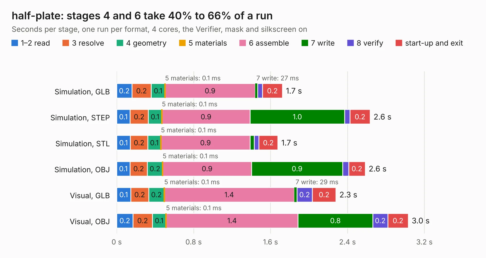

# 2917. half-plate

Board 2,917 of the 3,107 of [Corpus Testing](../Corpus-Testing.md), on [Corpus Page 28](../CorpusTestingPages/Corpus-Testing-28.md#2917-half-plate).

| Mode and format | 1–2 read | 3 resolve | 4 geometry | 5 materials | 6 assemble | 7 write | 8 verify | start-up and exit | Total |
|---|---:|---:|---:|---:|---:|---:|---:|---:|---:|
| Simulation, GLB | 0.2 | 0.2 | 0.1 | 0.1&nbsp;ms | 0.9 | 27&nbsp;ms | 49&nbsp;ms | 0.2 | 1.7 |
| Simulation, STEP | 0.1 | 0.2 | 0.1 | 0.1&nbsp;ms | 0.9 | 1.0 | 56&nbsp;ms | 0.2 | 2.6 |
| Simulation, STL | 0.1 | 0.2 | 0.1 | 0.1&nbsp;ms | 0.9 | 44&nbsp;ms | 48&nbsp;ms | 0.2 | 1.7 |
| Simulation, OBJ | 0.1 | 0.2 | 0.2 | 0.1&nbsp;ms | 0.9 | 0.9 | 63&nbsp;ms | 0.2 | 2.6 |
| Visual, GLB | 0.1 | 0.2 | 0.2 | 0.1&nbsp;ms | 1.4 | 29&nbsp;ms | 0.2 | 0.2 | 2.3 |
| Visual, OBJ | 0.2 | 0.2 | 0.1 | 0.1&nbsp;ms | 1.4 | 0.8 | 0.2 | 0.2 | 3.0 |

<table align="center"><tr><td valign="top">

| Board | Repo: [tzarc/keyboards](https://github.com/tzarc/keyboards) Board: `half-plate.kicad_pcb` |
|---|---|
| Folder | Ghoul / v1.0 / half-plate |
| Complexity | 47&nbsp;/&nbsp;1000 (size&nbsp;17, features&nbsp;30) |
| KESE&nbsp;features | filled zones, curved board outline |
| Tested | 9th November 2026 |
| Copper&nbsp;layers | 2 |
| File&nbsp;format | KiCad 6 (20211014) |
| Parts,&nbsp;tracks,&nbsp;vias | 0, 0, 0 |
| Triangles,&nbsp;simulation | 173,544 in 6 parts |
| Note | no components |
| Verifier | PASS in all six runs |

</td><td valign="top">

<table>
<tr><th>File type</th><th>File size</th><th>Peak memory used</th></tr>
<tr><th colspan="3" align="left">Simulation</th></tr>
<tr><td>GLB</td><td align="right">6.1&nbsp;MB</td><td align="right">230&nbsp;MB</td></tr>
<tr><td>STEP</td><td align="right">32&nbsp;MB</td><td align="right">249&nbsp;MB</td></tr>
<tr><td>STL</td><td align="right">8.7&nbsp;MB</td><td align="right">227&nbsp;MB</td></tr>
<tr><td>OBJ</td><td align="right">17&nbsp;MB</td><td align="right">234&nbsp;MB</td></tr>
<tr><th colspan="3" align="left">Visual</th></tr>
<tr><td>GLB</td><td align="right">5.0&nbsp;MB</td><td align="right">191&nbsp;MB</td></tr>
<tr><td>OBJ</td><td align="right">14&nbsp;MB</td><td align="right">191&nbsp;MB</td></tr>
</table>

</td></tr></table>

| Previous | Next |
|:---|---:|
| [2916. ghoul](b2916b_keyboards_ghoul.md) | [2918. Kobold](b2918b_keyboards_Kobold.md) |
