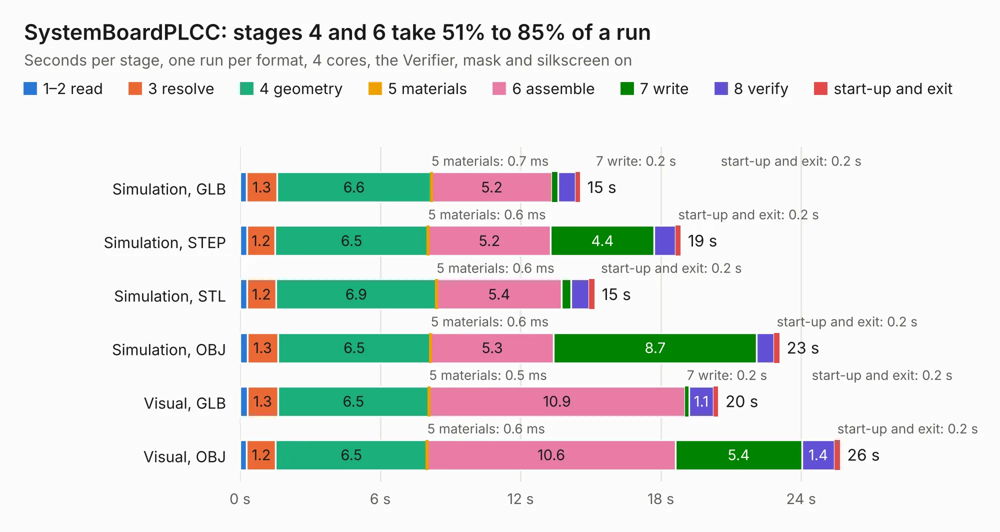

# 2917. SystemBoardPLCC

Board 2,917 of the 3,125 of [Corpus Testing](../Corpus-Testing.md), on [Corpus Page 28](../CorpusTestingPages/Corpus-Testing-28.md#2917-systemboardplcc).

| Mode and format | 1–2 read | 3 resolve | 4 geometry | 5 materials | 6 assemble | 7 write | 8 verify | start-up and exit | Total |
|---|---:|---:|---:|---:|---:|---:|---:|---:|---:|
| Simulation, GLB | 0.3 | 1.3 | 6.6 | 0.7&nbsp;ms | 5.2 | 0.2 | 0.8 | 0.2 | 14.5 |
| Simulation, STEP | 0.3 | 1.2 | 6.5 | 0.6&nbsp;ms | 5.2 | 4.4 | 0.9 | 0.2 | 18.9 |
| Simulation, STL | 0.3 | 1.2 | 6.9 | 0.6&nbsp;ms | 5.4 | 0.4 | 0.8 | 0.2 | 15.2 |
| Simulation, OBJ | 0.3 | 1.3 | 6.5 | 0.6&nbsp;ms | 5.3 | 8.7 | 0.7 | 0.2 | 23.1 |
| Visual, GLB | 0.3 | 1.3 | 6.5 | 0.5&nbsp;ms | 10.9 | 0.2 | 1.1 | 0.2 | 20.5 |
| Visual, OBJ | 0.3 | 1.2 | 6.5 | 0.6&nbsp;ms | 10.6 | 5.4 | 1.4 | 0.2 | 25.7 |

<table align="center"><tr><td valign="top">

| Board | Repo: [transistorfet/retroverse](https://github.com/transistorfet/retroverse) Board: `SystemBoardPLCC.kicad_pcb` |
|---|---|
| Folder | components / systemboard / hardware / SystemBoardPLCC |
| Complexity | 308&nbsp;/&nbsp;1000 (size&nbsp;208, features&nbsp;100) |
| KESE&nbsp;features | through vias, custom pads, rounded, trapezoid or chamfered pads, filled zones, copper drawings, stack-up, dielectric εr and tanδ |
| Tested | 9th November 2026 |
| Copper&nbsp;layers | 2 |
| File&nbsp;format | KiCad 8 (20240108) |
| Parts,&nbsp;tracks,&nbsp;vias | 33, 568, 138 |
| Triangles,&nbsp;simulation | 1,694,846 in 126 parts |
| Verifier | PASS in all six runs |

</td><td valign="top">

<table>
<tr><th>File type</th><th>File size</th><th>Peak memory used</th></tr>
<tr><th colspan="3" align="left">Simulation</th></tr>
<tr><td>GLB</td><td align="right">57&nbsp;MB</td><td align="right">770&nbsp;MB</td></tr>
<tr><td>STEP</td><td align="right">239&nbsp;MB</td><td align="right">787&nbsp;MB</td></tr>
<tr><td>STL</td><td align="right">85&nbsp;MB</td><td align="right">783&nbsp;MB</td></tr>
<tr><td>OBJ</td><td align="right">173&nbsp;MB</td><td align="right">1.1&nbsp;GB</td></tr>
<tr><th colspan="3" align="left">Visual</th></tr>
<tr><td>GLB</td><td align="right">36&nbsp;MB</td><td align="right">725&nbsp;MB</td></tr>
<tr><td>OBJ</td><td align="right">110&nbsp;MB</td><td align="right">844&nbsp;MB</td></tr>
</table>

</td></tr></table>

| Previous | Next |
|:---|---:|
| [2916. MemBird - Woodcock](b2916b_retroverse_MemBird-Woodcock.md) | [2918. SystemBoardSMT](b2918b_retroverse_SystemBoardSMT.md) |
