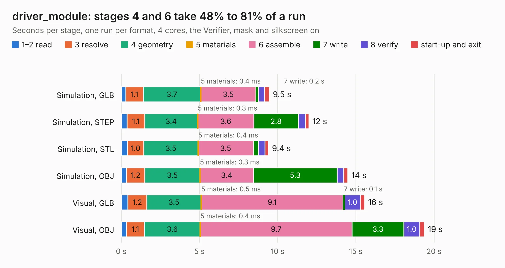

# 2920. driver_module

Board 2,920 of the 3,121 of [Corpus Testing](../Corpus-Testing.md), on [Corpus Page 28](../CorpusTestingPages/Corpus-Testing-28.md#2920-driver_module).

| Mode and format | 1–2 read | 3 resolve | 4 geometry | 5 materials | 6 assemble | 7 write | 8 verify | start-up and exit | Total |
|---|---:|---:|---:|---:|---:|---:|---:|---:|---:|
| Simulation, GLB | 0.3 | 1.1 | 3.7 | 0.4&nbsp;ms | 3.5 | 0.2 | 0.4 | 0.3 | 9.5 |
| Simulation, STEP | 0.4 | 1.1 | 3.4 | 0.3&nbsp;ms | 3.6 | 2.8 | 0.5 | 0.2 | 12.0 |
| Simulation, STL | 0.4 | 1.0 | 3.5 | 0.4&nbsp;ms | 3.5 | 0.3 | 0.4 | 0.2 | 9.4 |
| Simulation, OBJ | 0.3 | 1.2 | 3.5 | 0.3&nbsp;ms | 3.4 | 5.3 | 0.4 | 0.3 | 14.5 |
| Visual, GLB | 0.4 | 1.2 | 3.5 | 0.5&nbsp;ms | 9.1 | 0.1 | 1.0 | 0.3 | 15.6 |
| Visual, OBJ | 0.3 | 1.1 | 3.6 | 0.4&nbsp;ms | 9.7 | 3.3 | 1.0 | 0.3 | 19.4 |

<table align="center"><tr><td valign="top">

| Board | Repo: [twisted-fields/rp2040-motor-controller](https://github.com/twisted-fields/rp2040-motor-controller) Board: `driver_module.kicad_pcb` |
|---|---|
| Folder | driver_module |
| Complexity | 294&nbsp;/&nbsp;1000 (size&nbsp;199, features&nbsp;95) |
| KESE&nbsp;features | through vias, slotted holes, rounded, trapezoid or chamfered pads, filled zones, curved board outline, stack-up, dielectric εr and tanδ |
| Tested | 9th November 2026 |
| Copper&nbsp;layers | 4 |
| File&nbsp;format | KiCad 8 (20240108) |
| Parts,&nbsp;tracks,&nbsp;vias | 106, 640, 162 |
| Triangles,&nbsp;simulation | 1,087,146 in 74 parts |
| Verifier | PASS in all six runs |

</td><td valign="top">

<table>
<tr><th>File type</th><th>File size</th><th>Peak memory used</th></tr>
<tr><th colspan="3" align="left">Simulation</th></tr>
<tr><td>GLB</td><td align="right">37&nbsp;MB</td><td align="right">436&nbsp;MB</td></tr>
<tr><td>STEP</td><td align="right">137&nbsp;MB</td><td align="right">548&nbsp;MB</td></tr>
<tr><td>STL</td><td align="right">54&nbsp;MB</td><td align="right">442&nbsp;MB</td></tr>
<tr><td>OBJ</td><td align="right">111&nbsp;MB</td><td align="right">780&nbsp;MB</td></tr>
<tr><th colspan="3" align="left">Visual</th></tr>
<tr><td>GLB</td><td align="right">24&nbsp;MB</td><td align="right">603&nbsp;MB</td></tr>
<tr><td>OBJ</td><td align="right">73&nbsp;MB</td><td align="right">592&nbsp;MB</td></tr>
</table>

</td></tr></table>

| Previous | Next |
|:---|---:|
| [2919. RP2040_debugger](b2919b_rp2040-motor-controller_RP2040-debugger.md) | [2921. RP2040_base](b2921b_rp2040-motor-controller_RP2040-base.md) |
