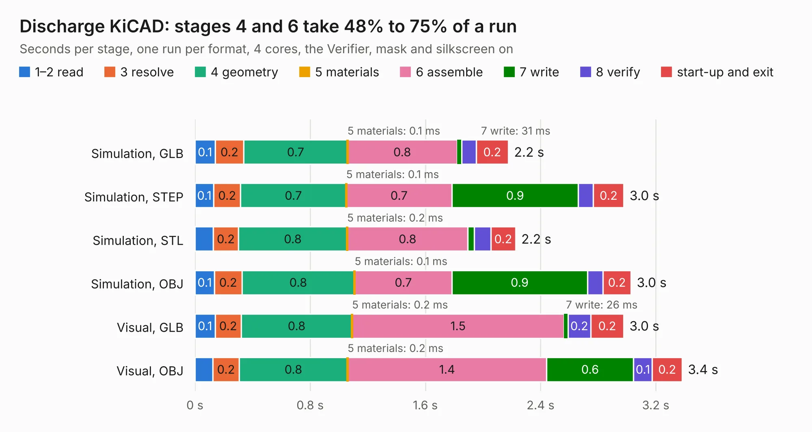

# 2921. Discharge KiCAD

Board 2,921 of the 3,103 of [Corpus Testing](../Corpus-Testing.md), on [Corpus Page 28](../CorpusTestingPages/Corpus-Testing-28.md#2921-discharge-kicad).

| Mode and format | 1–2 read | 3 resolve | 4 geometry | 5 materials | 6 assemble | 7 write | 8 verify | start-up and exit | Total |
|---|---:|---:|---:|---:|---:|---:|---:|---:|---:|
| Simulation, GLB | 0.1 | 0.2 | 0.7 | 0.1&nbsp;ms | 0.8 | 31&nbsp;ms | 0.1 | 0.2 | 2.2 |
| Simulation, STEP | 0.1 | 0.2 | 0.7 | 0.1&nbsp;ms | 0.7 | 0.9 | 0.1 | 0.2 | 3.0 |
| Simulation, STL | 0.1 | 0.2 | 0.8 | 0.2&nbsp;ms | 0.8 | 43&nbsp;ms | 0.1 | 0.2 | 2.2 |
| Simulation, OBJ | 0.1 | 0.2 | 0.8 | 0.1&nbsp;ms | 0.7 | 0.9 | 0.1 | 0.2 | 3.0 |
| Visual, GLB | 0.1 | 0.2 | 0.8 | 0.2&nbsp;ms | 1.5 | 26&nbsp;ms | 0.2 | 0.2 | 3.0 |
| Visual, OBJ | 0.1 | 0.2 | 0.8 | 0.2&nbsp;ms | 1.4 | 0.6 | 0.1 | 0.2 | 3.4 |

<table align="center"><tr><td valign="top">

| Board | Repo: [ucdfs/circuits](https://github.com/ucdfs/circuits) Board: `Discharge KiCAD.kicad_pcb` |
|---|---|
| Folder | Kieran Care package / Discharge_KR |
| Complexity | 194&nbsp;/&nbsp;1000 (size&nbsp;119, features&nbsp;75) |
| KESE&nbsp;features | custom pads, rounded, trapezoid or chamfered pads, copper drawings, curved board outline, stack-up, dielectric εr and tanδ |
| Tested | 9th November 2026 |
| Copper&nbsp;layers | 2 |
| File&nbsp;format | KiCad 9 (20241229) |
| Parts,&nbsp;tracks,&nbsp;vias | 16, 80, 0 |
| Triangles,&nbsp;simulation | 203,798 in 22 parts |
| Verifier | PASS in all six runs |

</td><td valign="top">

<table>
<tr><th>File type</th><th>File size</th><th>Peak memory used</th></tr>
<tr><th colspan="3" align="left">Simulation</th></tr>
<tr><td>GLB</td><td align="right">6.8&nbsp;MB</td><td align="right">214&nbsp;MB</td></tr>
<tr><td>STEP</td><td align="right">26&nbsp;MB</td><td align="right">228&nbsp;MB</td></tr>
<tr><td>STL</td><td align="right">10&nbsp;MB</td><td align="right">219&nbsp;MB</td></tr>
<tr><td>OBJ</td><td align="right">20&nbsp;MB</td><td align="right">212&nbsp;MB</td></tr>
<tr><th colspan="3" align="left">Visual</th></tr>
<tr><td>GLB</td><td align="right">4.4&nbsp;MB</td><td align="right">188&nbsp;MB</td></tr>
<tr><td>OBJ</td><td align="right">12&nbsp;MB</td><td align="right">192&nbsp;MB</td></tr>
</table>

</td></tr></table>

| Previous | Next |
|:---|---:|
| [2920. Charger_Shutdown_KR](b2920b_circuits_Charger-Shutdown-KR.md) | [2922. Cell Tap Fuse Board 2x](b2922b_circuits_Cell-Tap-Fuse-Board-2x.md) |
