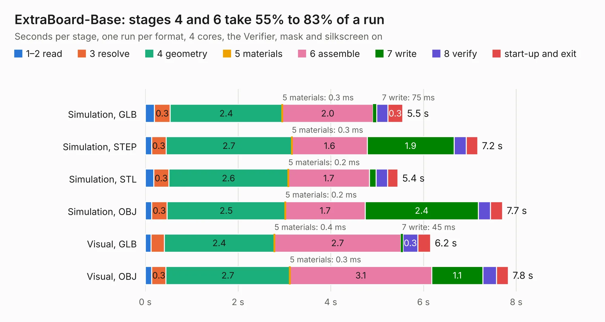

# 2924. ExtraBoard-Base

Board 2,924 of the 3,117 of [Corpus Testing](../Corpus-Testing.md), on [Corpus Page 28](../CorpusTestingPages/Corpus-Testing-28.md#2924-extraboard-base).

| Mode and format | 1–2 read | 3 resolve | 4 geometry | 5 materials | 6 assemble | 7 write | 8 verify | start-up and exit | Total |
|---|---:|---:|---:|---:|---:|---:|---:|---:|---:|
| Simulation, GLB | 0.2 | 0.3 | 2.4 | 0.3&nbsp;ms | 2.0 | 75&nbsp;ms | 0.2 | 0.3 | 5.5 |
| Simulation, STEP | 0.1 | 0.3 | 2.7 | 0.3&nbsp;ms | 1.6 | 1.9 | 0.3 | 0.2 | 7.2 |
| Simulation, STL | 0.2 | 0.3 | 2.6 | 0.2&nbsp;ms | 1.7 | 0.1 | 0.2 | 0.2 | 5.4 |
| Simulation, OBJ | 0.1 | 0.3 | 2.5 | 0.2&nbsp;ms | 1.7 | 2.4 | 0.3 | 0.3 | 7.7 |
| Visual, GLB | 0.1 | 0.3 | 2.4 | 0.4&nbsp;ms | 2.7 | 45&nbsp;ms | 0.3 | 0.3 | 6.2 |
| Visual, OBJ | 0.1 | 0.3 | 2.7 | 0.3&nbsp;ms | 3.1 | 1.1 | 0.3 | 0.3 | 7.8 |

<table align="center"><tr><td valign="top">

| Board | Repo: [tzarc/keyboards](https://github.com/tzarc/keyboards) Board: `ExtraBoard-Base.kicad_pcb` |
|---|---|
| Folder | Djinn / Rev2a / ExtraBoard-Base |
| Complexity | 74&nbsp;/&nbsp;1000 (size&nbsp;44, features&nbsp;30) |
| KESE&nbsp;features | filled zones, curved board outline |
| Tested | 10th November 2026 |
| Copper&nbsp;layers | 2 |
| File&nbsp;format | KiCad 5 (20171130) |
| Parts,&nbsp;tracks,&nbsp;vias | 11, 0, 0 |
| Triangles,&nbsp;simulation | 382,012 in 12 parts |
| Verifier | PASS in all six runs |

</td><td valign="top">

<table>
<tr><th>File type</th><th>File size</th><th>Peak memory used</th></tr>
<tr><th colspan="3" align="left">Simulation</th></tr>
<tr><td>GLB</td><td align="right">13&nbsp;MB</td><td align="right">249&nbsp;MB</td></tr>
<tr><td>STEP</td><td align="right">57&nbsp;MB</td><td align="right">272&nbsp;MB</td></tr>
<tr><td>STL</td><td align="right">19&nbsp;MB</td><td align="right">250&nbsp;MB</td></tr>
<tr><td>OBJ</td><td align="right">38&nbsp;MB</td><td align="right">283&nbsp;MB</td></tr>
<tr><th colspan="3" align="left">Visual</th></tr>
<tr><td>GLB</td><td align="right">6.2&nbsp;MB</td><td align="right">198&nbsp;MB</td></tr>
<tr><td>OBJ</td><td align="right">18&nbsp;MB</td><td align="right">216&nbsp;MB</td></tr>
</table>

</td></tr></table>

| Previous | Next |
|:---|---:|
| [2923. Djinn](b2923b_keyboards_Djinn-Rev2a_Djinn.md) | [2925. ExtraBoard-Plate](b2925b_keyboards_ExtraBoard-Plate.md) |
