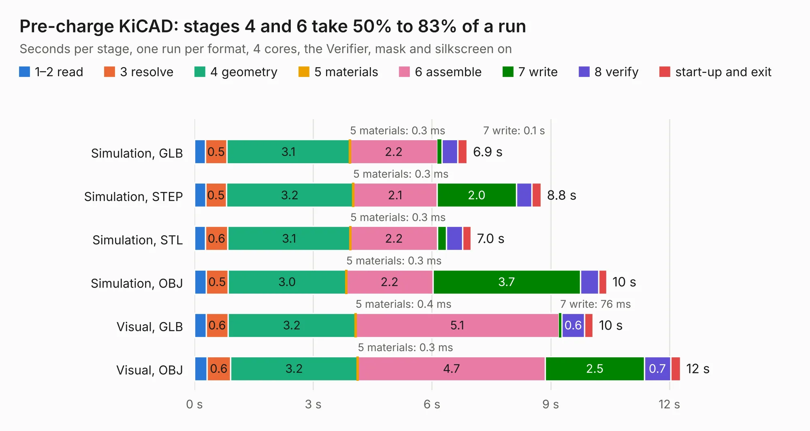

# 2926. Pre-charge KiCAD

Board 2,926 of the 3,101 of [Corpus Testing](../Corpus-Testing.md), on [Corpus Page 28](../CorpusTestingPages/Corpus-Testing-28.md#2926-pre-charge-kicad).

| Mode and format | 1–2 read | 3 resolve | 4 geometry | 5 materials | 6 assemble | 7 write | 8 verify | start-up and exit | Total |
|---|---:|---:|---:|---:|---:|---:|---:|---:|---:|
| Simulation, GLB | 0.3 | 0.5 | 3.1 | 0.3&nbsp;ms | 2.2 | 0.1 | 0.4 | 0.2 | 6.9 |
| Simulation, STEP | 0.3 | 0.5 | 3.2 | 0.3&nbsp;ms | 2.1 | 2.0 | 0.4 | 0.2 | 8.8 |
| Simulation, STL | 0.3 | 0.6 | 3.1 | 0.3&nbsp;ms | 2.2 | 0.2 | 0.4 | 0.2 | 7.0 |
| Simulation, OBJ | 0.3 | 0.5 | 3.0 | 0.3&nbsp;ms | 2.2 | 3.7 | 0.5 | 0.2 | 10.4 |
| Visual, GLB | 0.3 | 0.6 | 3.2 | 0.4&nbsp;ms | 5.1 | 76&nbsp;ms | 0.6 | 0.2 | 10.1 |
| Visual, OBJ | 0.3 | 0.6 | 3.2 | 0.3&nbsp;ms | 4.7 | 2.5 | 0.7 | 0.3 | 12.3 |

<table align="center"><tr><td valign="top">

| Board | Repo: [ucdfs/circuits](https://github.com/ucdfs/circuits) Board: `Pre-charge KiCAD.kicad_pcb` |
|---|---|
| Folder | Kieran Care package / Pre-charge_KR |
| Complexity | 264&nbsp;/&nbsp;1000 (size&nbsp;154, features&nbsp;110) |
| KESE&nbsp;features | through vias, custom pads, rounded, trapezoid or chamfered pads, filled zones, copper drawings, curved board outline, stack-up, dielectric εr and tanδ |
| Tested | 9th November 2026 |
| Copper&nbsp;layers | 2 |
| File&nbsp;format | KiCad 9 (20241229) |
| Parts,&nbsp;tracks,&nbsp;vias | 51, 274, 13 |
| Triangles,&nbsp;simulation | 666,692 in 42 parts |
| Verifier | PASS in all six runs |

</td><td valign="top">

<table>
<tr><th>File type</th><th>File size</th><th>Peak memory used</th></tr>
<tr><th colspan="3" align="left">Simulation</th></tr>
<tr><td>GLB</td><td align="right">23&nbsp;MB</td><td align="right">359&nbsp;MB</td></tr>
<tr><td>STEP</td><td align="right">102&nbsp;MB</td><td align="right">419&nbsp;MB</td></tr>
<tr><td>STL</td><td align="right">33&nbsp;MB</td><td align="right">365&nbsp;MB</td></tr>
<tr><td>OBJ</td><td align="right">67&nbsp;MB</td><td align="right">478&nbsp;MB</td></tr>
<tr><th colspan="3" align="left">Visual</th></tr>
<tr><td>GLB</td><td align="right">15&nbsp;MB</td><td align="right">372&nbsp;MB</td></tr>
<tr><td>OBJ</td><td align="right">43&nbsp;MB</td><td align="right">443&nbsp;MB</td></tr>
</table>

</td></tr></table>

| Previous | Next |
|:---|---:|
| [2925. PDU_KR](b2925b_circuits_PDU-KR.md) | [2927. Breakout](b2927b_circuits_Breakout.md) |
