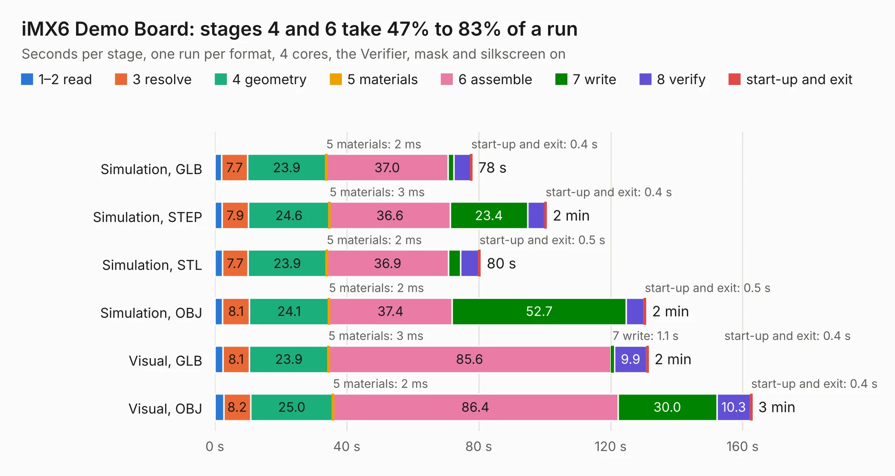

# 2926. iMX6 Demo Board

Board 2,926 of the 3,130 of [Corpus Testing](../Corpus-Testing.md), on [Corpus Page 28](../CorpusTestingPages/Corpus-Testing-28.md#2926-imx6-demo-board).

| Mode and format | 1–2 read | 3 resolve | 4 geometry | 5 materials | 6 assemble | 7 write | 8 verify | start-up and exit | Total |
|---|---:|---:|---:|---:|---:|---:|---:|---:|---:|
| Simulation, GLB | 2.1 | 7.7 | 23.9 | 2&nbsp;ms | 37.0 | 1.7 | 5.2 | 0.4 | 78.0 |
| Simulation, STEP | 2.2 | 7.9 | 24.6 | 3&nbsp;ms | 36.6 | 23.4 | 5.3 | 0.4 | 100.5 |
| Simulation, STL | 2.3 | 7.7 | 23.9 | 2&nbsp;ms | 36.9 | 3.6 | 5.5 | 0.5 | 80.5 |
| Simulation, OBJ | 2.4 | 8.1 | 24.1 | 2&nbsp;ms | 37.4 | 52.7 | 5.4 | 0.5 | 130.6 |
| Visual, GLB | 2.4 | 8.1 | 23.9 | 3&nbsp;ms | 85.6 | 1.1 | 9.9 | 0.4 | 131.3 |
| Visual, OBJ | 2.7 | 8.2 | 25.0 | 2&nbsp;ms | 86.4 | 30.0 | 10.3 | 0.4 | 162.8 |

<table align="center"><tr><td valign="top">

| Board | Repo: [ts-manuel/imx6-demo-board](https://github.com/ts-manuel/imx6-demo-board) Board: `iMX6 Demo Board.kicad_pcb` |
|---|---|
| Folder | kicad |
| Complexity | 511&nbsp;/&nbsp;1000 (size&nbsp;326, features&nbsp;185) |
| KESE&nbsp;features | through vias, slotted holes, custom pads, rounded, trapezoid or chamfered pads, arc tracks, filled zones, copper drawings, curved board outline, knockout text, TrueType text, stack-up, dielectric εr and tanδ, copper finish, mask and silkscreen colours |
| Tested | 9th November 2026 |
| Copper&nbsp;layers | 6 |
| File&nbsp;format | KiCad 9 (20241229) |
| Parts,&nbsp;tracks,&nbsp;vias | 458, 7,806, 973 |
| Triangles,&nbsp;simulation | 9,038,324 in 603 parts |
| Verifier | PASS in all six runs |

</td><td valign="top">

<table>
<tr><th>File type</th><th>File size</th><th>Peak memory used</th></tr>
<tr><th colspan="3" align="left">Simulation</th></tr>
<tr><td>GLB</td><td align="right">306&nbsp;MB</td><td align="right">2.4&nbsp;GB</td></tr>
<tr><td>STEP</td><td align="right">1.4&nbsp;GB</td><td align="right">3.2&nbsp;GB</td></tr>
<tr><td>STL</td><td align="right">452&nbsp;MB</td><td align="right">2.5&nbsp;GB</td></tr>
<tr><td>OBJ</td><td align="right">982&nbsp;MB</td><td align="right">5.7&nbsp;GB</td></tr>
<tr><th colspan="3" align="left">Visual</th></tr>
<tr><td>GLB</td><td align="right">179&nbsp;MB</td><td align="right">2.9&nbsp;GB</td></tr>
<tr><td>OBJ</td><td align="right">598&nbsp;MB</td><td align="right">3.7&nbsp;GB</td></tr>
</table>

</td></tr></table>

| Previous | Next |
|:---|---:|
| [2925. trezor_v1.1](b2925b_trezor-hardware_trezor-v1-1.md) | [2927. iMX6 Demo Board_from_REF](b2927b_imx6-demo-board_iMX6-Demo-Board-from-REF.md) |
