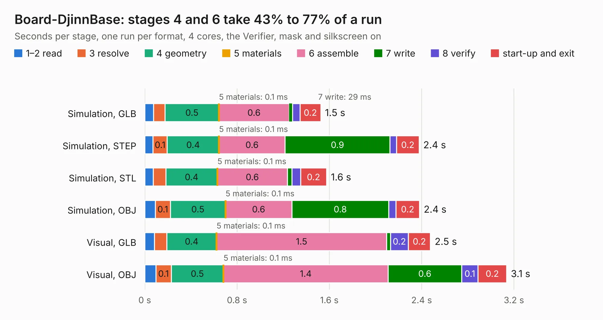

# 2928. Board-DjinnBase

Board 2,928 of the 3,125 of [Corpus Testing](../Corpus-Testing.md), on [Corpus Page 28](../CorpusTestingPages/Corpus-Testing-28.md#2928-board-djinnbase).

| Mode and format | 1–2 read | 3 resolve | 4 geometry | 5 materials | 6 assemble | 7 write | 8 verify | start-up and exit | Total |
|---|---:|---:|---:|---:|---:|---:|---:|---:|---:|
| Simulation, GLB | 76&nbsp;ms | 0.1 | 0.5 | 0.1&nbsp;ms | 0.6 | 29&nbsp;ms | 65&nbsp;ms | 0.2 | 1.5 |
| Simulation, STEP | 71&nbsp;ms | 0.1 | 0.4 | 0.1&nbsp;ms | 0.6 | 0.9 | 58&nbsp;ms | 0.2 | 2.4 |
| Simulation, STL | 73&nbsp;ms | 0.1 | 0.4 | 0.1&nbsp;ms | 0.6 | 41&nbsp;ms | 74&nbsp;ms | 0.2 | 1.6 |
| Simulation, OBJ | 92&nbsp;ms | 0.1 | 0.5 | 0.1&nbsp;ms | 0.6 | 0.8 | 61&nbsp;ms | 0.2 | 2.4 |
| Visual, GLB | 83&nbsp;ms | 0.1 | 0.4 | 0.1&nbsp;ms | 1.5 | 33&nbsp;ms | 0.2 | 0.2 | 2.5 |
| Visual, OBJ | 96&nbsp;ms | 0.1 | 0.5 | 0.1&nbsp;ms | 1.4 | 0.6 | 0.1 | 0.2 | 3.1 |

<table align="center"><tr><td valign="top">

| Board | Repo: [tzarc/keyboards](https://github.com/tzarc/keyboards) Board: `Board-DjinnBase.kicad_pcb` |
|---|---|
| Folder | Djinn / Rev1 / Board-DjinnBase |
| Complexity | 54&nbsp;/&nbsp;1000 (size&nbsp;24, features&nbsp;30) |
| KESE&nbsp;features | filled zones, curved board outline |
| Tested | 9th November 2026 |
| Copper&nbsp;layers | 2 |
| File&nbsp;format | KiCad 5 (20171130) |
| Parts,&nbsp;tracks,&nbsp;vias | 1, 0, 0 |
| Triangles,&nbsp;simulation | 177,144 in 12 parts |
| Verifier | PASS in all six runs |

</td><td valign="top">

<table>
<tr><th>File type</th><th>File size</th><th>Peak memory used</th></tr>
<tr><th colspan="3" align="left">Simulation</th></tr>
<tr><td>GLB</td><td align="right">5.9&nbsp;MB</td><td align="right">184&nbsp;MB</td></tr>
<tr><td>STEP</td><td align="right">29&nbsp;MB</td><td align="right">197&nbsp;MB</td></tr>
<tr><td>STL</td><td align="right">8.9&nbsp;MB</td><td align="right">187&nbsp;MB</td></tr>
<tr><td>OBJ</td><td align="right">17&nbsp;MB</td><td align="right">191&nbsp;MB</td></tr>
<tr><th colspan="3" align="left">Visual</th></tr>
<tr><td>GLB</td><td align="right">4.5&nbsp;MB</td><td align="right">139&nbsp;MB</td></tr>
<tr><td>OBJ</td><td align="right">13&nbsp;MB</td><td align="right">159&nbsp;MB</td></tr>
</table>

</td></tr></table>

| Previous | Next |
|:---|---:|
| [2927. user_interface](b2927b_rp2040-motor-controller_user-interface.md) | [2929. Board-DjinnPlate](b2929b_keyboards_Board-DjinnPlate.md) |
