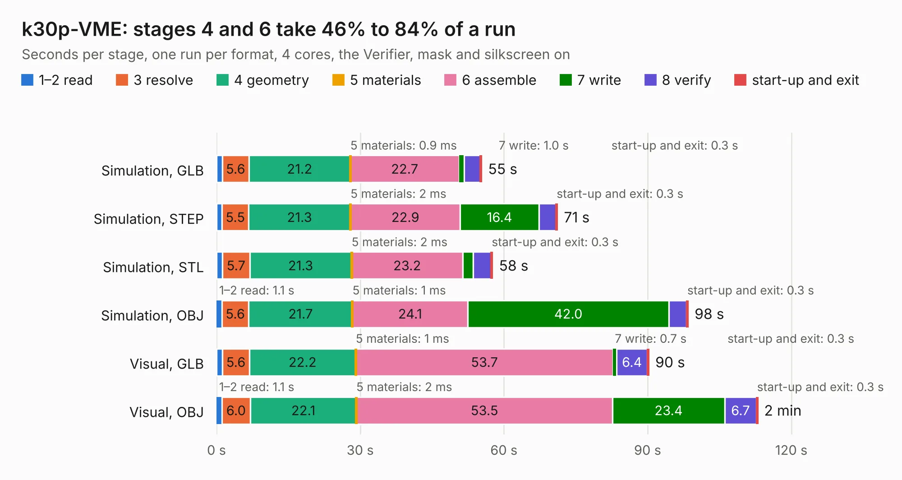

# 2929. k30p-VME

Board 2,929 of the 3,139 of [Corpus Testing](../Corpus-Testing.md), on [Corpus Page 28](../CorpusTestingPages/Corpus-Testing-28.md#2929-k30p-vme).

| Mode and format | 1–2 read | 3 resolve | 4 geometry | 5 materials | 6 assemble | 7 write | 8 verify | start-up and exit | Total |
|---|---:|---:|---:|---:|---:|---:|---:|---:|---:|
| Simulation, GLB | 1.2 | 5.6 | 21.2 | 0.9&nbsp;ms | 22.7 | 1.0 | 3.4 | 0.3 | 55.4 |
| Simulation, STEP | 1.2 | 5.5 | 21.3 | 2&nbsp;ms | 22.9 | 16.4 | 3.6 | 0.3 | 71.2 |
| Simulation, STL | 1.2 | 5.7 | 21.3 | 2&nbsp;ms | 23.2 | 2.2 | 3.7 | 0.3 | 57.6 |
| Simulation, OBJ | 1.1 | 5.6 | 21.7 | 1&nbsp;ms | 24.1 | 42.0 | 3.7 | 0.3 | 98.5 |
| Visual, GLB | 1.2 | 5.6 | 22.2 | 1&nbsp;ms | 53.7 | 0.7 | 6.4 | 0.3 | 90.3 |
| Visual, OBJ | 1.1 | 6.0 | 22.1 | 2&nbsp;ms | 53.5 | 23.4 | 6.7 | 0.3 | 113.0 |

<table align="center"><tr><td valign="top">

| Board | Repo: [transistorfet/retroverse](https://github.com/transistorfet/retroverse) Board: `k30p-VME.kicad_pcb` |
|---|---|
| Folder | components / computie-vme / hardware / k30p-VME |
| Complexity | 399&nbsp;/&nbsp;1000 (size&nbsp;289, features&nbsp;110) |
| KESE&nbsp;features | through vias, slotted holes, custom pads, rounded, trapezoid or chamfered pads, filled zones, copper drawings, stack-up, dielectric εr and tanδ |
| Tested | 10th November 2026 |
| Copper&nbsp;layers | 4 |
| File&nbsp;format | KiCad 8 (20240108) |
| Parts,&nbsp;tracks,&nbsp;vias | 105, 4,465, 823 |
| Triangles,&nbsp;simulation | 7,066,974 in 318 parts |
| Verifier | PASS in all six runs |

</td><td valign="top">

<table>
<tr><th>File type</th><th>File size</th><th>Peak memory used</th></tr>
<tr><th colspan="3" align="left">Simulation</th></tr>
<tr><td>GLB</td><td align="right">239&nbsp;MB</td><td align="right">1.8&nbsp;GB</td></tr>
<tr><td>STEP</td><td align="right">923&nbsp;MB</td><td align="right">2.4&nbsp;GB</td></tr>
<tr><td>STL</td><td align="right">353&nbsp;MB</td><td align="right">1.8&nbsp;GB</td></tr>
<tr><td>OBJ</td><td align="right">750&nbsp;MB</td><td align="right">4.5&nbsp;GB</td></tr>
<tr><th colspan="3" align="left">Visual</th></tr>
<tr><td>GLB</td><td align="right">145&nbsp;MB</td><td align="right">2.4&nbsp;GB</td></tr>
<tr><td>OBJ</td><td align="right">474&nbsp;MB</td><td align="right">3.1&nbsp;GB</td></tr>
</table>

</td></tr></table>

| Previous | Next |
|:---|---:|
| [2928. k30p-VME-Frontpanel](b2928b_retroverse_k30p-VME-Frontpanel.md) | [2930. MemBird - Woodcock](b2930b_retroverse_MemBird-Woodcock.md) |
