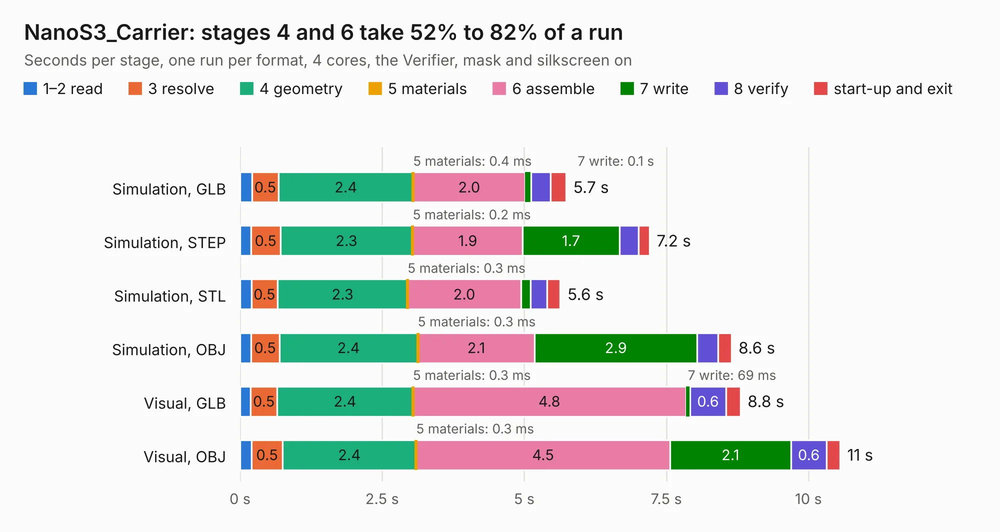

# 2931. NanoS3_Carrier

Board 2,931 of the 3,100 of [Corpus Testing](../Corpus-Testing.md), on [Corpus Page 28](../CorpusTestingPages/Corpus-Testing-28.md#2931-nanos3_carrier).

| Mode and format | 1–2 read | 3 resolve | 4 geometry | 5 materials | 6 assemble | 7 write | 8 verify | start-up and exit | Total |
|---|---:|---:|---:|---:|---:|---:|---:|---:|---:|
| Simulation, GLB | 0.2 | 0.5 | 2.4 | 0.4&nbsp;ms | 2.0 | 0.1 | 0.3 | 0.3 | 5.7 |
| Simulation, STEP | 0.2 | 0.5 | 2.3 | 0.2&nbsp;ms | 1.9 | 1.7 | 0.3 | 0.2 | 7.2 |
| Simulation, STL | 0.2 | 0.5 | 2.3 | 0.3&nbsp;ms | 2.0 | 0.2 | 0.3 | 0.2 | 5.6 |
| Simulation, OBJ | 0.2 | 0.5 | 2.4 | 0.3&nbsp;ms | 2.1 | 2.9 | 0.4 | 0.2 | 8.6 |
| Visual, GLB | 0.2 | 0.5 | 2.4 | 0.3&nbsp;ms | 4.8 | 69&nbsp;ms | 0.6 | 0.3 | 8.8 |
| Visual, OBJ | 0.2 | 0.5 | 2.4 | 0.3&nbsp;ms | 4.5 | 2.1 | 0.6 | 0.2 | 10.6 |

<table align="center"><tr><td valign="top">

| Board | Repo: [UnexpectedMaker/esp32s3](https://github.com/UnexpectedMaker/esp32s3) Board: `NanoS3_Carrier.kicad_pcb` |
|---|---|
| Folder | kicad / NanoS3 Carrier |
| Complexity | 267&nbsp;/&nbsp;1000 (size&nbsp;152, features&nbsp;115) |
| KESE&nbsp;features | through vias, slotted holes, custom pads, rounded, trapezoid or chamfered pads, filled zones, copper drawings, stack-up, dielectric εr and tanδ, mask and silkscreen colours |
| Tested | 9th November 2026 |
| Copper&nbsp;layers | 2 |
| File&nbsp;format | KiCad 7 (20221018) |
| Parts,&nbsp;tracks,&nbsp;vias | 20, 255, 83 |
| Triangles,&nbsp;simulation | 547,766 in 55 parts |
| Verifier | PASS in all six runs |

</td><td valign="top">

<table>
<tr><th>File type</th><th>File size</th><th>Peak memory used</th></tr>
<tr><th colspan="3" align="left">Simulation</th></tr>
<tr><td>GLB</td><td align="right">19&nbsp;MB</td><td align="right">306&nbsp;MB</td></tr>
<tr><td>STEP</td><td align="right">102&nbsp;MB</td><td align="right">347&nbsp;MB</td></tr>
<tr><td>STL</td><td align="right">27&nbsp;MB</td><td align="right">319&nbsp;MB</td></tr>
<tr><td>OBJ</td><td align="right">56&nbsp;MB</td><td align="right">427&nbsp;MB</td></tr>
<tr><th colspan="3" align="left">Visual</th></tr>
<tr><td>GLB</td><td align="right">14&nbsp;MB</td><td align="right">364&nbsp;MB</td></tr>
<tr><td>OBJ</td><td align="right">43&nbsp;MB</td><td align="right">382&nbsp;MB</td></tr>
</table>

</td></tr></table>

| Previous | Next |
|:---|---:|
| [2930. uECG_v4_52_lsm_tlv](b2930b_uECG-pcb_uECG-v4-52-lsm-tlv.md) | [2932. OMGS3_Carrier_R1](b2932b_esp32s3_OMGS3-Carrier-R1.md) |
