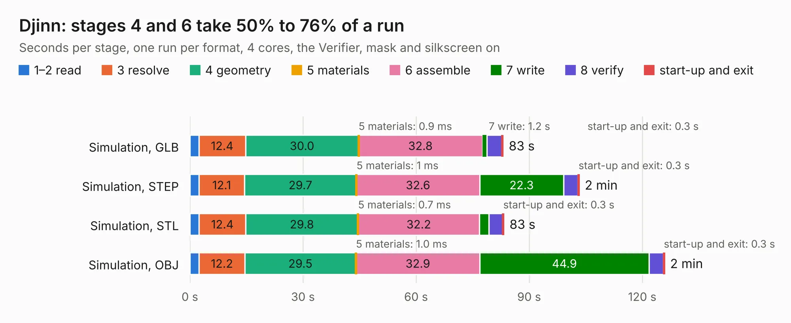

# 2933. Djinn

Board 2,933 of the 3,128 of [Corpus Testing](../Corpus-Testing.md), on [Corpus Page 28](../CorpusTestingPages/Corpus-Testing-28.md#2933-djinn).

| Mode and format | 1–2 read | 3 resolve | 4 geometry | 5 materials | 6 assemble | 7 write | 8 verify | start-up and exit | Total |
|---|---:|---:|---:|---:|---:|---:|---:|---:|---:|
| Simulation, GLB | 2.4 | 12.4 | 30.0 | 0.9&nbsp;ms | 32.8 | 1.2 | 4.0 | 0.3 | 83.1 |
| Simulation, STEP | 2.4 | 12.1 | 29.7 | 1&nbsp;ms | 32.6 | 22.3 | 3.8 | 0.3 | 103.3 |
| Simulation, STL | 2.4 | 12.4 | 29.8 | 0.7&nbsp;ms | 32.2 | 2.5 | 3.7 | 0.3 | 83.3 |
| Simulation, OBJ | 2.4 | 12.2 | 29.5 | 1.0&nbsp;ms | 32.9 | 44.9 | 3.8 | 0.3 | 125.9 |
| Visual, GLB | 2.4 | 12.0 | 30.4 | 2&nbsp;ms | 91.8 | 1.0 | 10.4 | 0.3 | 148.2 |
| Visual, OBJ | 2.4 | 12.1 | 29.9 | 0.7&nbsp;ms | 89.8 | 38.1 | 9.9 | 0.3 | 182.7 |

<table align="center"><tr><td valign="top">

| Board | Repo: [tzarc/keyboards](https://github.com/tzarc/keyboards) Board: `Djinn.kicad_pcb` |
|---|---|
| Folder | Djinn / Rev1 |
| Complexity | 345&nbsp;/&nbsp;1000 (size&nbsp;255, features&nbsp;90) |
| KESE&nbsp;features | through vias, slotted holes, custom pads, rounded, trapezoid or chamfered pads, filled zones, copper drawings, curved board outline |
| Tested | 9th November 2026 |
| Copper&nbsp;layers | 2 |
| File&nbsp;format | KiCad 5 (20171130) |
| Parts,&nbsp;tracks,&nbsp;vias | 230, 2,956, 630 |
| Triangles,&nbsp;simulation | 7,553,280 in 180 parts |
| Verifier | PASS in all six runs |

</td><td valign="top">

<table>
<tr><th>File type</th><th>File size</th><th>Peak memory used</th></tr>
<tr><th colspan="3" align="left">Simulation</th></tr>
<tr><td>GLB</td><td align="right">258&nbsp;MB</td><td align="right">2.7&nbsp;GB</td></tr>
<tr><td>STEP</td><td align="right">1.4&nbsp;GB</td><td align="right">3.1&nbsp;GB</td></tr>
<tr><td>STL</td><td align="right">378&nbsp;MB</td><td align="right">2.6&nbsp;GB</td></tr>
<tr><td>OBJ</td><td align="right">807&nbsp;MB</td><td align="right">4.8&nbsp;GB</td></tr>
<tr><th colspan="3" align="left">Visual</th></tr>
<tr><td>GLB</td><td align="right">234&nbsp;MB</td><td align="right">3.4&nbsp;GB</td></tr>
<tr><td>OBJ</td><td align="right">749&nbsp;MB</td><td align="right">4.5&nbsp;GB</td></tr>
</table>

</td></tr></table>

| Previous | Next |
|:---|---:|
| [2932. Board-DjinnPlate](b2932b_keyboards_Board-DjinnPlate.md) | [2934. Djinn](b2934b_keyboards_Djinn-Rev2a_Djinn.md) |
