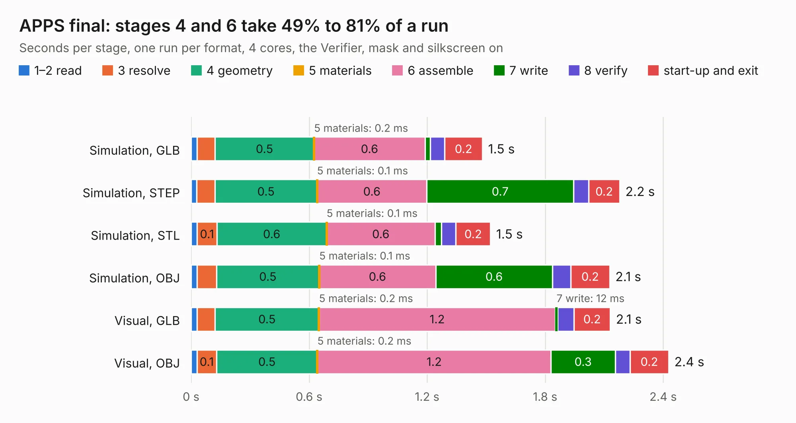

# 2934. APPS final

Board 2,934 of the 3,122 of [Corpus Testing](../Corpus-Testing.md), on [Corpus Page 28](../CorpusTestingPages/Corpus-Testing-28.md#2934-apps-final).

| Mode and format | 1–2 read | 3 resolve | 4 geometry | 5 materials | 6 assemble | 7 write | 8 verify | start-up and exit | Total |
|---|---:|---:|---:|---:|---:|---:|---:|---:|---:|
| Simulation, GLB | 30&nbsp;ms | 91&nbsp;ms | 0.5 | 0.2&nbsp;ms | 0.6 | 26&nbsp;ms | 74&nbsp;ms | 0.2 | 1.5 |
| Simulation, STEP | 28&nbsp;ms | 93&nbsp;ms | 0.5 | 0.1&nbsp;ms | 0.6 | 0.7 | 77&nbsp;ms | 0.2 | 2.2 |
| Simulation, STL | 31&nbsp;ms | 0.1 | 0.6 | 0.1&nbsp;ms | 0.6 | 33&nbsp;ms | 73&nbsp;ms | 0.2 | 1.5 |
| Simulation, OBJ | 30&nbsp;ms | 99&nbsp;ms | 0.5 | 0.1&nbsp;ms | 0.6 | 0.6 | 92&nbsp;ms | 0.2 | 2.1 |
| Visual, GLB | 30&nbsp;ms | 91&nbsp;ms | 0.5 | 0.2&nbsp;ms | 1.2 | 12&nbsp;ms | 82&nbsp;ms | 0.2 | 2.1 |
| Visual, OBJ | 30&nbsp;ms | 0.1 | 0.5 | 0.2&nbsp;ms | 1.2 | 0.3 | 74&nbsp;ms | 0.2 | 2.4 |

<table align="center"><tr><td valign="top">

| Board | Repo: [ucdfs/circuits](https://github.com/ucdfs/circuits) Board: `APPS final.kicad_pcb` |
|---|---|
| Folder | APPS_KR |
| Complexity | 169&nbsp;/&nbsp;1000 (size&nbsp;99, features&nbsp;70) |
| KESE&nbsp;features | rounded, trapezoid or chamfered pads, filled zones, curved board outline, stack-up, dielectric εr and tanδ |
| Tested | 9th November 2026 |
| Copper&nbsp;layers | 2 |
| File&nbsp;format | KiCad 8 (20240108) |
| Parts,&nbsp;tracks,&nbsp;vias | 12, 26, 0 |
| Triangles,&nbsp;simulation | 151,248 in 19 parts |
| Verifier | PASS in all six runs |

</td><td valign="top">

<table>
<tr><th>File type</th><th>File size</th><th>Peak memory used</th></tr>
<tr><th colspan="3" align="left">Simulation</th></tr>
<tr><td>GLB</td><td align="right">5.2&nbsp;MB</td><td align="right">182&nbsp;MB</td></tr>
<tr><td>STEP</td><td align="right">24&nbsp;MB</td><td align="right">184&nbsp;MB</td></tr>
<tr><td>STL</td><td align="right">7.6&nbsp;MB</td><td align="right">182&nbsp;MB</td></tr>
<tr><td>OBJ</td><td align="right">15&nbsp;MB</td><td align="right">180&nbsp;MB</td></tr>
<tr><th colspan="3" align="left">Visual</th></tr>
<tr><td>GLB</td><td align="right">2.8&nbsp;MB</td><td align="right">139&nbsp;MB</td></tr>
<tr><td>OBJ</td><td align="right">7.9&nbsp;MB</td><td align="right">140&nbsp;MB</td></tr>
</table>

</td></tr></table>

| Previous | Next |
|:---|---:|
| [2933. Kobold](b2933b_keyboards_Kobold.md) | [2935. Battery Temperature Sensor](b2935b_circuits_Battery-Temperature-Sensor.md) |
