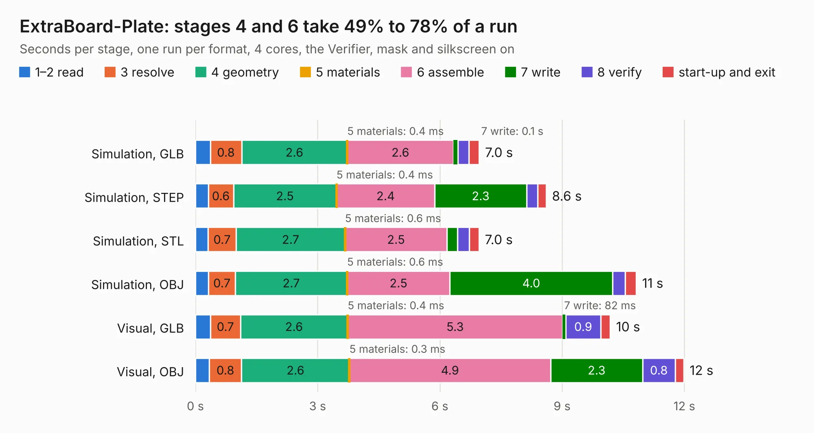

# 2934. ExtraBoard-Plate

Board 2,934 of the 3,126 of [Corpus Testing](../Corpus-Testing.md), on [Corpus Page 28](../CorpusTestingPages/Corpus-Testing-28.md#2934-extraboard-plate).

| Mode and format | 1–2 read | 3 resolve | 4 geometry | 5 materials | 6 assemble | 7 write | 8 verify | start-up and exit | Total |
|---|---:|---:|---:|---:|---:|---:|---:|---:|---:|
| Simulation, GLB | 0.4 | 0.8 | 2.6 | 0.4&nbsp;ms | 2.6 | 0.1 | 0.3 | 0.3 | 7.0 |
| Simulation, STEP | 0.3 | 0.6 | 2.5 | 0.4&nbsp;ms | 2.4 | 2.3 | 0.3 | 0.2 | 8.6 |
| Simulation, STL | 0.3 | 0.7 | 2.7 | 0.6&nbsp;ms | 2.5 | 0.3 | 0.3 | 0.2 | 7.0 |
| Simulation, OBJ | 0.3 | 0.7 | 2.7 | 0.6&nbsp;ms | 2.5 | 4.0 | 0.3 | 0.3 | 10.8 |
| Visual, GLB | 0.4 | 0.7 | 2.6 | 0.4&nbsp;ms | 5.3 | 82&nbsp;ms | 0.9 | 0.2 | 10.2 |
| Visual, OBJ | 0.3 | 0.8 | 2.6 | 0.3&nbsp;ms | 4.9 | 2.3 | 0.8 | 0.2 | 12.0 |

<table align="center"><tr><td valign="top">

| Board | Repo: [tzarc/keyboards](https://github.com/tzarc/keyboards) Board: `ExtraBoard-Plate.kicad_pcb` |
|---|---|
| Folder | Djinn / Rev2a / ExtraBoard-Plate |
| Complexity | 85&nbsp;/&nbsp;1000 (size&nbsp;45, features&nbsp;40) |
| KESE&nbsp;features | slotted holes, filled zones, curved board outline |
| Tested | 9th November 2026 |
| Copper&nbsp;layers | 2 |
| File&nbsp;format | KiCad 5 (20171130) |
| Parts,&nbsp;tracks,&nbsp;vias | 13, 0, 0 |
| Triangles,&nbsp;simulation | 743,632 in 12 parts |
| Verifier | PASS in all six runs |

</td><td valign="top">

<table>
<tr><th>File type</th><th>File size</th><th>Peak memory used</th></tr>
<tr><th colspan="3" align="left">Simulation</th></tr>
<tr><td>GLB</td><td align="right">25&nbsp;MB</td><td align="right">442&nbsp;MB</td></tr>
<tr><td>STEP</td><td align="right">141&nbsp;MB</td><td align="right">486&nbsp;MB</td></tr>
<tr><td>STL</td><td align="right">37&nbsp;MB</td><td align="right">445&nbsp;MB</td></tr>
<tr><td>OBJ</td><td align="right">75&nbsp;MB</td><td align="right">560&nbsp;MB</td></tr>
<tr><th colspan="3" align="left">Visual</th></tr>
<tr><td>GLB</td><td align="right">17&nbsp;MB</td><td align="right">432&nbsp;MB</td></tr>
<tr><td>OBJ</td><td align="right">50&nbsp;MB</td><td align="right">432&nbsp;MB</td></tr>
</table>

</td></tr></table>

| Previous | Next |
|:---|---:|
| [2933. ExtraBoard-Base](b2933b_keyboards_ExtraBoard-Base.md) | [2935. ghoul](b2935b_keyboards_ghoul.md) |
