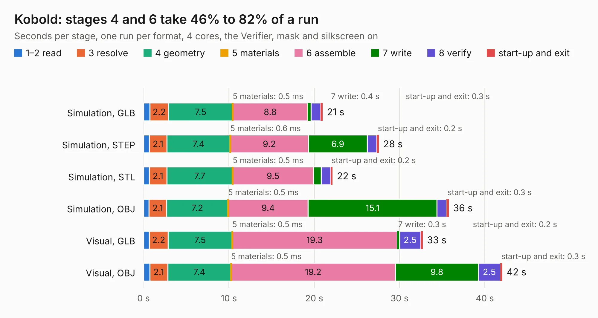

# 2935. Kobold

Board 2,935 of the 3,124 of [Corpus Testing](../Corpus-Testing.md), on [Corpus Page 28](../CorpusTestingPages/Corpus-Testing-28.md#2935-kobold).

| Mode and format | 1–2 read | 3 resolve | 4 geometry | 5 materials | 6 assemble | 7 write | 8 verify | start-up and exit | Total |
|---|---:|---:|---:|---:|---:|---:|---:|---:|---:|
| Simulation, GLB | 0.7 | 2.2 | 7.5 | 0.5&nbsp;ms | 8.8 | 0.4 | 1.1 | 0.3 | 21.0 |
| Simulation, STEP | 0.7 | 2.1 | 7.4 | 0.6&nbsp;ms | 9.2 | 6.9 | 1.1 | 0.2 | 27.6 |
| Simulation, STL | 0.7 | 2.1 | 7.7 | 0.5&nbsp;ms | 9.5 | 0.9 | 1.1 | 0.2 | 22.2 |
| Simulation, OBJ | 0.6 | 2.1 | 7.2 | 0.5&nbsp;ms | 9.4 | 15.1 | 1.1 | 0.3 | 35.8 |
| Visual, GLB | 0.7 | 2.2 | 7.5 | 0.5&nbsp;ms | 19.3 | 0.3 | 2.5 | 0.2 | 32.7 |
| Visual, OBJ | 0.7 | 2.1 | 7.4 | 0.5&nbsp;ms | 19.2 | 9.8 | 2.5 | 0.3 | 42.1 |

<table align="center"><tr><td valign="top">

| Board | Repo: [tzarc/keyboards](https://github.com/tzarc/keyboards) Board: `Kobold.kicad_pcb` |
|---|---|
| Folder | Kobold / R1 |
| Complexity | 339&nbsp;/&nbsp;1000 (size&nbsp;244, features&nbsp;95) |
| KESE&nbsp;features | through vias, slotted holes, rounded, trapezoid or chamfered pads, filled zones, curved board outline, stack-up, dielectric εr and tanδ |
| Tested | 9th November 2026 |
| Copper&nbsp;layers | 4 |
| File&nbsp;format | KiCad 9 (20241229) |
| Parts,&nbsp;tracks,&nbsp;vias | 95, 971, 220 |
| Triangles,&nbsp;simulation | 2,671,456 in 99 parts |
| Verifier | PASS in all six runs |

</td><td valign="top">

<table>
<tr><th>File type</th><th>File size</th><th>Peak memory used</th></tr>
<tr><th colspan="3" align="left">Simulation</th></tr>
<tr><td>GLB</td><td align="right">92&nbsp;MB</td><td align="right">904&nbsp;MB</td></tr>
<tr><td>STEP</td><td align="right">424&nbsp;MB</td><td align="right">1.1&nbsp;GB</td></tr>
<tr><td>STL</td><td align="right">134&nbsp;MB</td><td align="right">861&nbsp;MB</td></tr>
<tr><td>OBJ</td><td align="right">282&nbsp;MB</td><td align="right">1.7&nbsp;GB</td></tr>
<tr><th colspan="3" align="left">Visual</th></tr>
<tr><td>GLB</td><td align="right">59&nbsp;MB</td><td align="right">1.0&nbsp;GB</td></tr>
<tr><td>OBJ</td><td align="right">183&nbsp;MB</td><td align="right">1.2&nbsp;GB</td></tr>
</table>

</td></tr></table>

| Previous | Next |
|:---|---:|
| [2934. half-plate](b2934b_keyboards_half-plate.md) | [2936. APPS final](b2936b_circuits_APPS-final.md) |
