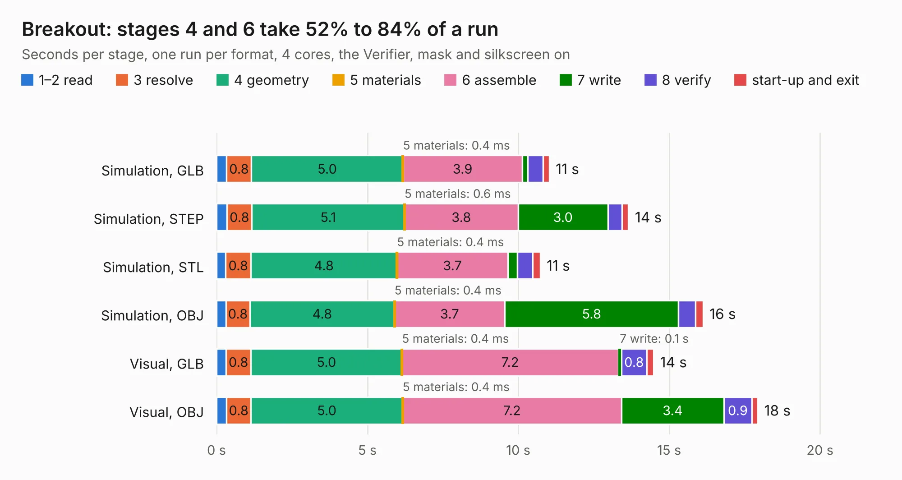

# 2936. Breakout

Board 2,936 of the 3,110 of [Corpus Testing](../Corpus-Testing.md), on [Corpus Page 28](../CorpusTestingPages/Corpus-Testing-28.md#2936-breakout).

| Mode and format | 1–2 read | 3 resolve | 4 geometry | 5 materials | 6 assemble | 7 write | 8 verify | start-up and exit | Total |
|---|---:|---:|---:|---:|---:|---:|---:|---:|---:|
| Simulation, GLB | 0.3 | 0.8 | 5.0 | 0.4&nbsp;ms | 3.9 | 0.2 | 0.5 | 0.2 | 11.0 |
| Simulation, STEP | 0.3 | 0.8 | 5.1 | 0.6&nbsp;ms | 3.8 | 3.0 | 0.5 | 0.2 | 13.7 |
| Simulation, STL | 0.3 | 0.8 | 4.8 | 0.4&nbsp;ms | 3.7 | 0.3 | 0.5 | 0.2 | 10.7 |
| Simulation, OBJ | 0.3 | 0.8 | 4.8 | 0.4&nbsp;ms | 3.7 | 5.8 | 0.6 | 0.2 | 16.1 |
| Visual, GLB | 0.3 | 0.8 | 5.0 | 0.4&nbsp;ms | 7.2 | 0.1 | 0.8 | 0.2 | 14.5 |
| Visual, OBJ | 0.3 | 0.8 | 5.0 | 0.4&nbsp;ms | 7.2 | 3.4 | 0.9 | 0.2 | 17.9 |

<table align="center"><tr><td valign="top">

| Board | Repo: [ucdfs/circuits](https://github.com/ucdfs/circuits) Board: `Breakout.kicad_pcb` |
|---|---|
| Folder | Kieran Care package / Teensy 4.1 Breakout Board |
| Complexity | 235&nbsp;/&nbsp;1000 (size&nbsp;150, features&nbsp;85) |
| KESE&nbsp;features | through vias, rounded, trapezoid or chamfered pads, filled zones, curved board outline, stack-up, dielectric εr and tanδ |
| Tested | 9th November 2026 |
| Copper&nbsp;layers | 2 |
| File&nbsp;format | KiCad 9 (20241229) |
| Parts,&nbsp;tracks,&nbsp;vias | 53, 218, 6 |
| Triangles,&nbsp;simulation | 1,096,444 in 107 parts |
| Verifier | PASS in all six runs |

</td><td valign="top">

<table>
<tr><th>File type</th><th>File size</th><th>Peak memory used</th></tr>
<tr><th colspan="3" align="left">Simulation</th></tr>
<tr><td>GLB</td><td align="right">37&nbsp;MB</td><td align="right">507&nbsp;MB</td></tr>
<tr><td>STEP</td><td align="right">155&nbsp;MB</td><td align="right">559&nbsp;MB</td></tr>
<tr><td>STL</td><td align="right">55&nbsp;MB</td><td align="right">481&nbsp;MB</td></tr>
<tr><td>OBJ</td><td align="right">110&nbsp;MB</td><td align="right">747&nbsp;MB</td></tr>
<tr><th colspan="3" align="left">Visual</th></tr>
<tr><td>GLB</td><td align="right">22&nbsp;MB</td><td align="right">521&nbsp;MB</td></tr>
<tr><td>OBJ</td><td align="right">67&nbsp;MB</td><td align="right">590&nbsp;MB</td></tr>
</table>

</td></tr></table>

| Previous | Next |
|:---|---:|
| [2935. Pre-charge KiCAD](b2935b_circuits_Pre-charge-KiCAD.md) | [2937. Voltage_Measurement_KR](b2937b_circuits_Voltage-Measurement-KR.md) |
