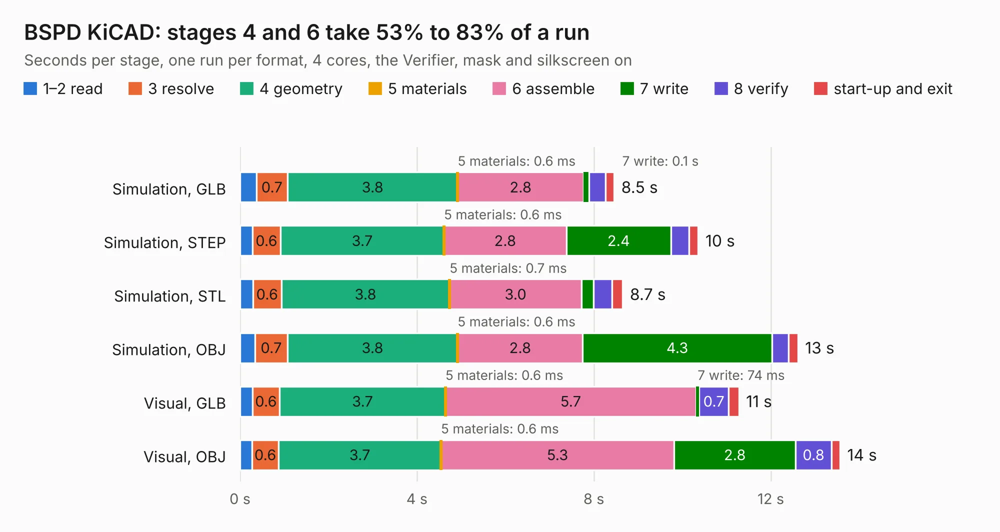

# 2937. BSPD KiCAD

Board 2,937 of the 3,121 of [Corpus Testing](../Corpus-Testing.md), on [Corpus Page 28](../CorpusTestingPages/Corpus-Testing-28.md#2937-bspd-kicad).

| Mode and format | 1–2 read | 3 resolve | 4 geometry | 5 materials | 6 assemble | 7 write | 8 verify | start-up and exit | Total |
|---|---:|---:|---:|---:|---:|---:|---:|---:|---:|
| Simulation, GLB | 0.4 | 0.7 | 3.8 | 0.6&nbsp;ms | 2.8 | 0.1 | 0.4 | 0.2 | 8.5 |
| Simulation, STEP | 0.3 | 0.6 | 3.7 | 0.6&nbsp;ms | 2.8 | 2.4 | 0.4 | 0.2 | 10.4 |
| Simulation, STL | 0.3 | 0.6 | 3.8 | 0.7&nbsp;ms | 3.0 | 0.3 | 0.4 | 0.2 | 8.7 |
| Simulation, OBJ | 0.3 | 0.7 | 3.8 | 0.6&nbsp;ms | 2.8 | 4.3 | 0.4 | 0.2 | 12.6 |
| Visual, GLB | 0.3 | 0.6 | 3.7 | 0.6&nbsp;ms | 5.7 | 74&nbsp;ms | 0.7 | 0.2 | 11.3 |
| Visual, OBJ | 0.3 | 0.6 | 3.7 | 0.6&nbsp;ms | 5.3 | 2.8 | 0.8 | 0.2 | 13.6 |

<table align="center"><tr><td valign="top">

| Board | Repo: [ucdfs/circuits](https://github.com/ucdfs/circuits) Board: `BSPD KiCAD.kicad_pcb` |
|---|---|
| Folder | Kieran Care package / BSPD_KR |
| Complexity | 239&nbsp;/&nbsp;1000 (size&nbsp;154, features&nbsp;85) |
| KESE&nbsp;features | through vias, rounded, trapezoid or chamfered pads, filled zones, curved board outline, stack-up, dielectric εr and tanδ |
| Tested | 9th November 2026 |
| Copper&nbsp;layers | 2 |
| File&nbsp;format | KiCad 9 (20241229) |
| Parts,&nbsp;tracks,&nbsp;vias | 59, 276, 5 |
| Triangles,&nbsp;simulation | 878,990 in 47 parts |
| Verifier | PASS in all six runs |

</td><td valign="top">

<table>
<tr><th>File type</th><th>File size</th><th>Peak memory used</th></tr>
<tr><th colspan="3" align="left">Simulation</th></tr>
<tr><td>GLB</td><td align="right">30&nbsp;MB</td><td align="right">434&nbsp;MB</td></tr>
<tr><td>STEP</td><td align="right">125&nbsp;MB</td><td align="right">503&nbsp;MB</td></tr>
<tr><td>STL</td><td align="right">44&nbsp;MB</td><td align="right">434&nbsp;MB</td></tr>
<tr><td>OBJ</td><td align="right">88&nbsp;MB</td><td align="right">625&nbsp;MB</td></tr>
<tr><th colspan="3" align="left">Visual</th></tr>
<tr><td>GLB</td><td align="right">18&nbsp;MB</td><td align="right">534&nbsp;MB</td></tr>
<tr><td>OBJ</td><td align="right">55&nbsp;MB</td><td align="right">456&nbsp;MB</td></tr>
</table>

</td></tr></table>

| Previous | Next |
|:---|---:|
| [2936. (LVE)Shutdown](b2936b_circuits_LVE-Shutdown.md) | [2938. Charger_Shutdown_KR](b2938b_circuits_Charger-Shutdown-KR.md) |
