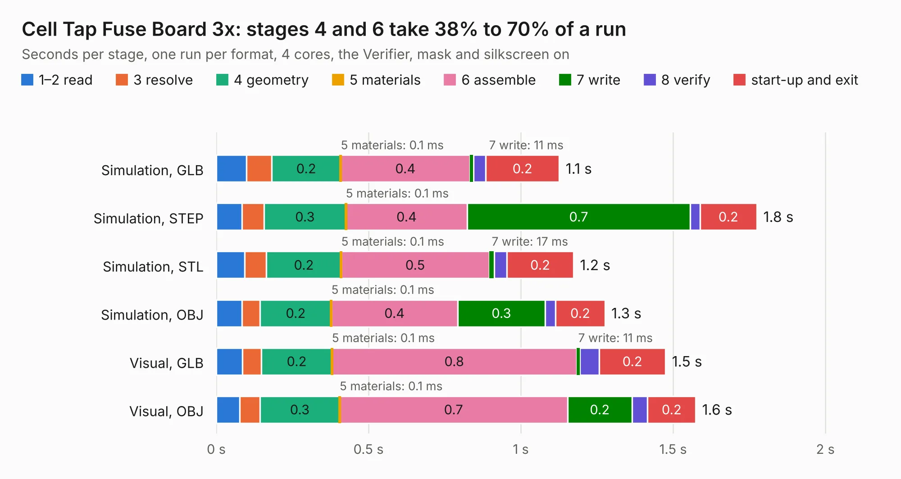

# 2939. Cell Tap Fuse Board 3x

Board 2,939 of the 3,119 of [Corpus Testing](../Corpus-Testing.md), on [Corpus Page 28](../CorpusTestingPages/Corpus-Testing-28.md#2939-cell-tap-fuse-board-3x).

| Mode and format | 1–2 read | 3 resolve | 4 geometry | 5 materials | 6 assemble | 7 write | 8 verify | start-up and exit | Total |
|---|---:|---:|---:|---:|---:|---:|---:|---:|---:|
| Simulation, GLB | 99&nbsp;ms | 83&nbsp;ms | 0.2 | 0.1&nbsp;ms | 0.4 | 11&nbsp;ms | 40&nbsp;ms | 0.2 | 1.1 |
| Simulation, STEP | 84&nbsp;ms | 73&nbsp;ms | 0.3 | 0.1&nbsp;ms | 0.4 | 0.7 | 32&nbsp;ms | 0.2 | 1.8 |
| Simulation, STL | 93&nbsp;ms | 72&nbsp;ms | 0.2 | 0.1&nbsp;ms | 0.5 | 17&nbsp;ms | 41&nbsp;ms | 0.2 | 1.2 |
| Simulation, OBJ | 84&nbsp;ms | 60&nbsp;ms | 0.2 | 0.1&nbsp;ms | 0.4 | 0.3 | 34&nbsp;ms | 0.2 | 1.3 |
| Visual, GLB | 86&nbsp;ms | 62&nbsp;ms | 0.2 | 0.1&nbsp;ms | 0.8 | 11&nbsp;ms | 63&nbsp;ms | 0.2 | 1.5 |
| Visual, OBJ | 77&nbsp;ms | 66&nbsp;ms | 0.3 | 0.1&nbsp;ms | 0.7 | 0.2 | 51&nbsp;ms | 0.2 | 1.6 |

<table align="center"><tr><td valign="top">

| Board | Repo: [ucdfs/circuits](https://github.com/ucdfs/circuits) Board: `Cell Tap Fuse Board 3x.kicad_pcb` |
|---|---|
| Folder | Kieran Care package / ENNOID_BMS - Cell Tap Fuse Board 3x |
| Complexity | 131&nbsp;/&nbsp;1000 (size&nbsp;81, features&nbsp;50) |
| KESE&nbsp;features | rounded, trapezoid or chamfered pads, curved board outline, stack-up, dielectric εr and tanδ |
| Tested | 9th November 2026 |
| Copper&nbsp;layers | 2 |
| File&nbsp;format | KiCad 9 (20241229) |
| Parts,&nbsp;tracks,&nbsp;vias | 4, 16, 0 |
| Triangles,&nbsp;simulation | 69,248 in 16 parts |
| Verifier | PASS in all six runs |

</td><td valign="top">

<table>
<tr><th>File type</th><th>File size</th><th>Peak memory used</th></tr>
<tr><th colspan="3" align="left">Simulation</th></tr>
<tr><td>GLB</td><td align="right">2.2&nbsp;MB</td><td align="right">171&nbsp;MB</td></tr>
<tr><td>STEP</td><td align="right">9.5&nbsp;MB</td><td align="right">173&nbsp;MB</td></tr>
<tr><td>STL</td><td align="right">3.5&nbsp;MB</td><td align="right">170&nbsp;MB</td></tr>
<tr><td>OBJ</td><td align="right">6.6&nbsp;MB</td><td align="right">170&nbsp;MB</td></tr>
<tr><th colspan="3" align="left">Visual</th></tr>
<tr><td>GLB</td><td align="right">1.5&nbsp;MB</td><td align="right">151&nbsp;MB</td></tr>
<tr><td>OBJ</td><td align="right">4.2&nbsp;MB</td><td align="right">150&nbsp;MB</td></tr>
</table>

</td></tr></table>

| Previous | Next |
|:---|---:|
| [2938. Cell Tap Fuse Board 2x](b2938b_circuits_Cell-Tap-Fuse-Board-2x.md) | [2940. BMS-Master](b2940b_circuits_BMS-Master.md) |
