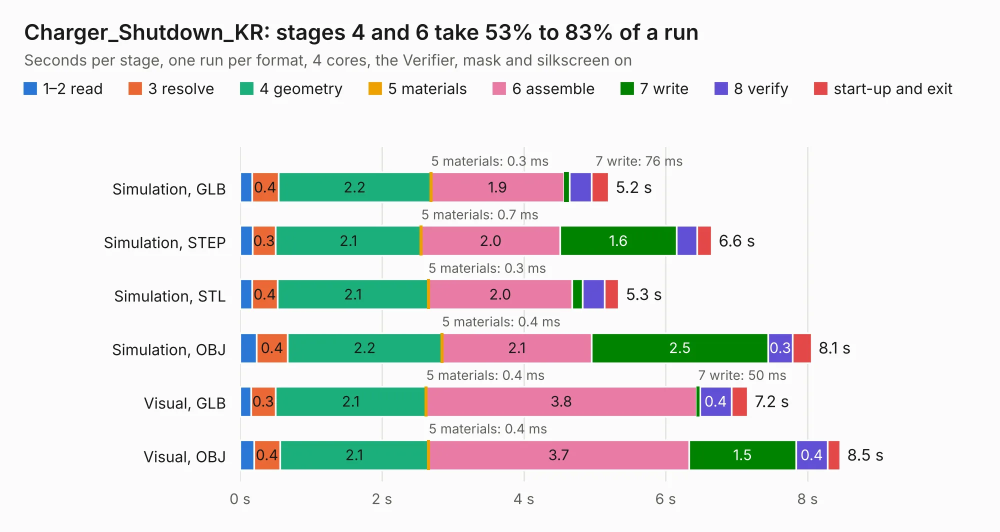

# 2940. Charger_Shutdown_KR

Board 2,940 of the 3,123 of [Corpus Testing](../Corpus-Testing.md), on [Corpus Page 28](../CorpusTestingPages/Corpus-Testing-28.md#2940-charger_shutdown_kr).

| Mode and format | 1–2 read | 3 resolve | 4 geometry | 5 materials | 6 assemble | 7 write | 8 verify | start-up and exit | Total |
|---|---:|---:|---:|---:|---:|---:|---:|---:|---:|
| Simulation, GLB | 0.2 | 0.4 | 2.2 | 0.3&nbsp;ms | 1.9 | 76&nbsp;ms | 0.3 | 0.2 | 5.2 |
| Simulation, STEP | 0.2 | 0.3 | 2.1 | 0.7&nbsp;ms | 2.0 | 1.6 | 0.3 | 0.2 | 6.6 |
| Simulation, STL | 0.2 | 0.4 | 2.1 | 0.3&nbsp;ms | 2.0 | 0.1 | 0.3 | 0.2 | 5.3 |
| Simulation, OBJ | 0.2 | 0.4 | 2.2 | 0.4&nbsp;ms | 2.1 | 2.5 | 0.3 | 0.3 | 8.1 |
| Visual, GLB | 0.2 | 0.3 | 2.1 | 0.4&nbsp;ms | 3.8 | 50&nbsp;ms | 0.4 | 0.2 | 7.2 |
| Visual, OBJ | 0.2 | 0.4 | 2.1 | 0.4&nbsp;ms | 3.7 | 1.5 | 0.4 | 0.2 | 8.5 |

<table align="center"><tr><td valign="top">

| Board | Repo: [ucdfs/circuits](https://github.com/ucdfs/circuits) Board: `Charger_Shutdown_KR.kicad_pcb` |
|---|---|
| Folder | Kieran Care package / Charger_Shutdown_KR |
| Complexity | 232&nbsp;/&nbsp;1000 (size&nbsp;147, features&nbsp;85) |
| KESE&nbsp;features | through vias, rounded, trapezoid or chamfered pads, filled zones, curved board outline, stack-up, dielectric εr and tanδ |
| Tested | 9th November 2026 |
| Copper&nbsp;layers | 2 |
| File&nbsp;format | KiCad 8 (20240108) |
| Parts,&nbsp;tracks,&nbsp;vias | 41, 209, 10 |
| Triangles,&nbsp;simulation | 524,408 in 45 parts |
| Verifier | PASS in all six runs |

</td><td valign="top">

<table>
<tr><th>File type</th><th>File size</th><th>Peak memory used</th></tr>
<tr><th colspan="3" align="left">Simulation</th></tr>
<tr><td>GLB</td><td align="right">17&nbsp;MB</td><td align="right">318&nbsp;MB</td></tr>
<tr><td>STEP</td><td align="right">77&nbsp;MB</td><td align="right">361&nbsp;MB</td></tr>
<tr><td>STL</td><td align="right">26&nbsp;MB</td><td align="right">307&nbsp;MB</td></tr>
<tr><td>OBJ</td><td align="right">52&nbsp;MB</td><td align="right">389&nbsp;MB</td></tr>
<tr><th colspan="3" align="left">Visual</th></tr>
<tr><td>GLB</td><td align="right">11&nbsp;MB</td><td align="right">343&nbsp;MB</td></tr>
<tr><td>OBJ</td><td align="right">33&nbsp;MB</td><td align="right">351&nbsp;MB</td></tr>
</table>

</td></tr></table>

| Previous | Next |
|:---|---:|
| [2939. BSPD KiCAD](b2939b_circuits_BSPD-KiCAD.md) | [2941. Discharge KiCAD](b2941b_circuits_Discharge-KiCAD.md) |
