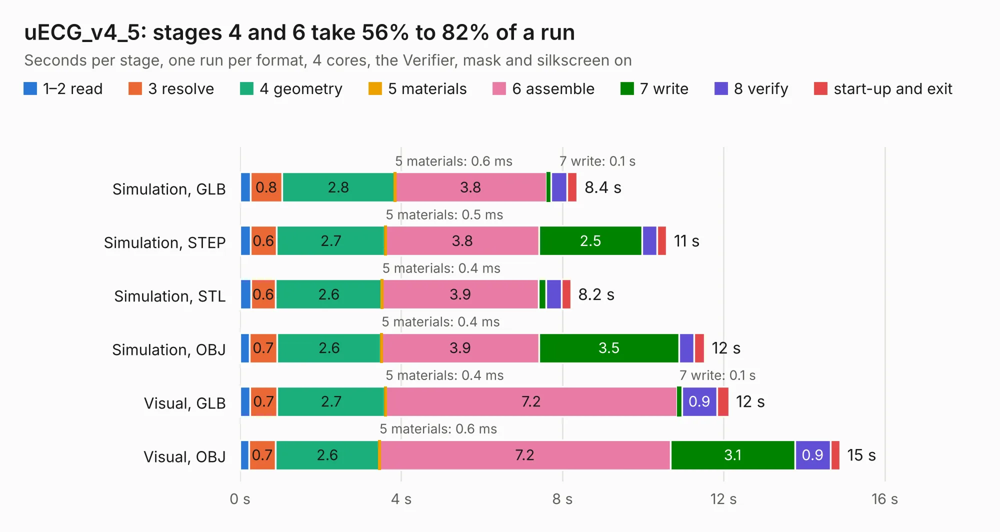

# 2941. uECG_v4_5

Board 2,941 of the 3,112 of [Corpus Testing](../Corpus-Testing.md), on [Corpus Page 28](../CorpusTestingPages/Corpus-Testing-28.md#2941-uecg_v4_5).

| Mode and format | 1–2 read | 3 resolve | 4 geometry | 5 materials | 6 assemble | 7 write | 8 verify | start-up and exit | Total |
|---|---:|---:|---:|---:|---:|---:|---:|---:|---:|
| Simulation, GLB | 0.3 | 0.8 | 2.8 | 0.6&nbsp;ms | 3.8 | 0.1 | 0.4 | 0.3 | 8.4 |
| Simulation, STEP | 0.3 | 0.6 | 2.7 | 0.5&nbsp;ms | 3.8 | 2.5 | 0.4 | 0.2 | 10.6 |
| Simulation, STL | 0.3 | 0.6 | 2.6 | 0.4&nbsp;ms | 3.9 | 0.2 | 0.4 | 0.2 | 8.2 |
| Simulation, OBJ | 0.2 | 0.7 | 2.6 | 0.4&nbsp;ms | 3.9 | 3.5 | 0.4 | 0.3 | 11.5 |
| Visual, GLB | 0.2 | 0.7 | 2.7 | 0.4&nbsp;ms | 7.2 | 0.1 | 0.9 | 0.3 | 12.1 |
| Visual, OBJ | 0.2 | 0.7 | 2.6 | 0.6&nbsp;ms | 7.2 | 3.1 | 0.9 | 0.2 | 14.9 |

<table align="center"><tr><td valign="top">

| Board | Repo: [ultimaterobotics/uECG_pcb](https://github.com/ultimaterobotics/uECG_pcb) Board: `uECG_v4_5.kicad_pcb` |
|---|---|
| Folder | uECG_v4_5 |
| Complexity | 273&nbsp;/&nbsp;1000 (size&nbsp;218, features&nbsp;55) |
| KESE&nbsp;features | through vias, rounded, trapezoid or chamfered pads, filled zones, curved board outline |
| Tested | 9th November 2026 |
| Copper&nbsp;layers | 2 |
| File&nbsp;format | KiCad 5 (20171130) |
| Parts,&nbsp;tracks,&nbsp;vias | 67, 730, 138 |
| Triangles,&nbsp;simulation | 725,870 in 100 parts |
| Verifier | PASS in all six runs |

</td><td valign="top">

<table>
<tr><th>File type</th><th>File size</th><th>Peak memory used</th></tr>
<tr><th colspan="3" align="left">Simulation</th></tr>
<tr><td>GLB</td><td align="right">25&nbsp;MB</td><td align="right">389&nbsp;MB</td></tr>
<tr><td>STEP</td><td align="right">126&nbsp;MB</td><td align="right">492&nbsp;MB</td></tr>
<tr><td>STL</td><td align="right">36&nbsp;MB</td><td align="right">388&nbsp;MB</td></tr>
<tr><td>OBJ</td><td align="right">73&nbsp;MB</td><td align="right">541&nbsp;MB</td></tr>
<tr><th colspan="3" align="left">Visual</th></tr>
<tr><td>GLB</td><td align="right">23&nbsp;MB</td><td align="right">568&nbsp;MB</td></tr>
<tr><td>OBJ</td><td align="right">68&nbsp;MB</td><td align="right">571&nbsp;MB</td></tr>
</table>

</td></tr></table>

| Previous | Next |
|:---|---:|
| [2940. flightcontroller](b2940b_flightcontroller_flightcontroller.md) | [2942. uECG_v4_52_lsm_tlv](b2942b_uECG-pcb_uECG-v4-52-lsm-tlv.md) |
