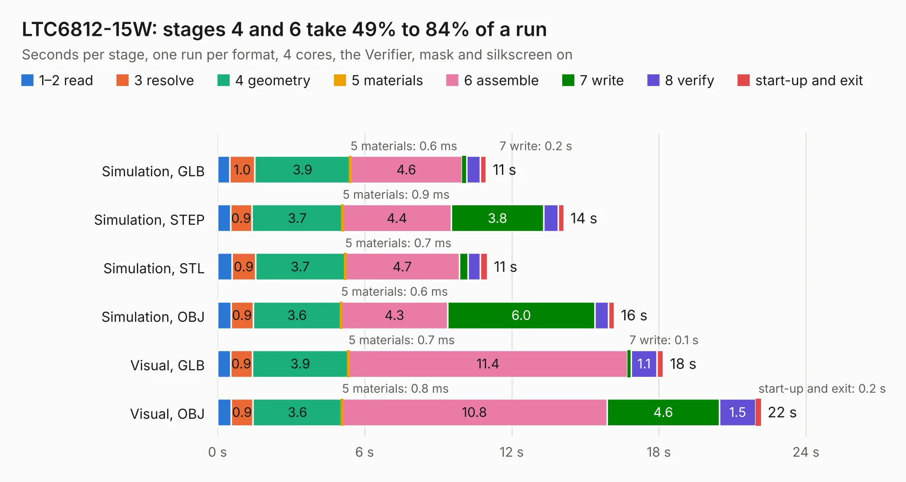

# 2942. LTC6812-15W

Board 2,942 of the 3,128 of [Corpus Testing](../Corpus-Testing.md), on [Corpus Page 28](../CorpusTestingPages/Corpus-Testing-28.md#2942-ltc6812-15w).

| Mode and format | 1–2 read | 3 resolve | 4 geometry | 5 materials | 6 assemble | 7 write | 8 verify | start-up and exit | Total |
|---|---:|---:|---:|---:|---:|---:|---:|---:|---:|
| Simulation, GLB | 0.5 | 1.0 | 3.9 | 0.6&nbsp;ms | 4.6 | 0.2 | 0.5 | 0.3 | 11.0 |
| Simulation, STEP | 0.5 | 0.9 | 3.7 | 0.9&nbsp;ms | 4.4 | 3.8 | 0.6 | 0.2 | 14.1 |
| Simulation, STL | 0.6 | 0.9 | 3.7 | 0.7&nbsp;ms | 4.7 | 0.4 | 0.5 | 0.3 | 11.0 |
| Simulation, OBJ | 0.5 | 0.9 | 3.6 | 0.6&nbsp;ms | 4.3 | 6.0 | 0.6 | 0.2 | 16.2 |
| Visual, GLB | 0.5 | 0.9 | 3.9 | 0.7&nbsp;ms | 11.4 | 0.1 | 1.1 | 0.3 | 18.2 |
| Visual, OBJ | 0.6 | 0.9 | 3.6 | 0.8&nbsp;ms | 10.8 | 4.6 | 1.5 | 0.2 | 22.2 |

<table align="center"><tr><td valign="top">

| Board | Repo: [ucdfs/circuits](https://github.com/ucdfs/circuits) Board: `LTC6812-15W.kicad_pcb` |
|---|---|
| Folder | ENNOID_BMS / Slave |
| Complexity | 324&nbsp;/&nbsp;1000 (size&nbsp;244, features&nbsp;80) |
| KESE&nbsp;features | through vias, rounded, trapezoid or chamfered pads, arc tracks, curved board outline, stack-up, dielectric εr and tanδ |
| Tested | 9th November 2026 |
| Copper&nbsp;layers | 2 |
| File&nbsp;format | KiCad 9 (20241229) |
| Parts,&nbsp;tracks,&nbsp;vias | 246, 1,418, 64 |
| Triangles,&nbsp;simulation | 1,120,794 in 280 parts |
| Verifier | PASS in all six runs |

</td><td valign="top">

<table>
<tr><th>File type</th><th>File size</th><th>Peak memory used</th></tr>
<tr><th colspan="3" align="left">Simulation</th></tr>
<tr><td>GLB</td><td align="right">38&nbsp;MB</td><td align="right">580&nbsp;MB</td></tr>
<tr><td>STEP</td><td align="right">189&nbsp;MB</td><td align="right">627&nbsp;MB</td></tr>
<tr><td>STL</td><td align="right">56&nbsp;MB</td><td align="right">565&nbsp;MB</td></tr>
<tr><td>OBJ</td><td align="right">113&nbsp;MB</td><td align="right">767&nbsp;MB</td></tr>
<tr><th colspan="3" align="left">Visual</th></tr>
<tr><td>GLB</td><td align="right">30&nbsp;MB</td><td align="right">835&nbsp;MB</td></tr>
<tr><td>OBJ</td><td align="right">92&nbsp;MB</td><td align="right">832&nbsp;MB</td></tr>
</table>

</td></tr></table>

| Previous | Next |
|:---|---:|
| [2941. Battery Temperature Sensor](b2941b_circuits_Battery-Temperature-Sensor.md) | [2943. (LVE)Shutdown](b2943b_circuits_LVE-Shutdown.md) |
