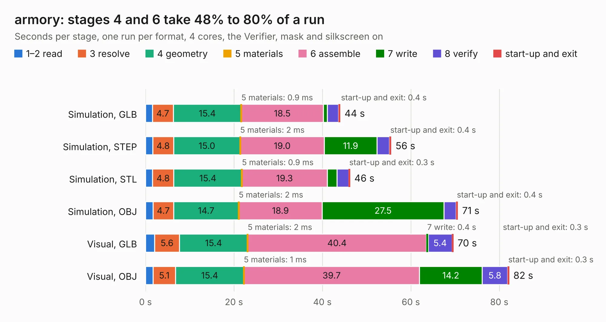

# 2943. armory

Board 2,943 of the 3,108 of [Corpus Testing](../Corpus-Testing.md), on [Corpus Page 28](../CorpusTestingPages/Corpus-Testing-28.md#2943-armory).

| Mode and format | 1–2 read | 3 resolve | 4 geometry | 5 materials | 6 assemble | 7 write | 8 verify | start-up and exit | Total |
|---|---:|---:|---:|---:|---:|---:|---:|---:|---:|
| Simulation, GLB | 1.5 | 4.7 | 15.4 | 0.9&nbsp;ms | 18.5 | 0.9 | 2.5 | 0.4 | 44.0 |
| Simulation, STEP | 1.6 | 4.8 | 15.0 | 2&nbsp;ms | 19.0 | 11.9 | 2.8 | 0.4 | 55.6 |
| Simulation, STL | 1.6 | 4.8 | 15.4 | 0.9&nbsp;ms | 19.3 | 2.2 | 2.6 | 0.3 | 46.2 |
| Simulation, OBJ | 1.7 | 4.7 | 14.7 | 2&nbsp;ms | 18.9 | 27.5 | 2.7 | 0.4 | 70.6 |
| Visual, GLB | 2.1 | 5.6 | 15.4 | 2&nbsp;ms | 40.4 | 0.4 | 5.4 | 0.3 | 69.6 |
| Visual, OBJ | 1.7 | 5.1 | 15.4 | 1&nbsp;ms | 39.7 | 14.2 | 5.8 | 0.3 | 82.2 |

<table align="center"><tr><td valign="top">

| Board | Repo: [usbarmory/usbarmory](https://github.com/usbarmory/usbarmory) Board: `armory.kicad_pcb` |
|---|---|
| Folder | hardware / mark-two-beta |
| Complexity | 400&nbsp;/&nbsp;1000 (size&nbsp;320, features&nbsp;80) |
| KESE&nbsp;features | through vias, slotted holes, custom pads, rounded, trapezoid or chamfered pads, filled zones, curved board outline |
| Tested | 9th November 2026 |
| Copper&nbsp;layers | 6 |
| File&nbsp;format | KiCad 5 (20171130) |
| Parts,&nbsp;tracks,&nbsp;vias | 180, 18,286, 423 |
| Triangles,&nbsp;simulation | 5,129,354 in 434 parts |
| Verifier | PASS in all six runs |

</td><td valign="top">

<table>
<tr><th>File type</th><th>File size</th><th>Peak memory used</th></tr>
<tr><th colspan="3" align="left">Simulation</th></tr>
<tr><td>GLB</td><td align="right">178&nbsp;MB</td><td align="right">1.5&nbsp;GB</td></tr>
<tr><td>STEP</td><td align="right">738&nbsp;MB</td><td align="right">1.8&nbsp;GB</td></tr>
<tr><td>STL</td><td align="right">257&nbsp;MB</td><td align="right">1.5&nbsp;GB</td></tr>
<tr><td>OBJ</td><td align="right">553&nbsp;MB</td><td align="right">3.3&nbsp;GB</td></tr>
<tr><th colspan="3" align="left">Visual</th></tr>
<tr><td>GLB</td><td align="right">94&nbsp;MB</td><td align="right">1.6&nbsp;GB</td></tr>
<tr><td>OBJ</td><td align="right">302&nbsp;MB</td><td align="right">2.0&nbsp;GB</td></tr>
</table>

</td></tr></table>

| Previous | Next |
|:---|---:|
| [2942. armory](b2942b_usbarmory_hardware-mark-one_armory.md) | [2944. accessory](b2944b_usbarmory_accessory.md) |
