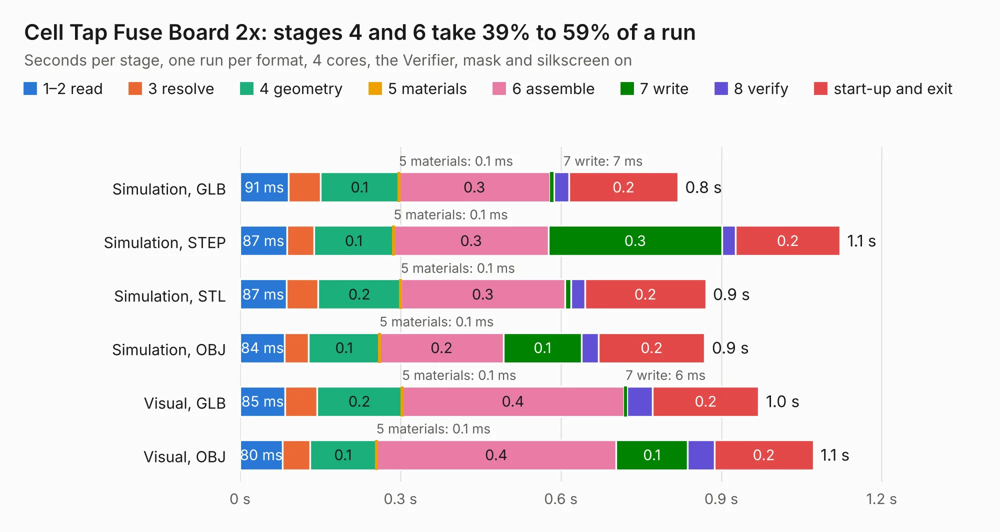

# 2944. Cell Tap Fuse Board 2x

Board 2,944 of the 3,125 of [Corpus Testing](../Corpus-Testing.md), on [Corpus Page 28](../CorpusTestingPages/Corpus-Testing-28.md#2944-cell-tap-fuse-board-2x).

| Mode and format | 1–2 read | 3 resolve | 4 geometry | 5 materials | 6 assemble | 7 write | 8 verify | start-up and exit | Total |
|---|---:|---:|---:|---:|---:|---:|---:|---:|---:|
| Simulation, GLB | 91&nbsp;ms | 60&nbsp;ms | 0.1 | 0.1&nbsp;ms | 0.3 | 7&nbsp;ms | 29&nbsp;ms | 0.2 | 0.8 |
| Simulation, STEP | 87&nbsp;ms | 51&nbsp;ms | 0.1 | 0.1&nbsp;ms | 0.3 | 0.3 | 26&nbsp;ms | 0.2 | 1.1 |
| Simulation, STL | 87&nbsp;ms | 59&nbsp;ms | 0.2 | 0.1&nbsp;ms | 0.3 | 12&nbsp;ms | 26&nbsp;ms | 0.2 | 0.9 |
| Simulation, OBJ | 84&nbsp;ms | 45&nbsp;ms | 0.1 | 0.1&nbsp;ms | 0.2 | 0.1 | 32&nbsp;ms | 0.2 | 0.9 |
| Visual, GLB | 85&nbsp;ms | 59&nbsp;ms | 0.2 | 0.1&nbsp;ms | 0.4 | 6&nbsp;ms | 48&nbsp;ms | 0.2 | 1.0 |
| Visual, OBJ | 80&nbsp;ms | 51&nbsp;ms | 0.1 | 0.1&nbsp;ms | 0.4 | 0.1 | 50&nbsp;ms | 0.2 | 1.1 |

<table align="center"><tr><td valign="top">

| Board | Repo: [ucdfs/circuits](https://github.com/ucdfs/circuits) Board: `Cell Tap Fuse Board 2x.kicad_pcb` |
|---|---|
| Folder | Kieran Care package / ENNOID_BMS - Cell Tap Fuse Board 2x |
| Complexity | 115&nbsp;/&nbsp;1000 (size&nbsp;65, features&nbsp;50) |
| KESE&nbsp;features | rounded, trapezoid or chamfered pads, curved board outline, stack-up, dielectric εr and tanδ |
| Tested | 9th November 2026 |
| Copper&nbsp;layers | 2 |
| File&nbsp;format | KiCad 9 (20241229) |
| Parts,&nbsp;tracks,&nbsp;vias | 2, 8, 0 |
| Triangles,&nbsp;simulation | 41,276 in 13 parts |
| Verifier | PASS in all six runs |

</td><td valign="top">

<table>
<tr><th>File type</th><th>File size</th><th>Peak memory used</th></tr>
<tr><th colspan="3" align="left">Simulation</th></tr>
<tr><td>GLB</td><td align="right">1.4&nbsp;MB</td><td align="right">68&nbsp;MB</td></tr>
<tr><td>STEP</td><td align="right">6.3&nbsp;MB</td><td align="right">73&nbsp;MB</td></tr>
<tr><td>STL</td><td align="right">2.1&nbsp;MB</td><td align="right">68&nbsp;MB</td></tr>
<tr><td>OBJ</td><td align="right">3.9&nbsp;MB</td><td align="right">78&nbsp;MB</td></tr>
<tr><th colspan="3" align="left">Visual</th></tr>
<tr><td>GLB</td><td align="right">1.0&nbsp;MB</td><td align="right">103&nbsp;MB</td></tr>
<tr><td>OBJ</td><td align="right">2.7&nbsp;MB</td><td align="right">103&nbsp;MB</td></tr>
</table>

</td></tr></table>

| Previous | Next |
|:---|---:|
| [2943. Discharge KiCAD](b2943b_circuits_Discharge-KiCAD.md) | [2945. Cell Tap Fuse Board 3x](b2945b_circuits_Cell-Tap-Fuse-Board-3x.md) |
