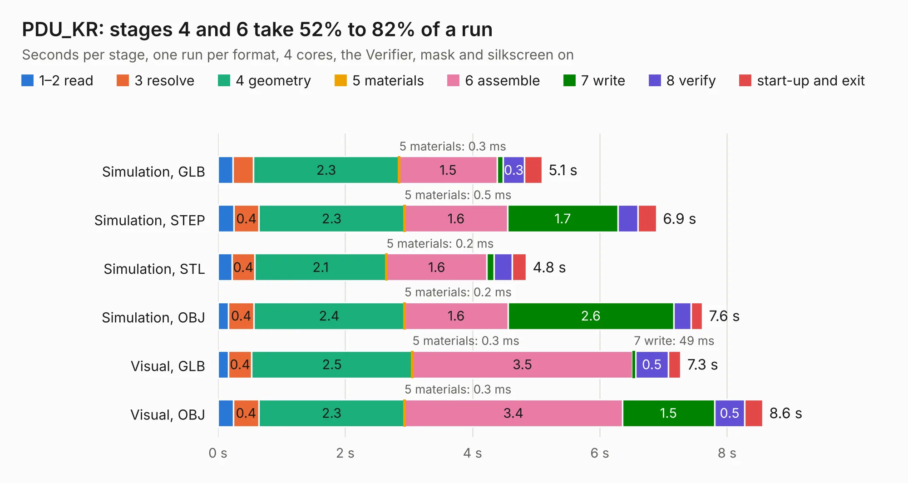

# 2945. PDU_KR

Board 2,945 of the 3,121 of [Corpus Testing](../Corpus-Testing.md), on [Corpus Page 28](../CorpusTestingPages/Corpus-Testing-28.md#2945-pdu_kr).

| Mode and format | 1–2 read | 3 resolve | 4 geometry | 5 materials | 6 assemble | 7 write | 8 verify | start-up and exit | Total |
|---|---:|---:|---:|---:|---:|---:|---:|---:|---:|
| Simulation, GLB | 0.2 | 0.3 | 2.3 | 0.3&nbsp;ms | 1.5 | 97&nbsp;ms | 0.3 | 0.3 | 5.1 |
| Simulation, STEP | 0.3 | 0.4 | 2.3 | 0.5&nbsp;ms | 1.6 | 1.7 | 0.3 | 0.3 | 6.9 |
| Simulation, STL | 0.2 | 0.4 | 2.1 | 0.2&nbsp;ms | 1.6 | 0.1 | 0.3 | 0.2 | 4.8 |
| Simulation, OBJ | 0.2 | 0.4 | 2.4 | 0.2&nbsp;ms | 1.6 | 2.6 | 0.3 | 0.2 | 7.6 |
| Visual, GLB | 0.2 | 0.4 | 2.5 | 0.3&nbsp;ms | 3.5 | 49&nbsp;ms | 0.5 | 0.2 | 7.3 |
| Visual, OBJ | 0.2 | 0.4 | 2.3 | 0.3&nbsp;ms | 3.4 | 1.5 | 0.5 | 0.3 | 8.6 |

<table align="center"><tr><td valign="top">

| Board | Repo: [ucdfs/circuits](https://github.com/ucdfs/circuits) Board: `PDU_KR.kicad_pcb` |
|---|---|
| Folder | Kieran Care package / PDU_KR |
| Complexity | 206&nbsp;/&nbsp;1000 (size&nbsp;136, features&nbsp;70) |
| KESE&nbsp;features | rounded, trapezoid or chamfered pads, filled zones, curved board outline, stack-up, dielectric εr and tanδ |
| Tested | 9th November 2026 |
| Copper&nbsp;layers | 2 |
| File&nbsp;format | KiCad 9 (20241229) |
| Parts,&nbsp;tracks,&nbsp;vias | 44, 114, 0 |
| Triangles,&nbsp;simulation | 502,746 in 34 parts |
| Verifier | PASS in all six runs |

</td><td valign="top">

<table>
<tr><th>File type</th><th>File size</th><th>Peak memory used</th></tr>
<tr><th colspan="3" align="left">Simulation</th></tr>
<tr><td>GLB</td><td align="right">17&nbsp;MB</td><td align="right">323&nbsp;MB</td></tr>
<tr><td>STEP</td><td align="right">87&nbsp;MB</td><td align="right">337&nbsp;MB</td></tr>
<tr><td>STL</td><td align="right">25&nbsp;MB</td><td align="right">296&nbsp;MB</td></tr>
<tr><td>OBJ</td><td align="right">51&nbsp;MB</td><td align="right">385&nbsp;MB</td></tr>
<tr><th colspan="3" align="left">Visual</th></tr>
<tr><td>GLB</td><td align="right">10&nbsp;MB</td><td align="right">326&nbsp;MB</td></tr>
<tr><td>OBJ</td><td align="right">30&nbsp;MB</td><td align="right">328&nbsp;MB</td></tr>
</table>

</td></tr></table>

| Previous | Next |
|:---|---:|
| [2944. TSAL](b2944b_circuits_TSAL.md) | [2946. Pre-charge KiCAD](b2946b_circuits_Pre-charge-KiCAD.md) |
