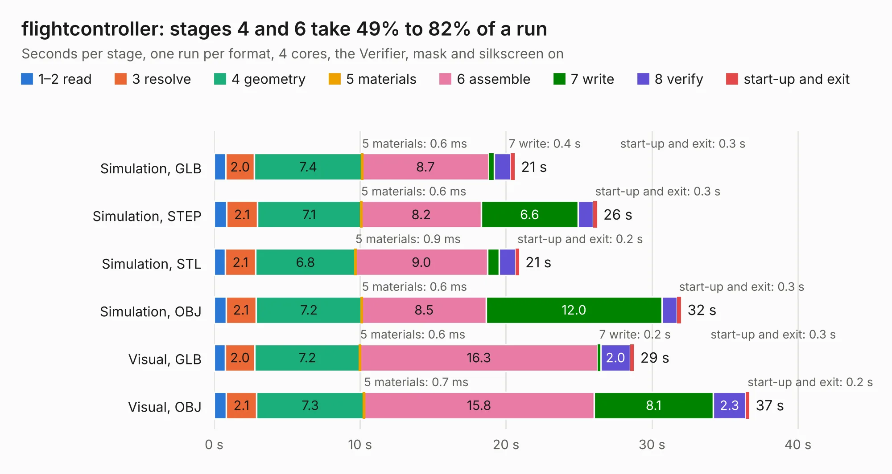

# 2946. flightcontroller

Board 2,946 of the 3,118 of [Corpus Testing](../Corpus-Testing.md), on [Corpus Page 28](../CorpusTestingPages/Corpus-Testing-28.md#2946-flightcontroller).

| Mode and format | 1–2 read | 3 resolve | 4 geometry | 5 materials | 6 assemble | 7 write | 8 verify | start-up and exit | Total |
|---|---:|---:|---:|---:|---:|---:|---:|---:|---:|
| Simulation, GLB | 0.8 | 2.0 | 7.4 | 0.6&nbsp;ms | 8.7 | 0.4 | 1.1 | 0.3 | 20.6 |
| Simulation, STEP | 0.9 | 2.1 | 7.1 | 0.6&nbsp;ms | 8.2 | 6.6 | 1.0 | 0.3 | 26.2 |
| Simulation, STL | 0.8 | 2.1 | 6.8 | 0.9&nbsp;ms | 9.0 | 0.8 | 1.1 | 0.2 | 20.9 |
| Simulation, OBJ | 0.8 | 2.1 | 7.2 | 0.6&nbsp;ms | 8.5 | 12.0 | 1.1 | 0.3 | 32.0 |
| Visual, GLB | 0.8 | 2.0 | 7.2 | 0.6&nbsp;ms | 16.3 | 0.2 | 2.0 | 0.3 | 28.8 |
| Visual, OBJ | 0.8 | 2.1 | 7.3 | 0.7&nbsp;ms | 15.8 | 8.1 | 2.3 | 0.2 | 36.7 |

<table align="center"><tr><td valign="top">

| Board | Repo: [ukinori/flightcontroller](https://github.com/ukinori/flightcontroller) Board: `flightcontroller.kicad_pcb` |
|---|---|
| Complexity | 348&nbsp;/&nbsp;1000 (size&nbsp;263, features&nbsp;85) |
| KESE&nbsp;features | through vias, slotted holes, rounded, trapezoid or chamfered pads, filled zones, stack-up, dielectric εr and tanδ |
| Tested | 9th November 2026 |
| Copper&nbsp;layers | 4 |
| File&nbsp;format | KiCad 10 (20260206) |
| Parts,&nbsp;tracks,&nbsp;vias | 129, 3,528, 249 |
| Triangles,&nbsp;simulation | 2,284,130 in 154 parts |
| Verifier | PASS in all six runs |

</td><td valign="top">

<table>
<tr><th>File type</th><th>File size</th><th>Peak memory used</th></tr>
<tr><th colspan="3" align="left">Simulation</th></tr>
<tr><td>GLB</td><td align="right">78&nbsp;MB</td><td align="right">807&nbsp;MB</td></tr>
<tr><td>STEP</td><td align="right">366&nbsp;MB</td><td align="right">1.0&nbsp;GB</td></tr>
<tr><td>STL</td><td align="right">114&nbsp;MB</td><td align="right">811&nbsp;MB</td></tr>
<tr><td>OBJ</td><td align="right">238&nbsp;MB</td><td align="right">1.5&nbsp;GB</td></tr>
<tr><th colspan="3" align="left">Visual</th></tr>
<tr><td>GLB</td><td align="right">52&nbsp;MB</td><td align="right">963&nbsp;MB</td></tr>
<tr><td>OBJ</td><td align="right">162&nbsp;MB</td><td align="right">1.1&nbsp;GB</td></tr>
</table>

</td></tr></table>

| Previous | Next |
|:---|---:|
| [2945. Voltage_Measurement_KR](b2945b_circuits_Voltage-Measurement-KR.md) | [2947. uECG_v4_5](b2947b_uECG-pcb_uECG-v4-5.md) |
