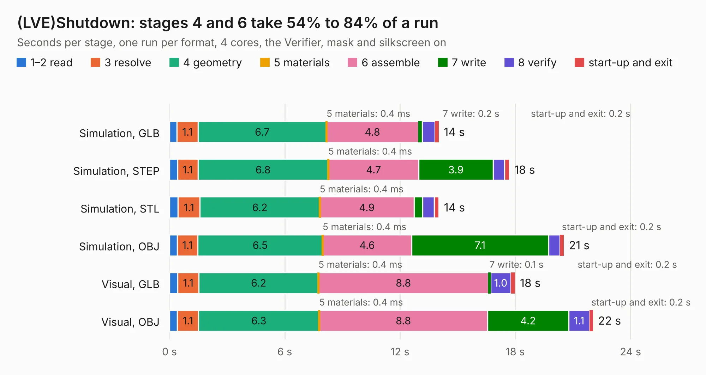

# 2947. (LVE)Shutdown

Board 2,947 of the 3,132 of [Corpus Testing](../Corpus-Testing.md), on [Corpus Page 28](../CorpusTestingPages/Corpus-Testing-28.md#2947-lveshutdown).

| Mode and format | 1–2 read | 3 resolve | 4 geometry | 5 materials | 6 assemble | 7 write | 8 verify | start-up and exit | Total |
|---|---:|---:|---:|---:|---:|---:|---:|---:|---:|
| Simulation, GLB | 0.4 | 1.1 | 6.7 | 0.4&nbsp;ms | 4.8 | 0.2 | 0.7 | 0.2 | 14.0 |
| Simulation, STEP | 0.4 | 1.1 | 6.8 | 0.4&nbsp;ms | 4.7 | 3.9 | 0.6 | 0.2 | 17.7 |
| Simulation, STL | 0.4 | 1.1 | 6.2 | 0.4&nbsp;ms | 4.9 | 0.4 | 0.6 | 0.2 | 14.0 |
| Simulation, OBJ | 0.4 | 1.1 | 6.5 | 0.4&nbsp;ms | 4.6 | 7.1 | 0.6 | 0.2 | 20.5 |
| Visual, GLB | 0.4 | 1.1 | 6.2 | 0.4&nbsp;ms | 8.8 | 0.1 | 1.0 | 0.2 | 18.0 |
| Visual, OBJ | 0.4 | 1.1 | 6.3 | 0.4&nbsp;ms | 8.8 | 4.2 | 1.1 | 0.2 | 22.0 |

<table align="center"><tr><td valign="top">

| Board | Repo: [ucdfs/circuits](https://github.com/ucdfs/circuits) Board: `(LVE)Shutdown.kicad_pcb` |
|---|---|
| Folder | Kieran Care package / (LVE)Shutdown_KR |
| Complexity | 253&nbsp;/&nbsp;1000 (size&nbsp;168, features&nbsp;85) |
| KESE&nbsp;features | through vias, rounded, trapezoid or chamfered pads, filled zones, curved board outline, stack-up, dielectric εr and tanδ |
| Tested | 9th November 2026 |
| Copper&nbsp;layers | 2 |
| File&nbsp;format | KiCad 9 (20241229) |
| Parts,&nbsp;tracks,&nbsp;vias | 114, 410, 11 |
| Triangles,&nbsp;simulation | 1,386,784 in 81 parts |
| Verifier | PASS in all six runs |

</td><td valign="top">

<table>
<tr><th>File type</th><th>File size</th><th>Peak memory used</th></tr>
<tr><th colspan="3" align="left">Simulation</th></tr>
<tr><td>GLB</td><td align="right">47&nbsp;MB</td><td align="right">599&nbsp;MB</td></tr>
<tr><td>STEP</td><td align="right">202&nbsp;MB</td><td align="right">693&nbsp;MB</td></tr>
<tr><td>STL</td><td align="right">69&nbsp;MB</td><td align="right">608&nbsp;MB</td></tr>
<tr><td>OBJ</td><td align="right">141&nbsp;MB</td><td align="right">965&nbsp;MB</td></tr>
<tr><th colspan="3" align="left">Visual</th></tr>
<tr><td>GLB</td><td align="right">29&nbsp;MB</td><td align="right">730&nbsp;MB</td></tr>
<tr><td>OBJ</td><td align="right">88&nbsp;MB</td><td align="right">728&nbsp;MB</td></tr>
</table>

</td></tr></table>

| Previous | Next |
|:---|---:|
| [2946. LTC6812-15W](b2946b_circuits_ENNOID-BMS-Slave_LTC6812-15W.md) | [2948. BSPD KiCAD](b2948b_circuits_BSPD-KiCAD.md) |
