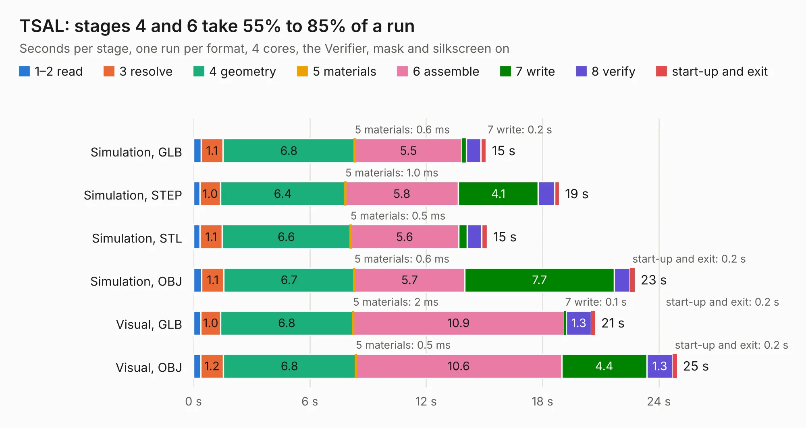

# 2947. TSAL

Board 2,947 of the 3,124 of [Corpus Testing](../Corpus-Testing.md), on [Corpus Page 28](../CorpusTestingPages/Corpus-Testing-28.md#2947-tsal).

| Mode and format | 1–2 read | 3 resolve | 4 geometry | 5 materials | 6 assemble | 7 write | 8 verify | start-up and exit | Total |
|---|---:|---:|---:|---:|---:|---:|---:|---:|---:|
| Simulation, GLB | 0.4 | 1.1 | 6.8 | 0.6&nbsp;ms | 5.5 | 0.2 | 0.7 | 0.3 | 15.1 |
| Simulation, STEP | 0.3 | 1.0 | 6.4 | 1.0&nbsp;ms | 5.8 | 4.1 | 0.8 | 0.3 | 18.9 |
| Simulation, STL | 0.3 | 1.1 | 6.6 | 0.5&nbsp;ms | 5.6 | 0.4 | 0.8 | 0.3 | 15.2 |
| Simulation, OBJ | 0.4 | 1.1 | 6.7 | 0.6&nbsp;ms | 5.7 | 7.7 | 0.8 | 0.2 | 22.8 |
| Visual, GLB | 0.4 | 1.0 | 6.8 | 2&nbsp;ms | 10.9 | 0.1 | 1.3 | 0.2 | 20.7 |
| Visual, OBJ | 0.4 | 1.2 | 6.8 | 0.5&nbsp;ms | 10.6 | 4.4 | 1.3 | 0.2 | 24.9 |

<table align="center"><tr><td valign="top">

| Board | Repo: [ucdfs/circuits](https://github.com/ucdfs/circuits) Board: `TSAL.kicad_pcb` |
|---|---|
| Folder | Kieran Care package / NEW_TSAL_KR |
| Complexity | 259&nbsp;/&nbsp;1000 (size&nbsp;174, features&nbsp;85) |
| KESE&nbsp;features | through vias, rounded, trapezoid or chamfered pads, filled zones, curved board outline, stack-up, dielectric εr and tanδ |
| Tested | 9th November 2026 |
| Copper&nbsp;layers | 2 |
| File&nbsp;format | KiCad 8 (20240108) |
| Parts,&nbsp;tracks,&nbsp;vias | 99, 613, 23 |
| Triangles,&nbsp;simulation | 1,575,932 in 88 parts |
| Verifier | PASS in all six runs |

</td><td valign="top">

<table>
<tr><th>File type</th><th>File size</th><th>Peak memory used</th></tr>
<tr><th colspan="3" align="left">Simulation</th></tr>
<tr><td>GLB</td><td align="right">53&nbsp;MB</td><td align="right">665&nbsp;MB</td></tr>
<tr><td>STEP</td><td align="right">220&nbsp;MB</td><td align="right">773&nbsp;MB</td></tr>
<tr><td>STL</td><td align="right">79&nbsp;MB</td><td align="right">666&nbsp;MB</td></tr>
<tr><td>OBJ</td><td align="right">160&nbsp;MB</td><td align="right">1.1&nbsp;GB</td></tr>
<tr><th colspan="3" align="left">Visual</th></tr>
<tr><td>GLB</td><td align="right">30&nbsp;MB</td><td align="right">781&nbsp;MB</td></tr>
<tr><td>OBJ</td><td align="right">92&nbsp;MB</td><td align="right">730&nbsp;MB</td></tr>
</table>

</td></tr></table>

| Previous | Next |
|:---|---:|
| [2946. LTC6812-15W](b2946b_circuits_Kieran-Care-package-ENNOID-BMS-Slave_LTC6812-15W.md) | [2948. PDU_KR](b2948b_circuits_PDU-KR.md) |
