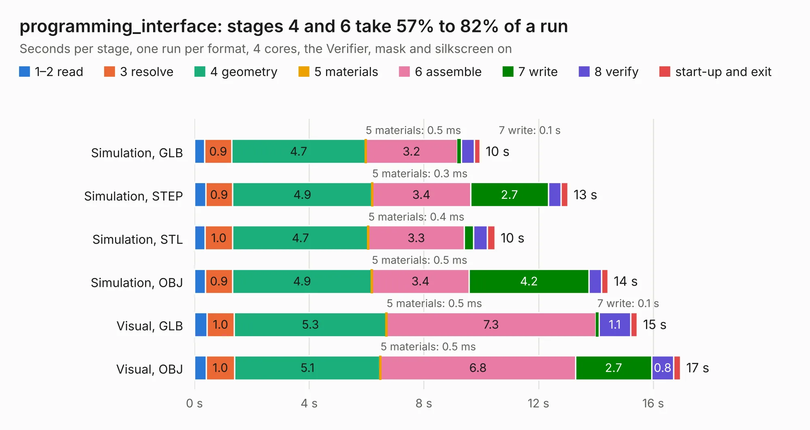

# 2948. programming_interface

Board 2,948 of the 3,103 of [Corpus Testing](../Corpus-Testing.md), on [Corpus Page 28](../CorpusTestingPages/Corpus-Testing-28.md#2948-programming_interface).

| Mode and format | 1–2 read | 3 resolve | 4 geometry | 5 materials | 6 assemble | 7 write | 8 verify | start-up and exit | Total |
|---|---:|---:|---:|---:|---:|---:|---:|---:|---:|
| Simulation, GLB | 0.4 | 0.9 | 4.7 | 0.5&nbsp;ms | 3.2 | 0.1 | 0.5 | 0.2 | 10.0 |
| Simulation, STEP | 0.4 | 0.9 | 4.9 | 0.3&nbsp;ms | 3.4 | 2.7 | 0.4 | 0.2 | 13.0 |
| Simulation, STL | 0.4 | 1.0 | 4.7 | 0.4&nbsp;ms | 3.3 | 0.3 | 0.5 | 0.3 | 10.5 |
| Simulation, OBJ | 0.4 | 0.9 | 4.9 | 0.5&nbsp;ms | 3.4 | 4.2 | 0.4 | 0.2 | 14.4 |
| Visual, GLB | 0.4 | 1.0 | 5.3 | 0.5&nbsp;ms | 7.3 | 0.1 | 1.1 | 0.2 | 15.4 |
| Visual, OBJ | 0.4 | 1.0 | 5.1 | 0.5&nbsp;ms | 6.8 | 2.7 | 0.8 | 0.2 | 16.9 |

<table align="center"><tr><td valign="top">

| Board | Repo: [vascofazza/8bit-cpu](https://github.com/vascofazza/8bit-cpu) Board: `programming_interface.kicad_pcb` |
|---|---|
| Folder | start9_programming_interface / programming_interface |
| Complexity | 247&nbsp;/&nbsp;1000 (size&nbsp;192, features&nbsp;55) |
| KESE&nbsp;features | through vias, filled zones, copper text, curved board outline |
| Tested | 9th November 2026 |
| Copper&nbsp;layers | 2 |
| File&nbsp;format | KiCad 5 (20171130) |
| Parts,&nbsp;tracks,&nbsp;vias | 13, 631, 11 |
| Triangles,&nbsp;simulation | 1,047,248 in 48 parts |
| Verifier | PASS in all six runs |

</td><td valign="top">

<table>
<tr><th>File type</th><th>File size</th><th>Peak memory used</th></tr>
<tr><th colspan="3" align="left">Simulation</th></tr>
<tr><td>GLB</td><td align="right">36&nbsp;MB</td><td align="right">431&nbsp;MB</td></tr>
<tr><td>STEP</td><td align="right">199&nbsp;MB</td><td align="right">520&nbsp;MB</td></tr>
<tr><td>STL</td><td align="right">52&nbsp;MB</td><td align="right">452&nbsp;MB</td></tr>
<tr><td>OBJ</td><td align="right">108&nbsp;MB</td><td align="right">749&nbsp;MB</td></tr>
<tr><th colspan="3" align="left">Visual</th></tr>
<tr><td>GLB</td><td align="right">23&nbsp;MB</td><td align="right">578&nbsp;MB</td></tr>
<tr><td>OBJ</td><td align="right">69&nbsp;MB</td><td align="right">578&nbsp;MB</td></tr>
</table>

</td></tr></table>

| Previous | Next |
|:---|---:|
| [2947. 8bit-computer](b2947b_8bit-cpu_8bit-computer.md) | [2949. omower](b2949b_omower_omower.md) |
