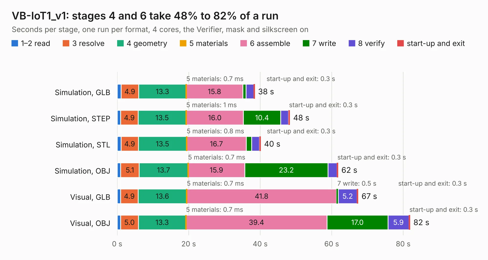

# 2950. VB-IoT1_v1

Board 2,950 of the 3,102 of [Corpus Testing](../Corpus-Testing.md), on [Corpus Page 28](../CorpusTestingPages/Corpus-Testing-28.md#2950-vb-iot1_v1).

| Mode and format | 1–2 read | 3 resolve | 4 geometry | 5 materials | 6 assemble | 7 write | 8 verify | start-up and exit | Total |
|---|---:|---:|---:|---:|---:|---:|---:|---:|---:|
| Simulation, GLB | 1.1 | 4.9 | 13.3 | 0.7&nbsp;ms | 15.8 | 0.9 | 2.1 | 0.3 | 38.4 |
| Simulation, STEP | 1.0 | 4.9 | 13.5 | 1&nbsp;ms | 16.0 | 10.4 | 2.2 | 0.3 | 48.3 |
| Simulation, STL | 1.1 | 4.9 | 13.5 | 0.8&nbsp;ms | 16.7 | 1.5 | 2.2 | 0.3 | 40.1 |
| Simulation, OBJ | 1.0 | 5.1 | 13.7 | 0.7&nbsp;ms | 15.9 | 23.2 | 2.5 | 0.3 | 61.7 |
| Visual, GLB | 1.0 | 4.9 | 13.6 | 0.7&nbsp;ms | 41.8 | 0.5 | 5.2 | 0.3 | 67.4 |
| Visual, OBJ | 1.0 | 5.0 | 13.3 | 0.7&nbsp;ms | 39.4 | 17.0 | 5.9 | 0.3 | 81.9 |

<table align="center"><tr><td valign="top">

| Board | Repo: [venseytech/VB-IoT1](https://github.com/venseytech/VB-IoT1) Board: `VB-IoT1_v1.kicad_pcb` |
|---|---|
| Folder | VB-IoT1_v1 |
| Complexity | 336&nbsp;/&nbsp;1000 (size&nbsp;281, features&nbsp;55) |
| KESE&nbsp;features | through vias, slotted holes, rounded, trapezoid or chamfered pads, filled zones |
| Tested | 9th November 2026 |
| Copper&nbsp;layers | 4 |
| File&nbsp;format | KiCad 4 (4) |
| Parts,&nbsp;tracks,&nbsp;vias | 175, 5,166, 533 |
| Triangles,&nbsp;simulation | 4,269,758 in 267 parts |
| Verifier | PASS in all six runs |

</td><td valign="top">

<table>
<tr><th>File type</th><th>File size</th><th>Peak memory used</th></tr>
<tr><th colspan="3" align="left">Simulation</th></tr>
<tr><td>GLB</td><td align="right">148&nbsp;MB</td><td align="right">1.3&nbsp;GB</td></tr>
<tr><td>STEP</td><td align="right">710&nbsp;MB</td><td align="right">1.7&nbsp;GB</td></tr>
<tr><td>STL</td><td align="right">214&nbsp;MB</td><td align="right">1.3&nbsp;GB</td></tr>
<tr><td>OBJ</td><td align="right">457&nbsp;MB</td><td align="right">2.7&nbsp;GB</td></tr>
<tr><th colspan="3" align="left">Visual</th></tr>
<tr><td>GLB</td><td align="right">111&nbsp;MB</td><td align="right">1.8&nbsp;GB</td></tr>
<tr><td>OBJ</td><td align="right">350&nbsp;MB</td><td align="right">2.3&nbsp;GB</td></tr>
</table>

</td></tr></table>

| Previous | Next |
|:---|---:|
| [2949. BLDC_4](b2949b_bldc-hardware_BLDC-4.md) | [2951. MicroZed_carrier_board_v4](b2951b_microzed-carrier-board_MicroZed-carrier-board-v4.md) |
