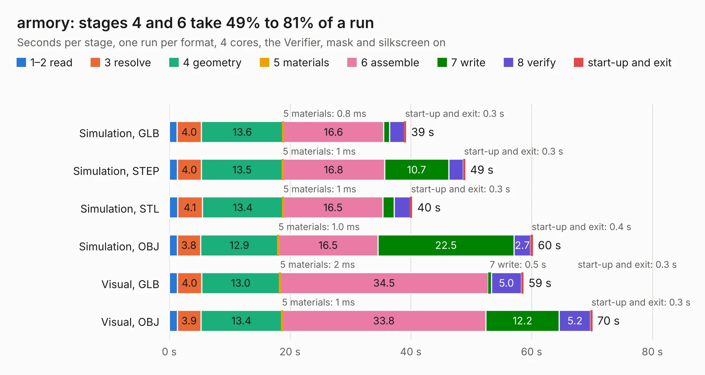

# 2950. armory

Board 2,950 of the 3,112 of [Corpus Testing](../Corpus-Testing.md), on [Corpus Page 28](../CorpusTestingPages/Corpus-Testing-28.md#2950-armory).

| Mode and format | 1–2 read | 3 resolve | 4 geometry | 5 materials | 6 assemble | 7 write | 8 verify | start-up and exit | Total |
|---|---:|---:|---:|---:|---:|---:|---:|---:|---:|
| Simulation, GLB | 1.3 | 4.0 | 13.6 | 0.8&nbsp;ms | 16.6 | 1.0 | 2.4 | 0.3 | 39.2 |
| Simulation, STEP | 1.3 | 4.0 | 13.5 | 1&nbsp;ms | 16.8 | 10.7 | 2.4 | 0.3 | 49.0 |
| Simulation, STL | 1.4 | 4.1 | 13.4 | 1&nbsp;ms | 16.5 | 1.9 | 2.6 | 0.3 | 40.2 |
| Simulation, OBJ | 1.3 | 3.8 | 12.9 | 1.0&nbsp;ms | 16.5 | 22.5 | 2.7 | 0.4 | 60.2 |
| Visual, GLB | 1.4 | 4.0 | 13.0 | 2&nbsp;ms | 34.5 | 0.5 | 5.0 | 0.3 | 58.7 |
| Visual, OBJ | 1.3 | 3.9 | 13.4 | 1&nbsp;ms | 33.8 | 12.2 | 5.2 | 0.3 | 70.0 |

<table align="center"><tr><td valign="top">

| Board | Repo: [usbarmory/usbarmory](https://github.com/usbarmory/usbarmory) Board: `armory.kicad_pcb` |
|---|---|
| Folder | hardware / mark-two |
| Complexity | 400&nbsp;/&nbsp;1000 (size&nbsp;320, features&nbsp;80) |
| KESE&nbsp;features | through vias, slotted holes, custom pads, rounded, trapezoid or chamfered pads, filled zones, curved board outline |
| Tested | 9th November 2026 |
| Copper&nbsp;layers | 6 |
| File&nbsp;format | KiCad 5 (20171130) |
| Parts,&nbsp;tracks,&nbsp;vias | 180, 17,717, 431 |
| Triangles,&nbsp;simulation | 5,187,220 in 436 parts |
| Verifier | PASS in all six runs |

</td><td valign="top">

<table>
<tr><th>File type</th><th>File size</th><th>Peak memory used</th></tr>
<tr><th colspan="3" align="left">Simulation</th></tr>
<tr><td>GLB</td><td align="right">179&nbsp;MB</td><td align="right">1.4&nbsp;GB</td></tr>
<tr><td>STEP</td><td align="right">751&nbsp;MB</td><td align="right">1.7&nbsp;GB</td></tr>
<tr><td>STL</td><td align="right">259&nbsp;MB</td><td align="right">1.7&nbsp;GB</td></tr>
<tr><td>OBJ</td><td align="right">559&nbsp;MB</td><td align="right">3.3&nbsp;GB</td></tr>
<tr><th colspan="3" align="left">Visual</th></tr>
<tr><td>GLB</td><td align="right">94&nbsp;MB</td><td align="right">1.8&nbsp;GB</td></tr>
<tr><td>OBJ</td><td align="right">304&nbsp;MB</td><td align="right">2.0&nbsp;GB</td></tr>
</table>

</td></tr></table>

| Previous | Next |
|:---|---:|
| [2949. armory](b2949b_usbarmory_hardware-mark-two-lan_armory.md) | [2951. milight-hub-base](b2951b_milight-hub_milight-hub-base.md) |
