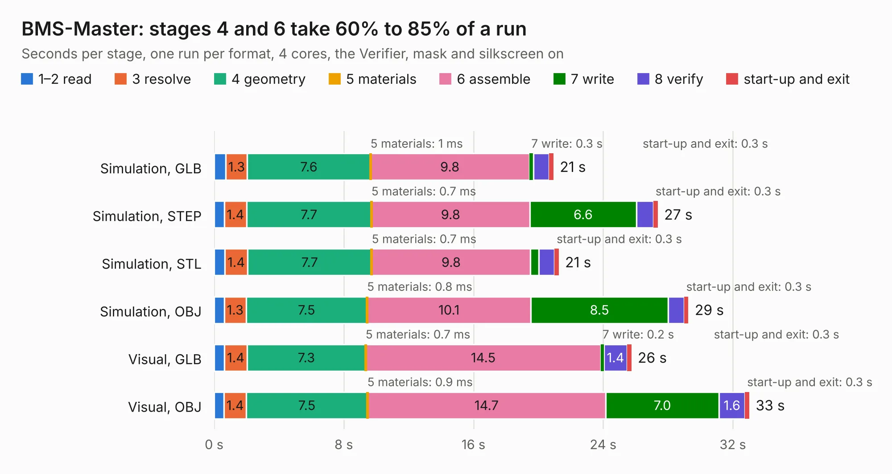

# 2952. BMS-Master

Board 2,952 of the 3,131 of [Corpus Testing](../Corpus-Testing.md), on [Corpus Page 28](../CorpusTestingPages/Corpus-Testing-28.md#2952-bms-master).

| Mode and format | 1–2 read | 3 resolve | 4 geometry | 5 materials | 6 assemble | 7 write | 8 verify | start-up and exit | Total |
|---|---:|---:|---:|---:|---:|---:|---:|---:|---:|
| Simulation, GLB | 0.7 | 1.3 | 7.6 | 1&nbsp;ms | 9.8 | 0.3 | 1.0 | 0.3 | 20.9 |
| Simulation, STEP | 0.6 | 1.4 | 7.7 | 0.7&nbsp;ms | 9.8 | 6.6 | 1.0 | 0.3 | 27.4 |
| Simulation, STL | 0.7 | 1.4 | 7.7 | 0.7&nbsp;ms | 9.8 | 0.5 | 1.0 | 0.3 | 21.3 |
| Simulation, OBJ | 0.6 | 1.3 | 7.5 | 0.8&nbsp;ms | 10.1 | 8.5 | 1.0 | 0.3 | 29.3 |
| Visual, GLB | 0.6 | 1.4 | 7.3 | 0.7&nbsp;ms | 14.5 | 0.2 | 1.4 | 0.3 | 25.7 |
| Visual, OBJ | 0.6 | 1.4 | 7.5 | 0.9&nbsp;ms | 14.7 | 7.0 | 1.6 | 0.3 | 33.0 |

<table align="center"><tr><td valign="top">

| Board | Repo: [ucdfs/circuits](https://github.com/ucdfs/circuits) Board: `BMS-Master.kicad_pcb` |
|---|---|
| Folder | Kieran Care package / ENNOID_BMS - Master |
| Complexity | 347&nbsp;/&nbsp;1000 (size&nbsp;237, features&nbsp;110) |
| KESE&nbsp;features | through vias, slotted holes, rounded, trapezoid or chamfered pads, arc tracks, filled zones, curved board outline, stack-up, dielectric εr and tanδ |
| Tested | 9th November 2026 |
| Copper&nbsp;layers | 2 |
| File&nbsp;format | KiCad 9 (20241229) |
| Parts,&nbsp;tracks,&nbsp;vias | 218, 1,289, 130 |
| Triangles,&nbsp;simulation | 1,469,656 in 201 parts |
| Verifier | PASS in all six runs |

</td><td valign="top">

<table>
<tr><th>File type</th><th>File size</th><th>Peak memory used</th></tr>
<tr><th colspan="3" align="left">Simulation</th></tr>
<tr><td>GLB</td><td align="right">51&nbsp;MB</td><td align="right">664&nbsp;MB</td></tr>
<tr><td>STEP</td><td align="right">263&nbsp;MB</td><td align="right">774&nbsp;MB</td></tr>
<tr><td>STL</td><td align="right">73&nbsp;MB</td><td align="right">691&nbsp;MB</td></tr>
<tr><td>OBJ</td><td align="right">151&nbsp;MB</td><td align="right">1.0&nbsp;GB</td></tr>
<tr><th colspan="3" align="left">Visual</th></tr>
<tr><td>GLB</td><td align="right">40&nbsp;MB</td><td align="right">869&nbsp;MB</td></tr>
<tr><td>OBJ</td><td align="right">122&nbsp;MB</td><td align="right">926&nbsp;MB</td></tr>
</table>

</td></tr></table>

| Previous | Next |
|:---|---:|
| [2951. Cell Tap Fuse Board 3x](b2951b_circuits_Cell-Tap-Fuse-Board-3x.md) | [2953. LTC6812-15W](b2953b_circuits_Kieran-Care-package-ENNOID-BMS-Slave_LTC6812-15W.md) |
