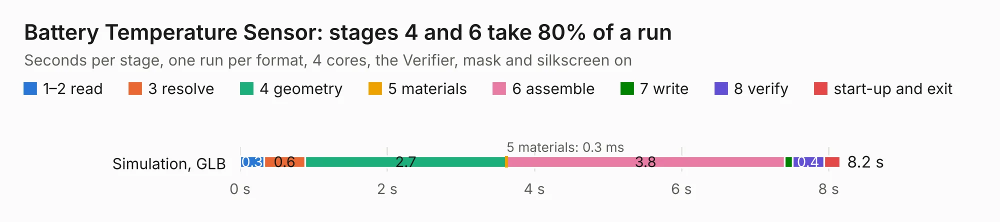

# 2952. Battery Temperature Sensor

Board 2,952 of the 3,139 of [Corpus Testing](../Corpus-Testing.md), on [Corpus Page 28](../CorpusTestingPages/Corpus-Testing-28.md#2952-battery-temperature-sensor).

| Mode and format | 1–2 read | 3 resolve | 4 geometry | 5 materials | 6 assemble | 7 write | 8 verify | start-up and exit | Total |
|---|---:|---:|---:|---:|---:|---:|---:|---:|---:|
| Simulation, GLB | 0.3 | 0.6 | 2.7 | 0.3&nbsp;ms | 3.8 | 0.1 | 0.4 | 0.2 | 8.2 |
| Simulation, STEP | 0.3 | 0.6 | 2.9 | 0.2&nbsp;ms | 3.8 | 3.1 | 0.4 | 0.2 | 11.3 |
| Simulation, STL | 0.4 | 0.6 | 2.9 | 0.2&nbsp;ms | 3.9 | 0.4 | 0.4 | 0.2 | 8.9 |
| Simulation, OBJ | 0.3 | 0.6 | 2.9 | 0.3&nbsp;ms | 4.2 | 3.5 | 0.4 | 0.2 | 12.2 |
| Visual, GLB | 0.3 | 0.5 | 2.8 | 0.4&nbsp;ms | 6.2 | 0.1 | 1.0 | 0.2 | 11.2 |
| Visual, OBJ | 0.3 | 0.6 | 2.8 | 0.3&nbsp;ms | 6.2 | 2.6 | 1.0 | 0.3 | 13.8 |

<table align="center"><tr><td valign="top">

| Board | Repo: [ucdfs/circuits](https://github.com/ucdfs/circuits) Board: `Battery Temperature Sensor.kicad_pcb` |
|---|---|
| Folder | Archive / Battery Temperature Sensor_KR |
| Complexity | 257&nbsp;/&nbsp;1000 (size&nbsp;172, features&nbsp;85) |
| KESE&nbsp;features | through vias, rounded, trapezoid or chamfered pads, filled zones, curved board outline, stack-up, dielectric εr and tanδ |
| Tested | 9th November 2026 |
| Copper&nbsp;layers | 2 |
| File&nbsp;format | KiCad 8 (20240108) |
| Parts,&nbsp;tracks,&nbsp;vias | 107, 419, 58 |
| Triangles,&nbsp;simulation | 735,112 in 53 parts |
| Verifier | PASS in all six runs |

</td><td valign="top">

<table>
<tr><th>File type</th><th>File size</th><th>Peak memory used</th></tr>
<tr><th colspan="3" align="left">Simulation</th></tr>
<tr><td>GLB</td><td align="right">25&nbsp;MB</td><td align="right">414&nbsp;MB</td></tr>
<tr><td>STEP</td><td align="right">119&nbsp;MB</td><td align="right">450&nbsp;MB</td></tr>
<tr><td>STL</td><td align="right">37&nbsp;MB</td><td align="right">417&nbsp;MB</td></tr>
<tr><td>OBJ</td><td align="right">73&nbsp;MB</td><td align="right">519&nbsp;MB</td></tr>
<tr><th colspan="3" align="left">Visual</th></tr>
<tr><td>GLB</td><td align="right">19&nbsp;MB</td><td align="right">598&nbsp;MB</td></tr>
<tr><td>OBJ</td><td align="right">56&nbsp;MB</td><td align="right">603&nbsp;MB</td></tr>
</table>

</td></tr></table>

| Previous | Next |
|:---|---:|
| [2951. APPS final](b2951b_circuits_APPS-final.md) | [2953. LTC6812-15W](b2953b_circuits_ENNOID-BMS-Slave_LTC6812-15W.md) |
