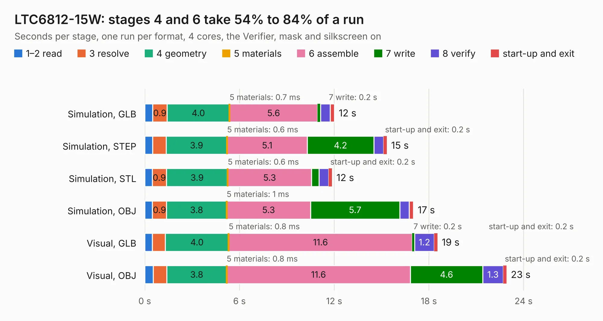

# 2953. LTC6812-15W

Board 2,953 of the 3,131 of [Corpus Testing](../Corpus-Testing.md), on [Corpus Page 28](../CorpusTestingPages/Corpus-Testing-28.md#2953-ltc6812-15w).

| Mode and format | 1–2 read | 3 resolve | 4 geometry | 5 materials | 6 assemble | 7 write | 8 verify | start-up and exit | Total |
|---|---:|---:|---:|---:|---:|---:|---:|---:|---:|
| Simulation, GLB | 0.5 | 0.9 | 4.0 | 0.7&nbsp;ms | 5.6 | 0.2 | 0.6 | 0.3 | 12.0 |
| Simulation, STEP | 0.5 | 0.9 | 3.9 | 0.6&nbsp;ms | 5.1 | 4.2 | 0.6 | 0.2 | 15.3 |
| Simulation, STL | 0.5 | 0.9 | 3.9 | 0.6&nbsp;ms | 5.3 | 0.5 | 0.6 | 0.2 | 11.9 |
| Simulation, OBJ | 0.5 | 0.9 | 3.8 | 1&nbsp;ms | 5.3 | 5.7 | 0.6 | 0.3 | 17.0 |
| Visual, GLB | 0.5 | 0.8 | 4.0 | 0.8&nbsp;ms | 11.6 | 0.2 | 1.2 | 0.2 | 18.5 |
| Visual, OBJ | 0.5 | 0.9 | 3.8 | 0.8&nbsp;ms | 11.6 | 4.6 | 1.3 | 0.2 | 22.9 |

<table align="center"><tr><td valign="top">

| Board | Repo: [ucdfs/circuits](https://github.com/ucdfs/circuits) Board: `LTC6812-15W.kicad_pcb` |
|---|---|
| Folder | Kieran Care package / ENNOID_BMS - Slave |
| Complexity | 344&nbsp;/&nbsp;1000 (size&nbsp;244, features&nbsp;100) |
| KESE&nbsp;features | through vias, rounded, trapezoid or chamfered pads, arc tracks, filled zones, curved board outline, stack-up, dielectric εr and tanδ |
| Tested | 9th November 2026 |
| Copper&nbsp;layers | 2 |
| File&nbsp;format | KiCad 9 (20241229) |
| Parts,&nbsp;tracks,&nbsp;vias | 246, 1,418, 64 |
| Triangles,&nbsp;simulation | 1,384,100 in 280 parts |
| Verifier | PASS in all six runs |

</td><td valign="top">

<table>
<tr><th>File type</th><th>File size</th><th>Peak memory used</th></tr>
<tr><th colspan="3" align="left">Simulation</th></tr>
<tr><td>GLB</td><td align="right">47&nbsp;MB</td><td align="right">609&nbsp;MB</td></tr>
<tr><td>STEP</td><td align="right">260&nbsp;MB</td><td align="right">713&nbsp;MB</td></tr>
<tr><td>STL</td><td align="right">69&nbsp;MB</td><td align="right">589&nbsp;MB</td></tr>
<tr><td>OBJ</td><td align="right">142&nbsp;MB</td><td align="right">965&nbsp;MB</td></tr>
<tr><th colspan="3" align="left">Visual</th></tr>
<tr><td>GLB</td><td align="right">39&nbsp;MB</td><td align="right">703&nbsp;MB</td></tr>
<tr><td>OBJ</td><td align="right">116&nbsp;MB</td><td align="right">892&nbsp;MB</td></tr>
</table>

</td></tr></table>

| Previous | Next |
|:---|---:|
| [2952. BMS-Master](b2952b_circuits_BMS-Master.md) | [2954. TSAL](b2954b_circuits_TSAL.md) |
