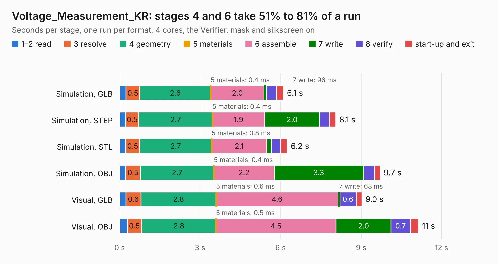

# 2953. Voltage_Measurement_KR

Board 2,953 of the 3,126 of [Corpus Testing](../Corpus-Testing.md), on [Corpus Page 28](../CorpusTestingPages/Corpus-Testing-28.md#2953-voltage_measurement_kr).

| Mode and format | 1–2 read | 3 resolve | 4 geometry | 5 materials | 6 assemble | 7 write | 8 verify | start-up and exit | Total |
|---|---:|---:|---:|---:|---:|---:|---:|---:|---:|
| Simulation, GLB | 0.2 | 0.5 | 2.6 | 0.4&nbsp;ms | 2.0 | 96&nbsp;ms | 0.4 | 0.3 | 6.1 |
| Simulation, STEP | 0.2 | 0.5 | 2.7 | 0.4&nbsp;ms | 1.9 | 2.0 | 0.4 | 0.2 | 8.1 |
| Simulation, STL | 0.2 | 0.5 | 2.7 | 0.8&nbsp;ms | 2.1 | 0.2 | 0.4 | 0.2 | 6.2 |
| Simulation, OBJ | 0.2 | 0.5 | 2.7 | 0.4&nbsp;ms | 2.2 | 3.3 | 0.4 | 0.2 | 9.7 |
| Visual, GLB | 0.2 | 0.6 | 2.8 | 0.6&nbsp;ms | 4.6 | 63&nbsp;ms | 0.6 | 0.2 | 9.0 |
| Visual, OBJ | 0.3 | 0.5 | 2.8 | 0.5&nbsp;ms | 4.5 | 2.0 | 0.7 | 0.3 | 11.1 |

<table align="center"><tr><td valign="top">

| Board | Repo: [ucdfs/circuits](https://github.com/ucdfs/circuits) Board: `Voltage_Measurement_KR.kicad_pcb` |
|---|---|
| Folder | Kieran Care package / Voltage_Measurement_KR |
| Complexity | 235&nbsp;/&nbsp;1000 (size&nbsp;150, features&nbsp;85) |
| KESE&nbsp;features | through vias, rounded, trapezoid or chamfered pads, filled zones, curved board outline, stack-up, dielectric εr and tanδ |
| Tested | 9th November 2026 |
| Copper&nbsp;layers | 2 |
| File&nbsp;format | KiCad 9 (20241229) |
| Parts,&nbsp;tracks,&nbsp;vias | 52, 225, 7 |
| Triangles,&nbsp;simulation | 638,094 in 38 parts |
| Verifier | PASS in all six runs |

</td><td valign="top">

<table>
<tr><th>File type</th><th>File size</th><th>Peak memory used</th></tr>
<tr><th colspan="3" align="left">Simulation</th></tr>
<tr><td>GLB</td><td align="right">21&nbsp;MB</td><td align="right">361&nbsp;MB</td></tr>
<tr><td>STEP</td><td align="right">92&nbsp;MB</td><td align="right">393&nbsp;MB</td></tr>
<tr><td>STL</td><td align="right">32&nbsp;MB</td><td align="right">367&nbsp;MB</td></tr>
<tr><td>OBJ</td><td align="right">64&nbsp;MB</td><td align="right">457&nbsp;MB</td></tr>
<tr><th colspan="3" align="left">Visual</th></tr>
<tr><td>GLB</td><td align="right">14&nbsp;MB</td><td align="right">421&nbsp;MB</td></tr>
<tr><td>OBJ</td><td align="right">41&nbsp;MB</td><td align="right">431&nbsp;MB</td></tr>
</table>

</td></tr></table>

| Previous | Next |
|:---|---:|
| [2952. Breakout](b2952b_circuits_Breakout.md) | [2954. flightcontroller](b2954b_flightcontroller_flightcontroller.md) |
