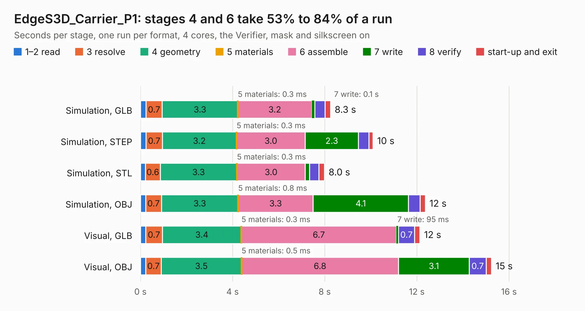

# 2953. EdgeS3D_Carrier_P1

Board 2,953 of the 3,120 of [Corpus Testing](../Corpus-Testing.md), on [Corpus Page 28](../CorpusTestingPages/Corpus-Testing-28.md#2953-edges3d_carrier_p1).

| Mode and format | 1–2 read | 3 resolve | 4 geometry | 5 materials | 6 assemble | 7 write | 8 verify | start-up and exit | Total |
|---|---:|---:|---:|---:|---:|---:|---:|---:|---:|
| Simulation, GLB | 0.2 | 0.7 | 3.3 | 0.3&nbsp;ms | 3.2 | 0.1 | 0.4 | 0.2 | 8.3 |
| Simulation, STEP | 0.2 | 0.7 | 3.2 | 0.3&nbsp;ms | 3.0 | 2.3 | 0.5 | 0.2 | 10.1 |
| Simulation, STL | 0.2 | 0.6 | 3.3 | 0.3&nbsp;ms | 3.0 | 0.2 | 0.4 | 0.2 | 8.0 |
| Simulation, OBJ | 0.2 | 0.7 | 3.3 | 0.8&nbsp;ms | 3.3 | 4.1 | 0.5 | 0.2 | 12.4 |
| Visual, GLB | 0.2 | 0.7 | 3.4 | 0.3&nbsp;ms | 6.7 | 95&nbsp;ms | 0.7 | 0.2 | 12.1 |
| Visual, OBJ | 0.2 | 0.7 | 3.5 | 0.5&nbsp;ms | 6.8 | 3.1 | 0.7 | 0.2 | 15.2 |

<table align="center"><tr><td valign="top">

| Board | Repo: [UnexpectedMaker/esp32s3](https://github.com/UnexpectedMaker/esp32s3) Board: `EdgeS3D_Carrier_P1.kicad_pcb` |
|---|---|
| Folder | series_d / KiCAD / EdgeS3D_Carrier_P1 |
| Complexity | 257&nbsp;/&nbsp;1000 (size&nbsp;157, features&nbsp;100) |
| KESE&nbsp;features | through vias, slotted holes, rounded, trapezoid or chamfered pads, filled zones, curved board outline, stack-up, dielectric εr and tanδ, mask and silkscreen colours |
| Tested | 9th November 2026 |
| Copper&nbsp;layers | 2 |
| File&nbsp;format | KiCad 9 (20241229) |
| Parts,&nbsp;tracks,&nbsp;vias | 15, 338, 160 |
| Triangles,&nbsp;simulation | 769,534 in 70 parts |
| Verifier | PASS in all six runs |

</td><td valign="top">

<table>
<tr><th>File type</th><th>File size</th><th>Peak memory used</th></tr>
<tr><th colspan="3" align="left">Simulation</th></tr>
<tr><td>GLB</td><td align="right">27&nbsp;MB</td><td align="right">378&nbsp;MB</td></tr>
<tr><td>STEP</td><td align="right">126&nbsp;MB</td><td align="right">465&nbsp;MB</td></tr>
<tr><td>STL</td><td align="right">38&nbsp;MB</td><td align="right">398&nbsp;MB</td></tr>
<tr><td>OBJ</td><td align="right">79&nbsp;MB</td><td align="right">556&nbsp;MB</td></tr>
<tr><th colspan="3" align="left">Visual</th></tr>
<tr><td>GLB</td><td align="right">21&nbsp;MB</td><td align="right">527&nbsp;MB</td></tr>
<tr><td>OBJ</td><td align="right">64&nbsp;MB</td><td align="right">529&nbsp;MB</td></tr>
</table>

</td></tr></table>

| Previous | Next |
|:---|---:|
| [2952. OMGS3_Carrier_R1](b2952b_esp32s3_OMGS3-Carrier-R1.md) | [2954. armory](b2954b_usbarmory_hardware-mark-one_armory.md) |
