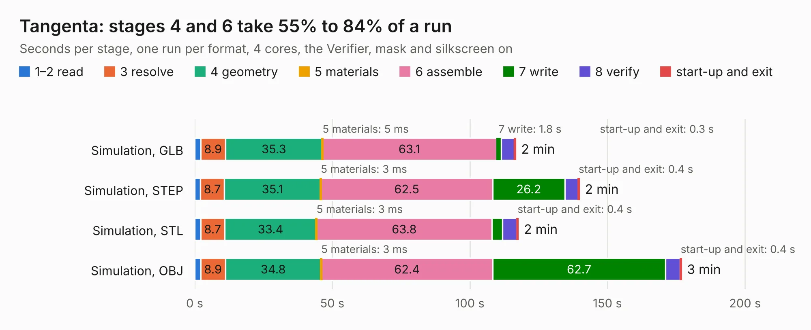

# 2954. Tangenta

Board 2,954 of the 3,103 of [Corpus Testing](../Corpus-Testing.md), on [Corpus Page 28](../CorpusTestingPages/Corpus-Testing-28.md#2954-tangenta).

| Mode and format | 1–2 read | 3 resolve | 4 geometry | 5 materials | 6 assemble | 7 write | 8 verify | start-up and exit | Total |
|---|---:|---:|---:|---:|---:|---:|---:|---:|---:|
| Simulation, GLB | 2.2 | 8.9 | 35.3 | 5&nbsp;ms | 63.1 | 1.8 | 4.9 | 0.3 | 116.6 |
| Simulation, STEP | 2.1 | 8.7 | 35.1 | 3&nbsp;ms | 62.5 | 26.2 | 4.9 | 0.4 | 139.7 |
| Simulation, STL | 2.2 | 8.7 | 33.4 | 3&nbsp;ms | 63.8 | 3.7 | 5.3 | 0.4 | 117.6 |
| Simulation, OBJ | 2.2 | 8.9 | 34.8 | 3&nbsp;ms | 62.4 | 62.7 | 5.3 | 0.4 | 176.8 |
| Visual, GLB | 2.3 | 8.9 | 35.0 | 3&nbsp;ms | 89.0 | 1.1 | 10.2 | 0.3 | 146.9 |
| Visual, OBJ | 2.2 | 9.1 | 35.3 | 3&nbsp;ms | 93.0 | 36.1 | 12.0 | 0.3 | 188.0 |

<table align="center"><tr><td valign="top">

| Board | Repo: [vmetodiev/tangenta](https://github.com/vmetodiev/tangenta) Board: `Tangenta.kicad_pcb` |
|---|---|
| Folder | Tangenta |
| Complexity | 395&nbsp;/&nbsp;1000 (size&nbsp;295, features&nbsp;100) |
| KESE&nbsp;features | through vias, slotted holes, rounded, trapezoid or chamfered pads, arc tracks, filled zones, stack-up, dielectric εr and tanδ |
| Tested | 9th November 2026 |
| Copper&nbsp;layers | 4 |
| File&nbsp;format | KiCad 9 (20241229) |
| Parts,&nbsp;tracks,&nbsp;vias | 559, 7,736, 1,128 |
| Triangles,&nbsp;simulation | 10,448,246 in 1043 parts |
| Verifier | PASS in all six runs |

</td><td valign="top">

<table>
<tr><th>File type</th><th>File size</th><th>Peak memory used</th></tr>
<tr><th colspan="3" align="left">Simulation</th></tr>
<tr><td>GLB</td><td align="right">345&nbsp;MB</td><td align="right">2.8&nbsp;GB</td></tr>
<tr><td>STEP</td><td align="right">1.3&nbsp;GB</td><td align="right">3.6&nbsp;GB</td></tr>
<tr><td>STL</td><td align="right">522&nbsp;MB</td><td align="right">2.8&nbsp;GB</td></tr>
<tr><td>OBJ</td><td align="right">1.1&nbsp;GB</td><td align="right">6.5&nbsp;GB</td></tr>
<tr><th colspan="3" align="left">Visual</th></tr>
<tr><td>GLB</td><td align="right">219&nbsp;MB</td><td align="right">3.5&nbsp;GB</td></tr>
<tr><td>OBJ</td><td align="right">719&nbsp;MB</td><td align="right">4.3&nbsp;GB</td></tr>
</table>

</td></tr></table>

| Previous | Next |
|:---|---:|
| [2953. vimdrones_esc_development_board](b2953b_AM32-esc-development-board_vimdrones-esc-development-board.md) | [2955. CM4_MATX](b2955b_CM4-MATX_KiCad_CM4-MATX_2586.md) |
