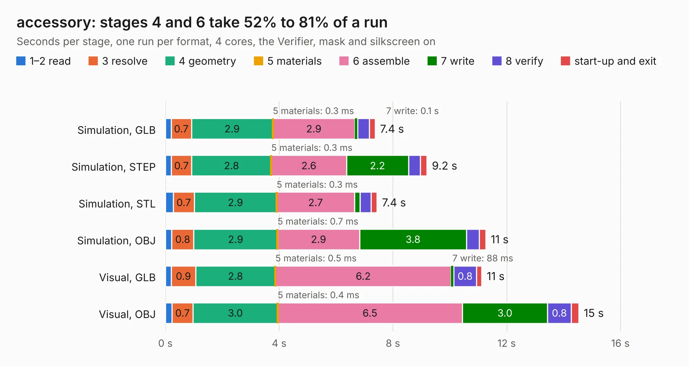

# 2954. accessory

Board 2,954 of the 3,118 of [Corpus Testing](../Corpus-Testing.md), on [Corpus Page 28](../CorpusTestingPages/Corpus-Testing-28.md#2954-accessory).

| Mode and format | 1–2 read | 3 resolve | 4 geometry | 5 materials | 6 assemble | 7 write | 8 verify | start-up and exit | Total |
|---|---:|---:|---:|---:|---:|---:|---:|---:|---:|
| Simulation, GLB | 0.2 | 0.7 | 2.9 | 0.3&nbsp;ms | 2.9 | 0.1 | 0.4 | 0.2 | 7.4 |
| Simulation, STEP | 0.2 | 0.7 | 2.8 | 0.3&nbsp;ms | 2.6 | 2.2 | 0.4 | 0.2 | 9.2 |
| Simulation, STL | 0.3 | 0.7 | 2.9 | 0.3&nbsp;ms | 2.7 | 0.2 | 0.4 | 0.2 | 7.4 |
| Simulation, OBJ | 0.2 | 0.8 | 2.9 | 0.7&nbsp;ms | 2.9 | 3.8 | 0.4 | 0.2 | 11.3 |
| Visual, GLB | 0.2 | 0.9 | 2.8 | 0.5&nbsp;ms | 6.2 | 88&nbsp;ms | 0.8 | 0.2 | 11.1 |
| Visual, OBJ | 0.2 | 0.7 | 3.0 | 0.4&nbsp;ms | 6.5 | 3.0 | 0.8 | 0.3 | 14.5 |

<table align="center"><tr><td valign="top">

| Board | Repo: [usbarmory/usbarmory](https://github.com/usbarmory/usbarmory) Board: `accessory.kicad_pcb` |
|---|---|
| Folder | hardware / mark-two-debug-accessory |
| Complexity | 278&nbsp;/&nbsp;1000 (size&nbsp;213, features&nbsp;65) |
| KESE&nbsp;features | through vias, slotted holes, filled zones, copper text, curved board outline |
| Tested | 9th November 2026 |
| Copper&nbsp;layers | 2 |
| File&nbsp;format | KiCad 5 (20171130) |
| Parts,&nbsp;tracks,&nbsp;vias | 37, 609, 80 |
| Triangles,&nbsp;simulation | 714,356 in 80 parts |
| Verifier | PASS in all six runs |

</td><td valign="top">

<table>
<tr><th>File type</th><th>File size</th><th>Peak memory used</th></tr>
<tr><th colspan="3" align="left">Simulation</th></tr>
<tr><td>GLB</td><td align="right">25&nbsp;MB</td><td align="right">388&nbsp;MB</td></tr>
<tr><td>STEP</td><td align="right">122&nbsp;MB</td><td align="right">480&nbsp;MB</td></tr>
<tr><td>STL</td><td align="right">36&nbsp;MB</td><td align="right">397&nbsp;MB</td></tr>
<tr><td>OBJ</td><td align="right">73&nbsp;MB</td><td align="right">517&nbsp;MB</td></tr>
<tr><th colspan="3" align="left">Visual</th></tr>
<tr><td>GLB</td><td align="right">20&nbsp;MB</td><td align="right">493&nbsp;MB</td></tr>
<tr><td>OBJ</td><td align="right">61&nbsp;MB</td><td align="right">496&nbsp;MB</td></tr>
</table>

</td></tr></table>

| Previous | Next |
|:---|---:|
| [2953. armory](b2953b_usbarmory_hardware-mark-two-beta_armory.md) | [2955. armory](b2955b_usbarmory_hardware-mark-two-lan_armory.md) |
