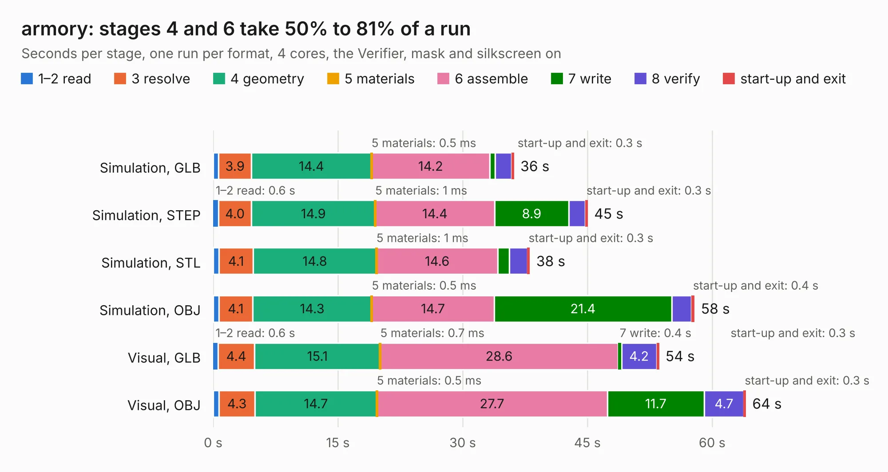

# 2954. armory

Board 2,954 of the 3,120 of [Corpus Testing](../Corpus-Testing.md), on [Corpus Page 28](../CorpusTestingPages/Corpus-Testing-28.md#2954-armory).

| Mode and format | 1–2 read | 3 resolve | 4 geometry | 5 materials | 6 assemble | 7 write | 8 verify | start-up and exit | Total |
|---|---:|---:|---:|---:|---:|---:|---:|---:|---:|
| Simulation, GLB | 0.7 | 3.9 | 14.4 | 0.5&nbsp;ms | 14.2 | 0.7 | 2.0 | 0.3 | 36.2 |
| Simulation, STEP | 0.6 | 4.0 | 14.9 | 1&nbsp;ms | 14.4 | 8.9 | 2.0 | 0.3 | 45.0 |
| Simulation, STL | 0.7 | 4.1 | 14.8 | 1&nbsp;ms | 14.6 | 1.4 | 2.2 | 0.3 | 38.1 |
| Simulation, OBJ | 0.7 | 4.1 | 14.3 | 0.5&nbsp;ms | 14.7 | 21.4 | 2.4 | 0.4 | 57.9 |
| Visual, GLB | 0.6 | 4.4 | 15.1 | 0.7&nbsp;ms | 28.6 | 0.4 | 4.2 | 0.3 | 53.6 |
| Visual, OBJ | 0.7 | 4.3 | 14.7 | 0.5&nbsp;ms | 27.7 | 11.7 | 4.7 | 0.3 | 64.1 |

<table align="center"><tr><td valign="top">

| Board | Repo: [usbarmory/usbarmory](https://github.com/usbarmory/usbarmory) Board: `armory.kicad_pcb` |
|---|---|
| Folder | hardware / mark-one |
| Complexity | 339&nbsp;/&nbsp;1000 (size&nbsp;294, features&nbsp;45) |
| KESE&nbsp;features | through vias, filled zones, curved board outline |
| Tested | 9th November 2026 |
| Copper&nbsp;layers | 8 |
| File&nbsp;format | KiCad 3 (3) |
| Parts,&nbsp;tracks,&nbsp;vias | 174, 2,408, 337 |
| Triangles,&nbsp;simulation | 4,039,766 in 144 parts |
| Verifier | PASS in all six runs |

</td><td valign="top">

<table>
<tr><th>File type</th><th>File size</th><th>Peak memory used</th></tr>
<tr><th colspan="3" align="left">Simulation</th></tr>
<tr><td>GLB</td><td align="right">140&nbsp;MB</td><td align="right">1.2&nbsp;GB</td></tr>
<tr><td>STEP</td><td align="right">558&nbsp;MB</td><td align="right">1.4&nbsp;GB</td></tr>
<tr><td>STL</td><td align="right">202&nbsp;MB</td><td align="right">1.1&nbsp;GB</td></tr>
<tr><td>OBJ</td><td align="right">443&nbsp;MB</td><td align="right">2.7&nbsp;GB</td></tr>
<tr><th colspan="3" align="left">Visual</th></tr>
<tr><td>GLB</td><td align="right">75&nbsp;MB</td><td align="right">1.4&nbsp;GB</td></tr>
<tr><td>OBJ</td><td align="right">240&nbsp;MB</td><td align="right">1.6&nbsp;GB</td></tr>
</table>

</td></tr></table>

| Previous | Next |
|:---|---:|
| [2953. EdgeS3D_Carrier_P1](b2953b_esp32s3_EdgeS3D-Carrier-P1.md) | [2955. armory](b2955b_usbarmory_hardware-mark-two-beta_armory.md) |
